# Admin

The admin panel has two pages: **Parents**, where the admin creates parent accounts, issues one-time links, disables or enables accounts and unlinks a parent's single sign-on, and **Account**, the admin's own username and Link single sign-on. The admin never sees a child: no names, no entries, no counts. Examples use fake parents: Ana, Bo, Cleo, Dan and Dee.

The admin signs in with their username and password, or by single sign-on once it is linked on the Account page. The username and the first password come from the deployment the first time the server starts; after that the operator resets the password with the admin command, which signs the admin out. They are not a parent: they have no children, no notification bell and no page outside the admin panel. If the admin asks for a child's page, they are sent back to the Parents page.

## Guide

### What do I see?

The page lists every parent account with a status:

- **Active**: the parent has set a password.
- **Invited**: the account exists but the parent has not set a password yet.
- **Disabled**: the parent cannot sign in (shown with a dashed outline).

Under the title a line counts them, for example "5 parents · 3 active · 1 invited · 1 disabled". Four buttons (**All**, **Active**, **Invited**, **Disabled**) filter the list. A note on the page says "What this screen can do. Create parents, issue a one-time invite or reset link, and disable or enable parents. It never shows children, their names or any count of them."

| Phone | Desktop |
|---|---|
| 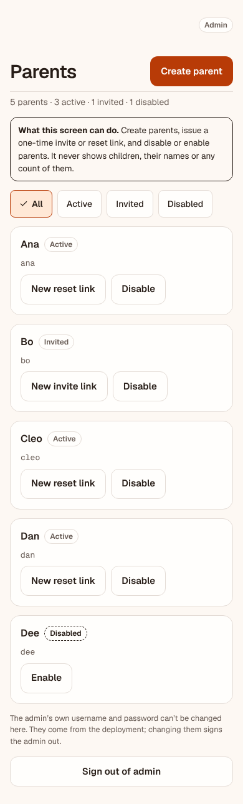 | 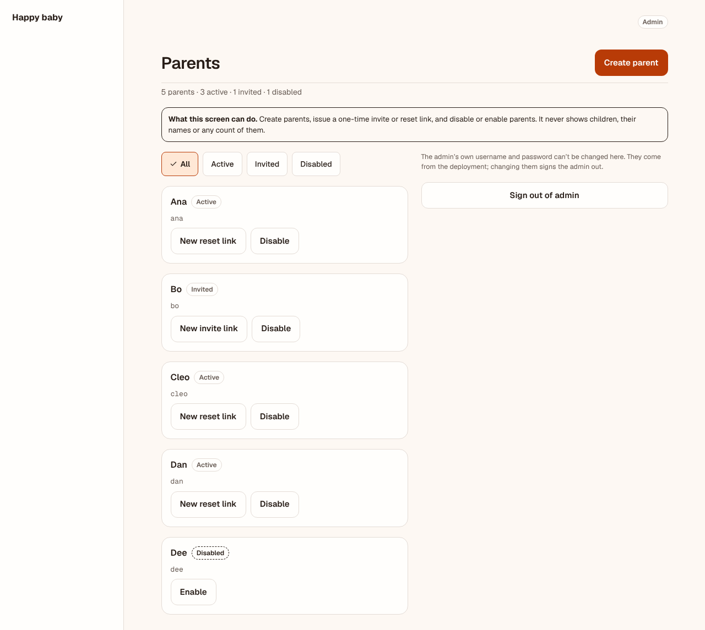 |

The admin's menu has two entries, **Parents** and **Account**. On a desktop they are in the left menu; on a phone they are two icon buttons at the top, before the Admin badge. The current one is highlighted.

### How do I create a parent?

1. Choose **Create parent**. A form opens.
2. Type the **Username**: 3 to 32 characters, using a to z, 0 to 9, dot, underscore or hyphen. It cannot be changed later.
3. Type the **Display name**: 1 to 64 characters.
4. Choose **Create parent** in the form.

The page then shows the invite link (next section). The new parent appears in the list as **Invited**.

If the username is malformed, the page keeps what you typed, shows "Check the fields with a message." and the message "Use 3 to 32 characters: a–z, 0–9, dot, underscore or hyphen" under the username. If another parent already has it: "That username is already taken". An empty or too long display name gives "Use 1 to 64 characters".

| Phone | Phone |
|---|---|
| 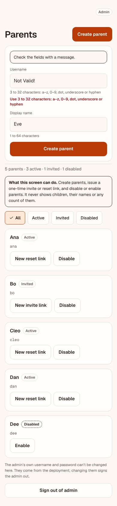 | 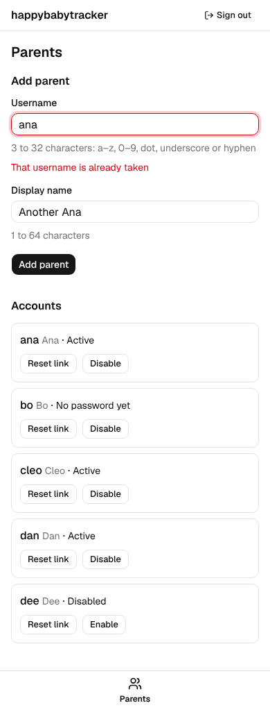 |

### How do I send an invite or reset link?

A new parent has no password. The admin sends them a one-time link; they open it to choose a password (see [Sign in and invites](Sign-in-and-invites.md)).

- For an **Invited** parent, choose **New invite link**. The link lasts **72 hours**.
- For an **Active** parent who forgot their password, choose **New reset link**. The link lasts **1 hour**.

The page shows a card, for example "Invite link for eve", that says: "Send this link to the parent. It works once and expires in 72 hours. Copy it now and hand it over by a channel you trust; it is shown only once." The link is in a read-only box. Choose **Copy link** to copy it (the button needs JavaScript; without it, select the text in the box). The message "Copied" confirms it.

The link is shown only once. It is not stored on the page: if you leave the page or do something else, you cannot see it again; make a new link instead. The pictures show a fake link made of the letter f.

| Phone | Phone |
|---|---|
| 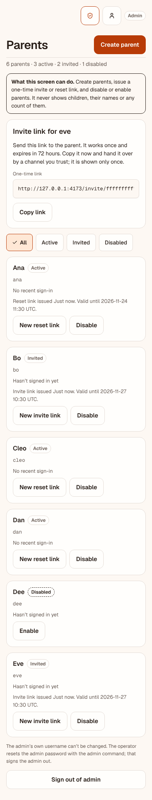 |  |

### How do I disable or enable a parent?

1. On the parent's card choose **Disable**. A red box opens with three lines: "Ana is signed out everywhere and can't sign in.", "Entries they logged stay and keep their name." and "You can enable the account again any time."
2. Choose **Disable** in the box to confirm.

A disabled parent shows **Enable** and no link buttons. Choose **Enable** to give the account back.

| Phone |
|---|
| 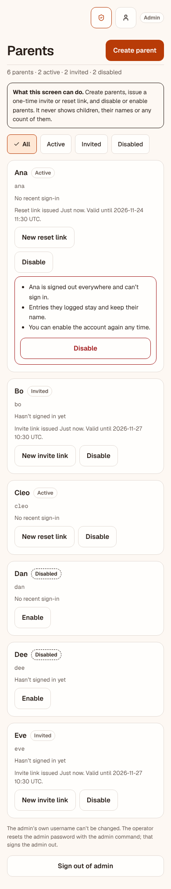 |

The open box on Ana's card is left over from the earlier step of the capture.

### Why can't I disable a parent?

A child always keeps at least one active guardian. If the parent is the only guardian of at least one child, disabling is refused with "This parent is the only guardian of at least one child. Another guardian must be added first." The page does not say which child. A guardian of that child must first give another person guardian access (see [Children and access](Children-and-access.md)); then you can disable.

| Phone |
|---|
| 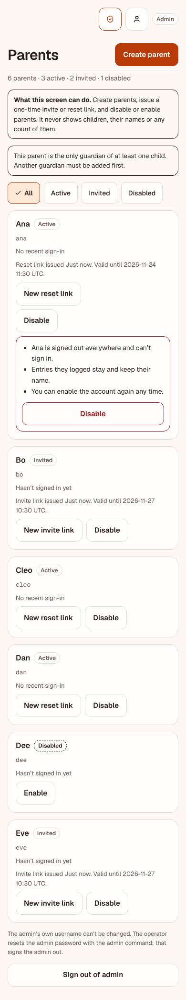 |

### How do I unlink a parent's single sign-on?

A parent who linked a single sign-on account shows a second badge, **Single sign-on**, beside the status. Unlink it when the parent's single sign-on account was recreated, or linked by mistake. Parents cannot unlink themselves.

1. On the parent's card choose **Unlink single sign-on**. A red box opens with two lines: "Ana is signed out everywhere and their notification devices are removed." and "Their password still works, if they have one."
2. Choose **Unlink single sign-on** in the box to confirm.

The page says "Single sign-on unlinked. Their sessions and notification devices were removed." and the badge is gone. The parent can link again from their profile, or, without a password, be sent a new invite link.

| Phone | Phone |
|---|---|
| 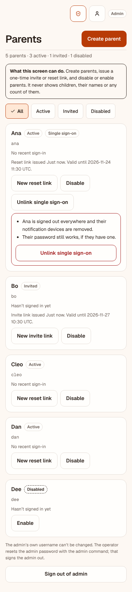 | 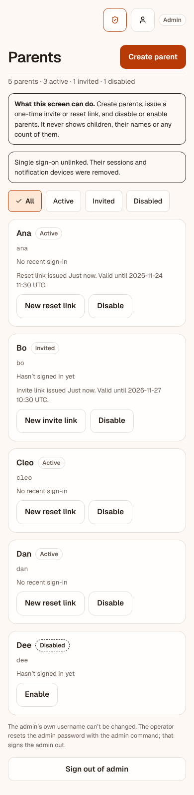 |

### How do I link single sign-on to the admin?

Open **Account**. It shows the admin's **Username**, which cannot be changed, and, when the deployment allows both passwords and single sign-on, a **Single sign-on** card. Type the admin password, choose **Link single sign-on**, sign in again on the single sign-on page, then **Confirm** on "You are linking … to admin". The card then says "Single sign-on is linked.", and **Continue with single sign-on** on the sign-in page opens the Parents page. A failure returns with **Go to Account**; the messages are those of [My profile](My-profile.md#how-do-i-link-single-sign-on).

| Phone | Desktop |
|---|---|
| 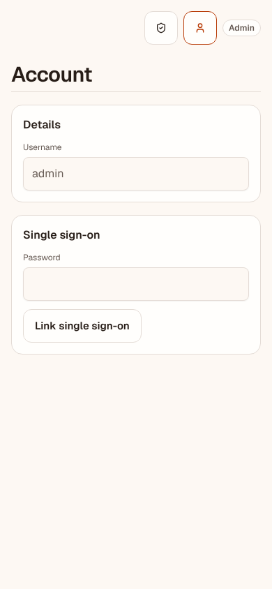 | 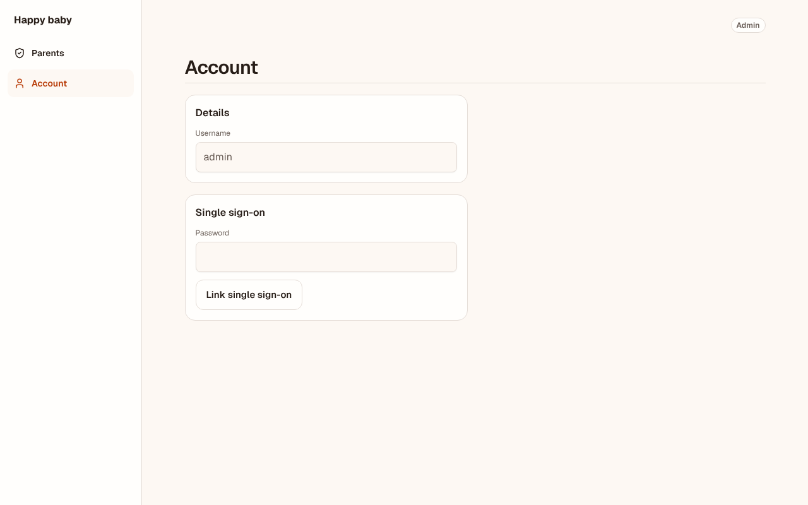 |

The admin's own single sign-on is removed by the operator with the admin command, not on this page.

### How do I sign out?

Choose **Sign out of admin** at the bottom of Parents. The page also says: "The admin's own username can't be changed. The operator resets the admin password with the admin command; that signs the admin out."

## Screens

| Screen | Route | Who can open it | States captured |
|---|---|---|---|
| Parents | `/admin/parents` | admin only | `01-parents`, `02-add-malformed-username`, `03-add-duplicate-username`, `04-invite-link`, `05-reset-link`, `06-disable-sole-guardian-refused`, `07-parent-disabled`, `08-unlink-confirm`, `09-unlinked` |
| Account | `/admin/account` | admin only | `sso/14-admin-account` |
| Link single sign-on | `/admin/account/link-sso` (the card's form; also its page without JavaScript) | admin only | the parent's version is `sso/12-link-sso-wrong-password` |
| Not found | any `/admin/*` page | a parent (guardian or caregiver) | see [Error pages](Error-pages.md), shot `errors/03-404-parent-on-admin` |

The shots are in the [screenshot catalogue](../screenshots/README.md#admin). The admin is refused by every route outside `/admin/*`, the sign-in page and the single sign-on pages: asking for a child's page sends the admin back to `/admin/parents`.

### Rules the screens show

- **The admin never sees a child.** The admin is not a parent row, holds no child access, and the page shows no child name or count.
- Username: 3 to 32 characters (a to z, 0 to 9, dot, underscore, hyphen). Display name: 1 to 64.
- Links: invite 72 hours, reset 1 hour; each works once, is shown once and is never sent by email. The link is not kept in the page, a cookie, an address or a log.
- Status: Active (has a password), Invited (no password), Disabled. A disabled parent has no link buttons.
- The only guardian of a child cannot be disabled; the server decides, so the refusal comes back even if the buttons are shown.
- A parent who no longer exists gives "That parent no longer exists".
- A **Single sign-on** badge marks a parent who linked single sign-on; only such a card offers Unlink, which also signs the parent out everywhere and removes their notification devices.
- The filter is a link (`?show=`), so it works without JavaScript; so do Create parent, the links, Disable, Enable, Unlink and Link single sign-on. Only Copy link needs JavaScript.

### Not built yet

The design shows a "Last active" time and a line saying when a link was issued. Neither exists, and the admin has no notification bell because an admin session cannot open any page outside the admin panel: see [Not built yet](Not-built-yet.md).

Back to the [wiki home](Home.md).
