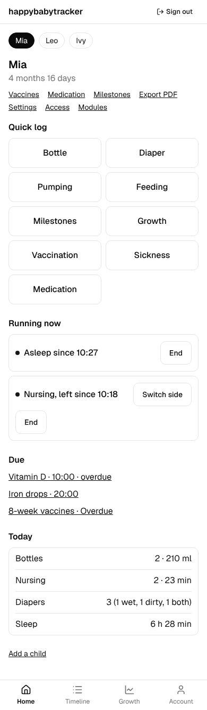
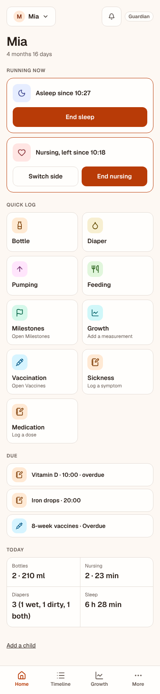
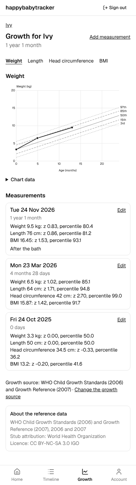
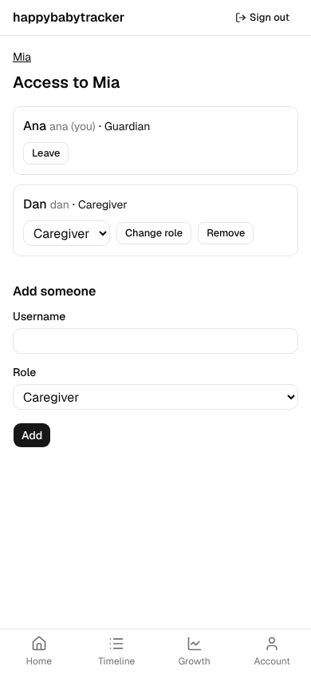

# Before and after

The first-pass design (before) is kept unchanged in `docs/screenshots-legacy`; the redesign (after) is in `docs/screenshots`. Both are captured by the same flow on the same frozen day and the same fake data, so a difference you see is a difference in the app. Phone captures are shown; every pair also exists for the desktop layout.

## What changed everywhere

- **The header.** Before: the app name with a Sign out button, and on Home a row of black child "pills". After: the child switcher on the left (opens a sheet), the notification bell and your role on the right. Sign out moved into More and the side navigation. See [Navigation and shell](Navigation-and-shell.md).
- **The navigation.** Before: Home, Timeline, Growth and Account on every width. After: Home, Timeline, Growth and More on a phone, and a left-hand side navigation with every page from 768 px. See [Roles, layouts and conventions](Roles-and-layouts.md).
- **Page titles.** The child's name is in the header, so titles no longer repeat it: "Growth for Ivy" became "Growth", "Access to Mia" became "Access".
- **Buttons and fields** are larger (at least 44 px), with one filled primary action per screen and the other actions outlined.
- **Colour** carries meaning only together with a word or an icon: each tracker has its own colour and icon, statuses have a word, refusals have a sentence under the field.

## Kid home

Same day, same child (`home/02-mia-busy-day`).

| Before | After |
|---|---|
|  |  |

- The running timers moved to the top as cards, with a full-width **End sleep** and **End nursing** (before: a small "End").
- The row of links to Vaccines, Medication, Milestones, Export PDF, Settings, Access and Modules is gone from the page. Vaccines, Medication, Milestones, Export PDF and Modules are in More or in the side navigation; Settings and Access are on the Child profile.
- Quick log tiles have an icon in the tracker's colour, and the page tiles say what they open ("Add a measurement", "Open Vaccines", "Log a dose").
- Due rows are cards with an icon (medication or vaccine). Today is a two-by-two grid instead of a list.
- Not in the redesign yet: the Latest list and the "x ago" subtitles ([Not built yet](Not-built-yet.md)).

## Growth

Same child, same measurements (`growth/01-ivy-weight-who`).

| Before | After |
|---|---|
|  |  |

- **Add measurement** is the page's one primary button. The measure tabs are a segmented control.
- The chart sits in a card with a legend that names the reference source. **Chart data** (the same numbers as a table) and a new **What do these numbers mean?** are disclosures.
- Each measurement is a card, with the line of the measure on the chart in bold, and an icon button for Edit instead of a text link.
- The reference note ("About the reference data") is a disclosure card at the end.

## Access

Same people, after adding Dan as a caregiver (`kid-admin/14-access-caregiver-added`).

| Before | After |
|---|---|
|  |  |

- The page explains the roles, and says when you are the only guardian ("You are Mia's only active guardian. Give another person guardian access before you leave or change your role.").
- Changing a role is one explicit button ("Make guardian") instead of a select plus "Change role"; removing is "Remove access".
- Adding a person is "Add a person" with a username field, a Role choice and **Give access**.

## Other screens

Every other screen of the [catalogue](../screenshots/README.md) has the legacy twin of the same name in the [legacy catalogue](../screenshots-legacy/README.md), where the shot exists in both. New in the redesign, with no legacy twin: the Switch child, More and Change theme sheets, the Choose a child pages and the Child profile (areas `shell` and `kid-admin`), the forms in sheets (area `sheets`) and Medical visits (area `visits`), which the first pass did not have.

Back to the [wiki home](Home.md).
