# Children and access

Everything about one child's setup: which trackers are on (Modules), the Child profile, Edit details, who has access, deleting a child, and adding a child. Examples use fake data: Mia (4 months), Leo (2 years 3 months, born early) and the parents Ana, Cleo and Dan.

With JavaScript, Edit details, Modules, Access and Add a child open in a sheet over the page you were on, and saving closes the sheet and shows a short message ([Forms in sheets](Forms-in-sheets.md)). The steps are the same. The form screenshots below show the same form as a page, which is what you get without JavaScript, in a new tab or when you open the address directly; after a save on the page you land where the steps say.

Modules, Child profile, Edit details and Access are **guardian** pages. A caregiver does not see them in the menu, and if a caregiver opens one by its address they get the same "Not found" page as for a child that does not exist (see [Error pages](Error-pages.md)). Adding a child is open to every signed-in parent.

## Guide

### Where do I find these pages?

- On a phone: **More**, then **Modules** or **Child profile** (guardians only).
- On a desktop: the same entries in the left menu.
- **Edit details** and **Manage access** are buttons on the Child profile.

### How do I turn a module on or off?

A module is a tracker or record type, such as Bottle, Pumping or Medication.

1. Open **Modules**. The title reads "Modules for Mia".
2. Tick the modules you want and untick the ones you do not. Under each name the page says whether it is "On by default for this age" or "Off by default for this age".
3. Choose **Save**. A box says "Saved".

A module you turn off leaves the home screen and the menu. Its entries stay and come back when you turn it on. For Mia (4 months) every module is on to begin with. For Leo (2 years 3 months) the baby trackers (Bottle, Nursing, Pumping, Diaper, Sleep, Feeding) and Milestones are off by default, and Growth, Vaccination, Sickness, Medication and Medical visits are on.

| Phone | Desktop |
|---|---|
| 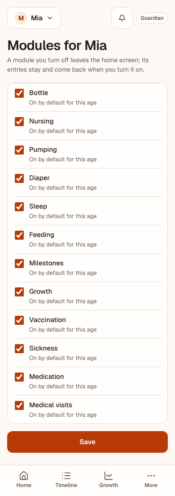 | 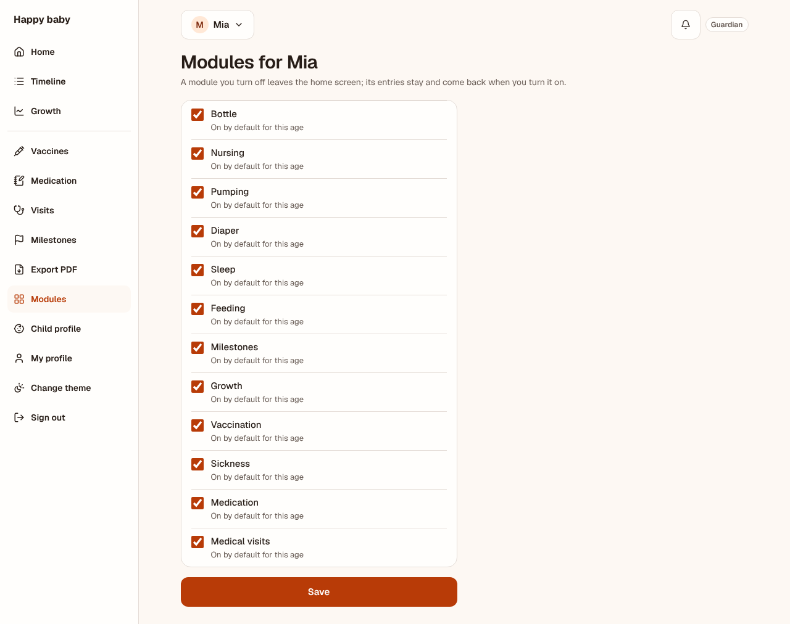 |

After Pumping and Feeding were unticked and saved (shot `02-modules-saved-two-off`), Mia's home no longer shows those two tiles (shot `03-home-with-modules-off`). Pages of a module that is off say so: see [Medication](Medication.md) and [Export PDF](Export-PDF.md), where a switched-off module can still be ticked.

### How do I see a child's details?

Open **Child profile**. It has four cards:

- **Details**: Name, Born, Weeks at birth (only if the child was born early), Sex and Time zone, with an **Edit details** button.
- **Settings for** the child: shortcuts to Trackers (the Modules page), Growth chart source, Vaccination schedule and the overdue minutes (for example "60 minutes").
- **People with access**: each person with a "Guardian" or "Caregiver" badge, a "You" badge on your own row, and their username, with a **Manage access** button.
- **Delete all data for** the child, which leads to the delete steps below.

| Phone | Desktop |
|---|---|
| 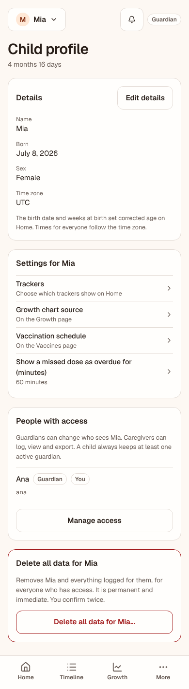 | 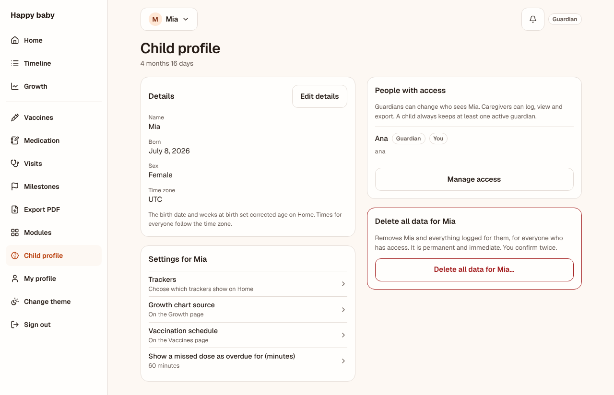 |

### How do I change a child's details?

1. On the Child profile choose **Edit details**.
2. Change **Name**, **Birth date**, **Time zone**, **Sex**, **Born early?**, **Growth chart source**, **Vaccination schedule** or **Show a missed dose as overdue for (minutes)**.
3. Choose **Save**. A box says "Saved". **Cancel** goes back to the Child profile.

Notes on the fields:

- The page says "Corrected age on Home uses the birth date and weeks at birth."
- **Time zone**: "Times are shown in this time zone. Changing it moves how past entries are grouped by day; it does not change when they happened."
- **Born early?**: ticking it shows **Weeks at birth** (22 to 44) and **Extra days (0 to 6)**. For Leo they read 35 and 2 (shot `10-settings-born-early`).
- **Growth chart source** lists each source with the months it covers.
- **Show a missed dose as overdue for (minutes)**: from 5 to 1440 (24 hours). "A missed dose leaves the home list after this time, or when the next dose of that course is due, whichever comes first."

| Phone | Desktop |
|---|---|
| 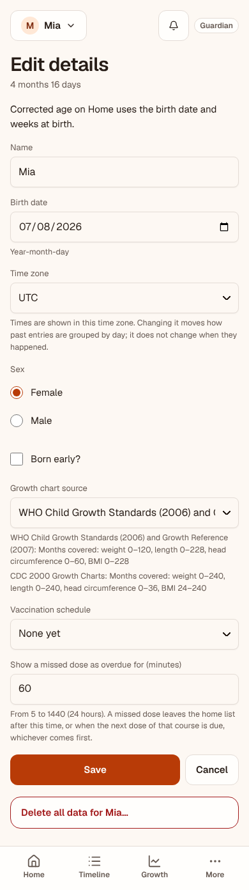 | 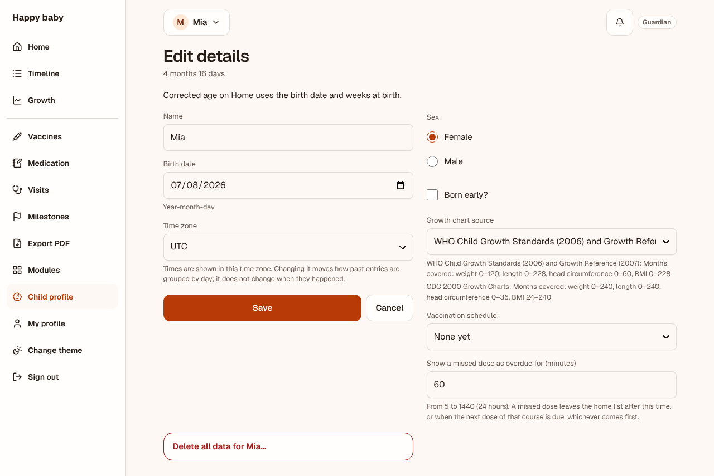 |

If a value is refused, the page keeps what you typed, shows "Check the fields with a message." above the form and a red message under the field. Shot `07-settings-overdue-out-of-range` shows 2 minutes refused with "Enter minutes from 5 to 1440". The other messages are:

- Name: "Enter a name of 1 to 64 characters"
- Birth date: "Enter a birth date from 1900-01-01 to today"
- Sex: "Choose female or male"
- Weeks: "Enter weeks from 22 to 44". Days: "Enter days from 0 to 6"
- Time zone: "Choose a time zone from the list"
- Growth chart source: "Choose a growth reference from the list"
- Vaccination schedule: "Choose a vaccination schedule from the list"

### How do I delete a child?

Deleting is permanent and immediate, and removes the child and everything logged for them for everyone with access. It takes two steps on **Edit details**:

1. Choose **Delete all data for** the child's name (the button at the bottom of the page, or the same button on the Child profile). The section opens and lists what goes: every logged entry (including entries other people logged), growth measurements and vaccination records, notes, the chosen trackers and these details, and access for everyone.
2. Type the child's exact name in "Type Mia to confirm", tick **I understand this is permanent and immediate**, then choose the red button **Delete all data for Mia**.

The button stays disabled until the box is ticked. If the typed name is not the child's name, the page says "The name does not match" and nothing is deleted. In the picture "Mila" was typed for Mia. After a delete you land on your home page, and the child is gone for everyone: opening it gives the Not found page.

| Phone |
|---|
| 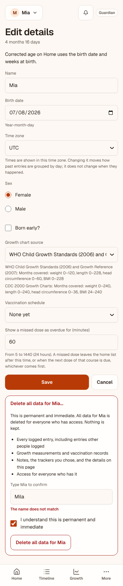 |

### How do I give someone access?

The person needs an account. Accounts are created by the admin (see [Admin](Admin.md)); you cannot create one here.

1. Open **Manage access** on the Child profile (or the Access page).
2. Under **Add a person**, type the **Parent's username**.
3. Choose a **Role**: **Caregiver** (the default, who can log, view and export) or **Guardian** (who can also change settings and access).
4. Choose **Give access**.

The person appears under **People with access**. If no active account has that username, or the account is disabled, the page says "No active account has that username." under the field and nothing changes. If no role is chosen it says "Choose guardian or caregiver". After a person is added the Role choice is empty again, as the picture shows: pick one again for the next person.

| Phone |
|---|
| 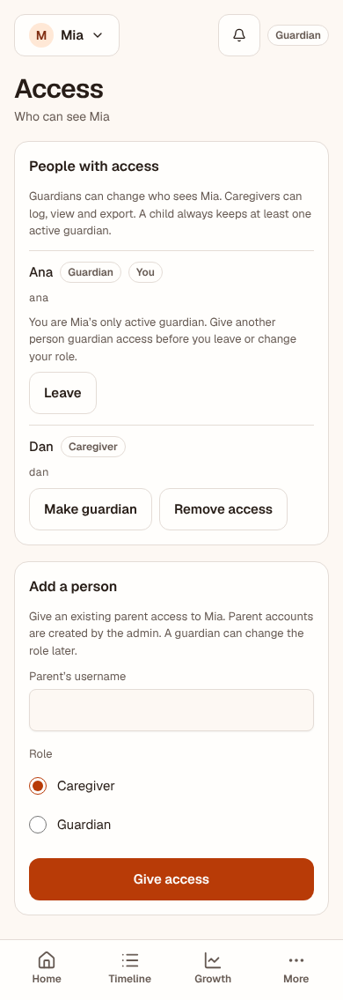 |

### How do I change a role or remove someone?

On their row in **People with access**:

- **Make guardian** (for a caregiver) or **Make caregiver** (for a guardian) changes their role.
- **Remove access** takes the child away from them. They get the Not found page for this child from then on.

Both work at once, with no confirmation step.

### How do I leave a child?

- A **guardian** chooses **Leave** on their own row in **People with access**. You land on your home page and the child is no longer in your list.
- A **caregiver** has no Access page. A caregiver leaves from the child's home with "Leave this child" and then "Yes, leave" and the child's name; see [Kid home](Kid-home.md).

A child always keeps at least one guardian. If you are the only guardian the page says "You are Mia's only active guardian. Give another person guardian access before you leave or change your role.", and **Leave** is refused with "A child needs at least one guardian." The same refusal applies to removing the last guardian or making them a caregiver. Give another person guardian access first.

| Phone |
|---|
| 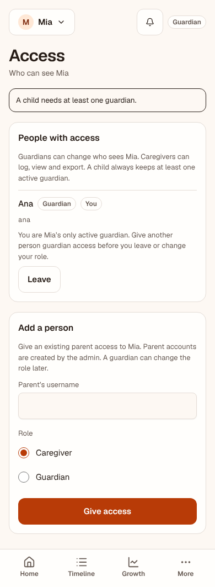 |

### How do I add a child?

1. Choose **Add a child**: at the bottom of a child's home, in the child list, or **Add your first child** if you have none yet.
2. Fill in **Name** (1 to 64 characters), **Birth date** (from 1900-01-01 to today), **Time zone**, and **Sex**.
3. If the child was born early, tick **Born early?** and enter **Weeks at birth** (22 to 44) and **Extra days (0 to 6)**. Birth date and weeks set the corrected age shown on Home.
4. Optional: **Growth chart source** (the WHO standards are chosen to begin with) and **Vaccination schedule** ("None yet" to begin with).
5. Choose **Add child**. You open the new child's home, and you are its guardian: "You will be a guardian of this child."

The **Time zone** starts as the one your device uses (UTC in the pictures, from the capturing browser). The "overdue minutes" setting is not on this form; set it later in Edit details.

| Phone |
|---|
| 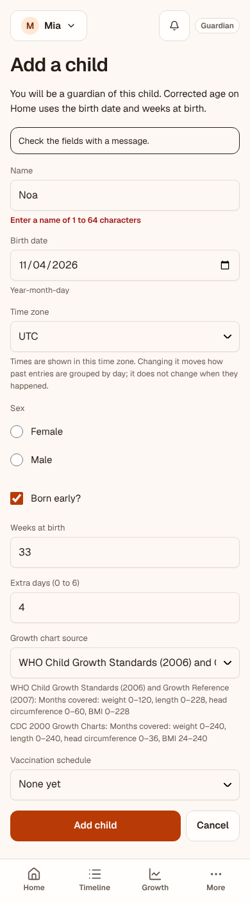 |

A refused form keeps what you typed and shows "Check the fields with a message." The messages are the same as in Edit details. The red message under Name in this picture is left over from the earlier refused save (shot `18-new-kid-errors`, which shows it on an empty form) and stays until you save again.

### What happens with a very long name?

A name can be 64 characters. This is a known defect: with a 64-character name without spaces the heading wraps, but the child switcher in the header does not shorten the name and the page becomes wider than the phone. The design says the name should be shortened.

| Phone |
|---|
| 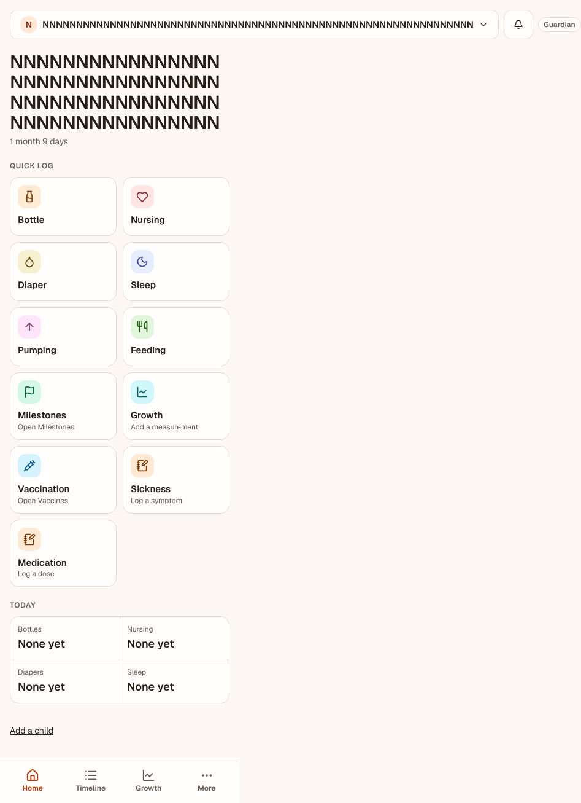 |

## Screens

| Screen | Route | Who can open it | States captured |
|---|---|---|---|
| Modules | `/kids/[kid]/modules` | guardian | `01-modules-under-12-months`, `02-modules-saved-two-off`, `05-modules-24-plus`; home afterwards: `03-home-with-modules-off` |
| Child profile | `/kids/[kid]/profile` | guardian | `21-profile-guardian` |
| Edit details | `/kids/[kid]/settings` | guardian | `06-settings`, `07-settings-overdue-out-of-range`, `08-settings-delete-name-mismatch`, `10-settings-born-early` |
| Access | `/kids/[kid]/access` | guardian | `11-access-sole-guardian`, `12-access-last-guardian`, `13-access-unknown-username`, `14-access-caregiver-added`, `16-access-guardian-and-caregiver` |
| Add a child | `/kids/new` | any signed-in parent (not the admin) | `17-new-kid-empty`, `18-new-kid-errors`, `19-new-kid-born-early` |
| Not found on a guardian page | the routes above | caregiver, or a parent with no grant | `04-modules-caregiver-404`, `09-settings-caregiver-404`, `15-access-caregiver-404`, `22-profile-caregiver-404` |
| Long name (defect) | `/kids/[kid]` | any role | `20-long-kid-name-home` |

The shots are in the [screenshot catalogue](../screenshots/README.md#kid-admin). Delete itself lands on a page already shown: only the confirm step is captured.

### Rules the screens show

- **Guardian only**: Modules, Child profile, Edit details and Access answer a caregiver, a parent with no grant and an unknown child with the same 404 page. The admin never sees a child.
- **A child always keeps at least one active guardian.** Leave, role change to caregiver and removal of the last guardian are refused with "A child needs at least one guardian." The check is made by the server when it saves the change, not by the page. The page also hides nothing: the buttons are shown and the refusal comes back.
- **Access is by username.** Only an existing, active account can be added. A disabled account counts as having no grant.
- **Limits**: name 1 to 64 characters; birth date from 1900-01-01 to today; weeks 22 to 44; extra days 0 to 6; overdue minutes 5 to 1440.
- **Time zone** is a choice from a list; changing it changes how past entries are grouped by day and when they happened stays the same.
- **Delete** needs the exact name and the tick; the name is also checked by the server, so it works without JavaScript. It removes everything for everyone.
- **Modules**: only modules whose state differs from the stored one are written. A module that is off is hidden from the home and the menu; its data is kept.

### Not built yet

The design shows undo toasts after a role change or removal, a confirmation sheet for removing access, an "Account disabled" badge, counts in the delete list and "Export a PDF first". None exists yet: see [Not built yet](Not-built-yet.md). The 64-character name defect is listed there too.

Back to the [wiki home](Home.md).
