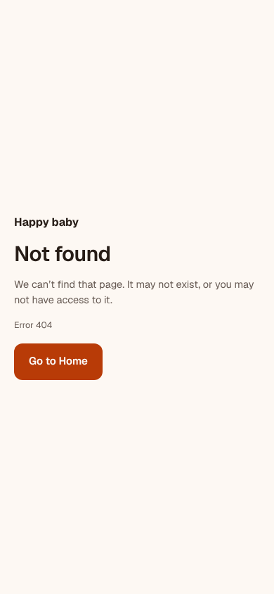
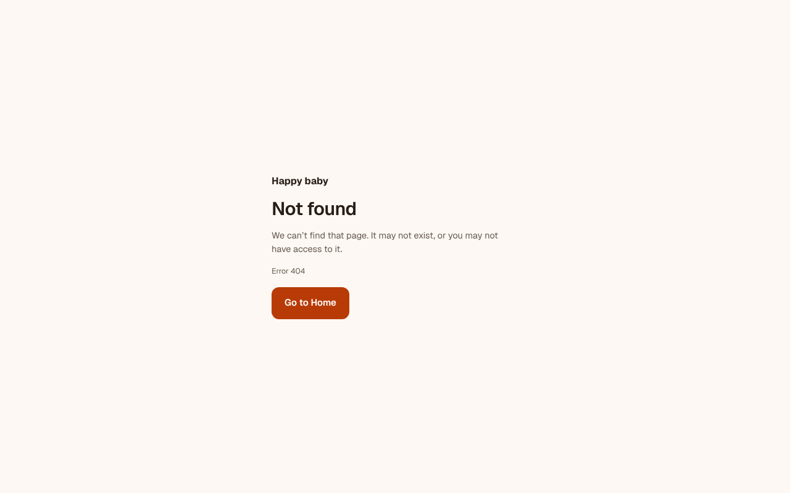
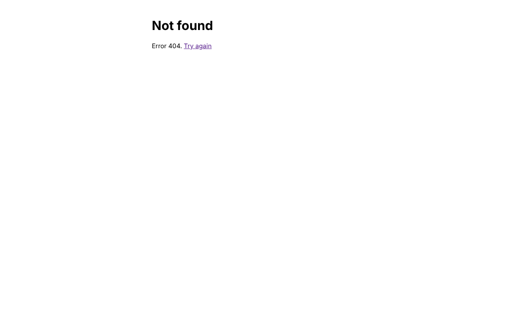
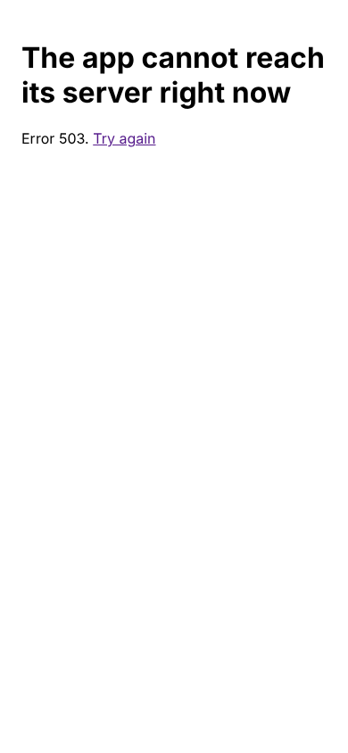
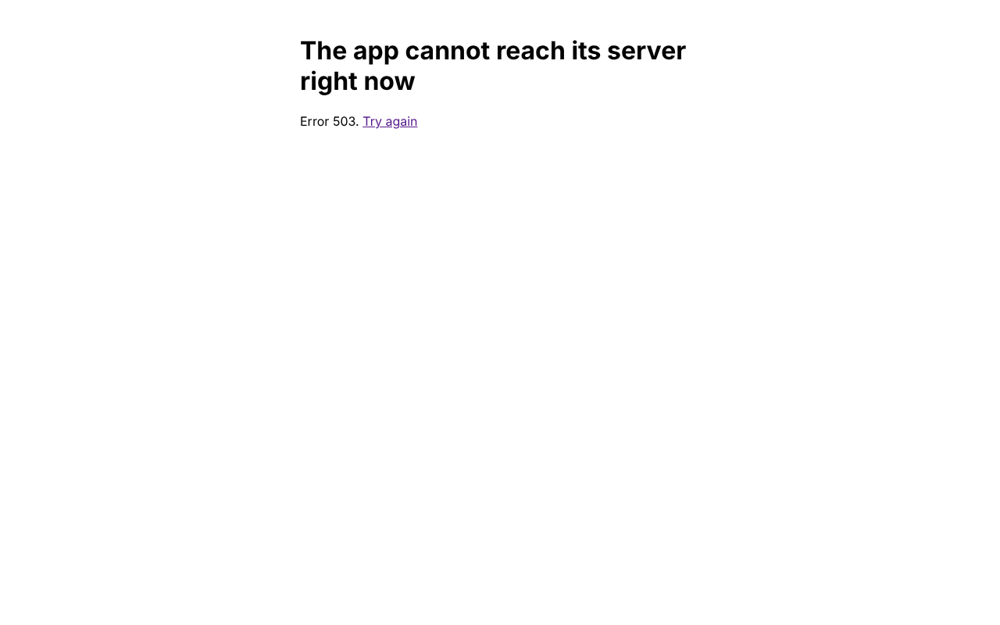

# Error pages

The app has two error pages you can meet: **Not found** (404) and **The app cannot reach its server right now** (503). Both are short and have no menu.

Two of the captured pages are plain, unstyled pages instead of the designed one. This page says which.

## Guide

### What does "Not found" mean?

The page says "Not found" and "We can't find that page. It may not exist, or you may not have access to it." with the line "Error 404" and a **Go to Home** button. It appears when:

- the address does not exist (a mistyped path);
- the child does not exist, or you have no access to that child;
- you are a caregiver and open a page only a guardian can use, such as Modules, Child profile, its settings page or Access of a child;
- you are a parent and open anything under `/admin`.

A child you cannot see looks exactly the same as a child that does not exist. This is on purpose: the app never confirms whether a child exists to someone who has no access. If you expected to see a child, ask a guardian of that child to give you access (see [Children and access](Children-and-access.md)).

| Phone | Desktop |
|---|---|
|  |  |

Choose **Go to Home** to go back.

### What if the path does not exist?

The same page. The picture shows what a signed-in parent gets for an address that is not part of the app.

| Phone |
|---|
|  |

### What if I am a parent and open the admin page?

The admin panel is for the admin only. A parent who opens `/admin/parents` gets a "Not found" page, but it is the plain fallback page, not the designed one: a "Not found" heading, "Error 404." and a "Try again" link, in default fonts on a white page, with no "Go to Home" button. This is a known gap against the design: the error is raised in the server's request hook, before a page loads, so the designed page is not used.

| Phone | Desktop |
|---|---|
|  |  |

The reverse is different: when the admin asks for any page other than the admin panel, the app sends the admin back to the Parents page rather than showing an error.

### What does the 503 page mean?

"The app cannot reach its server right now" with "Error 503." and a **Try again** link. The app's own web server is running, but the API it depends on did not answer, answered that it is unavailable or was too slow. Your sign-in is kept: you are not signed out. Try again in a moment; when the API answers again the same page loads normally.

This page is also the plain fallback page: a heading, "Error 503." and "Try again" in default fonts on a white page. The design has a styled page with the sentence "Your sign-in is kept. Try again in a moment." and a Try again button; that is not what appears. It is a known gap against the design.

| Phone | Desktop |
|---|---|
|  |  |

## Screens

| Screen | Route | Who sees it | States captured |
|---|---|---|---|
| Not found (designed page) | any unknown path; a child that is unknown or has no grant | signed-in guardian or caregiver | `01-404-unknown-kid`, `02-404-unknown-path` |
| Not found (plain fallback) | `/admin/*` | signed-in parent | `03-404-parent-on-admin` |
| Server unreachable (plain fallback) | any page, while the API is down, unavailable or slow | any signed-in user | `04-503-api-unavailable` |

The shots are in the [screenshot catalogue](../screenshots/README.md#errors). The generic "Something went wrong" page (any other server error) is not captured: the stub has no way to cause one. The "down" and "slow" API cases show the same 503 page.

### Rules the screens show

- **No grant is a 404.** A child without a grant and an unknown child give the same page, with the same words. A disabled parent counts as having no grant. The end-to-end tests compare the page text for an unknown id with the child just left and its guardian-only pages, and require them to be identical.
- A caregiver gets the 404 on guardian pages (Modules, Child profile, its settings page, Access).
- A parent gets a 404 on every `/admin` path; the admin is redirected to the Parents page from every other path.
- The 404 for a child has no app menu, so it does not show that the child exists.
- 503: the sign-in cookie is kept, so a user is not signed out by an outage.
- The two plain pages (`src/error.html`) use the browser's default fonts and no colours. They are the fallback of the framework, used when the error is raised before the app page can load; the designed page (`+error.svelte`) is used when the error is raised while a page loads.

### Known gaps

- `errors/04-503-api-unavailable` shows the unstyled fallback page, not the designed error page. This is a gap against the design.
- `errors/03-404-parent-on-admin` shows the same fallback page for a 404, with a "Try again" link instead of "Go to Home".

Back to the [wiki home](Home.md).
