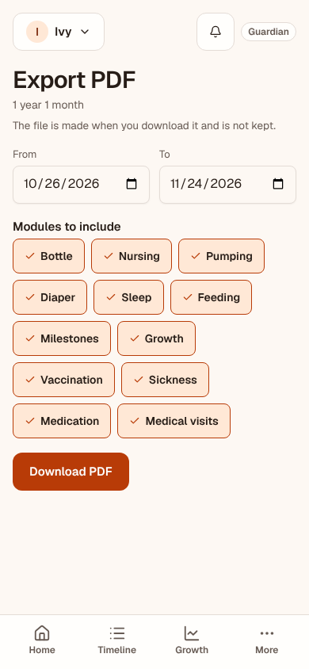
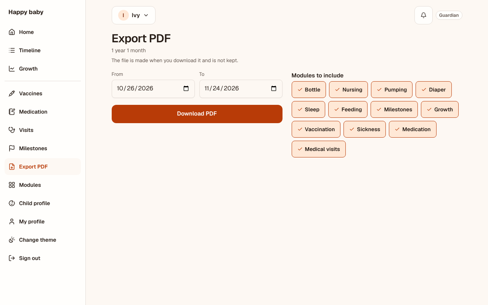
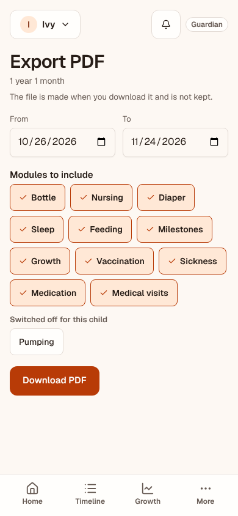
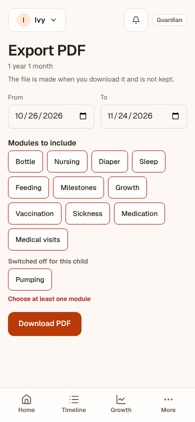
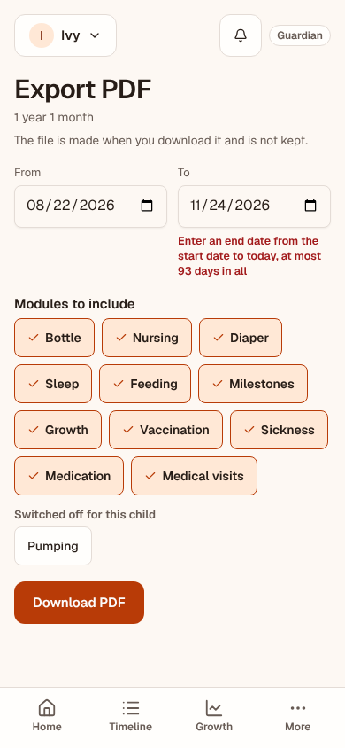
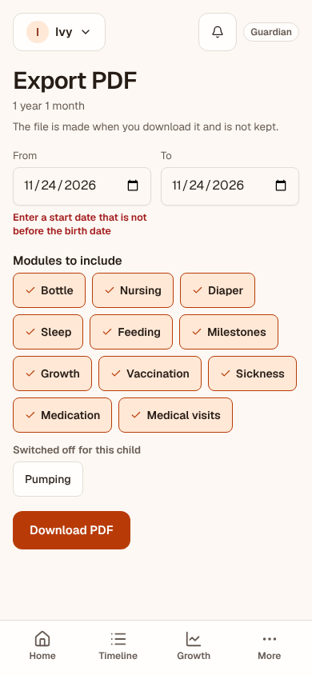
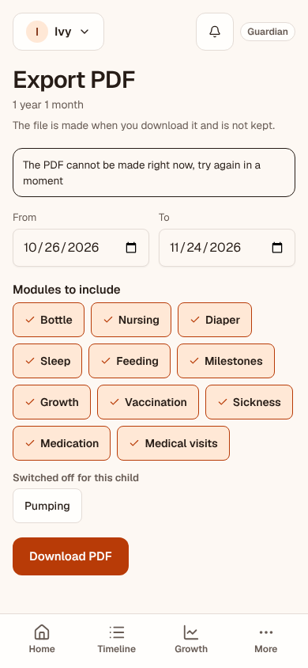
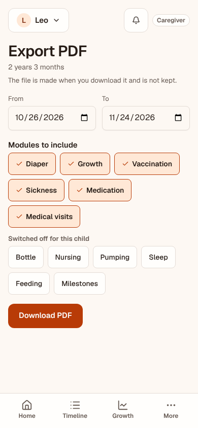
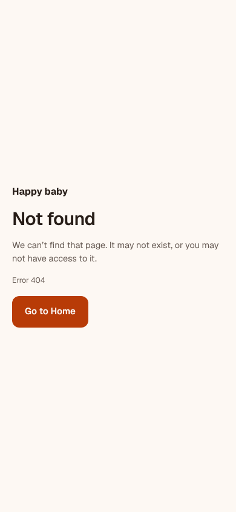

# Export PDF

Export PDF makes a PDF of one child's records for a date range and the modules you choose, for example to bring to a doctor's visit. Examples below use fake data: Ivy, 1 year 1 month, and Leo, 2 years 3 months.

The PDF itself is a download, not a page, so no screenshot shows it. The wiki shows only the page that asks for it and the messages it can answer with.

## Guide

### How do I open it?

- On a phone: **More**, then **Export PDF**.
- On a desktop: **Export PDF** in the left menu.

Guardians and caregivers of the child can both open it. The page says "The file is made when you download it and is not kept."

| Phone | Desktop |
|---|---|
|  |  |

### How do I download a PDF?

1. Check **From** and **To**. The page starts with the last 30 days ending today (counted on the child's clock), and never starts before the child's birth date. In the picture, 10/26/2026 to 11/24/2026.
2. Under **Modules to include**, leave ticked the modules you want. Every module is ticked to begin with. A ticked chip has a check mark and a coloured border; an unticked one is plain.
3. Choose **Download PDF**.

The browser saves a file named `happybabytracker-FROM-TO.pdf`, for example `happybabytracker-2026-10-26-2026-11-24.pdf` for the dates above. You stay on the Export page. Nothing is kept on the server: each download makes the file again.

The modules you can pick are Bottle, Nursing, Pumping, Diaper, Sleep, Feeding, Milestones, Growth, Vaccination, Sickness, Medication and Medical visits. The Medical visits section lists the visits of the range with their date and time, kind, doctor, place, reason and notes from the visit, and says which were cancelled; what was recorded at a visit is in its own module's section ([Medical visits](Medical-visits.md)).

### What if a module is switched off for the child?

A module a guardian switched off (see [Children and access](Children-and-access.md#how-do-i-turn-a-module-on-or-off)) is not ticked. It sits under its own sub-heading, "Switched off for this child". You can still tick it to include it in the PDF.

| Phone |
|---|
|  |

### What are the messages I can get?

If something is wrong the page comes back with your choices kept and a red message. The checks run in the order From, To, Modules.

**No module ticked.** The message is "Choose at least one module", under the chips. Your dates are kept.

| Phone |
|---|
|  |

**Range over 93 days.** The range counts both days, and **To** must not be after today. A longer range is refused with the message under **To**: "Enter an end date from the start date to today, at most 93 days in all". In the picture, From 08/22/2026 and To 11/24/2026 is 95 days.

| Phone |
|---|
|  |

The same message appears when **To** is before **From** or after today.

**From error.** If **From** is not a real date, or is before the child's birth date, the message "Enter a start date that is not before the birth date" appears under **From**. The date fields also stop you picking a date before the birth date or after today.

| Phone |
|---|
|  |

**The server is busy.** "The PDF cannot be made right now, try again in a moment" appears in a box above the dates. Your dates and ticks are kept: choose **Download PDF** again.

| Phone |
|---|
|  |

### What can a caregiver do?

A caregiver can export, the same as a guardian. The picture shows Leo (2 years 3 months) seen by a caregiver: six modules are ticked, and the others sit under "Switched off for this child".

| Phone |
|---|
|  |

### What if I get Not found?

A parent who has no access to the child gets the same "Not found" page as for a child that does not exist. See [Error pages](Error-pages.md).

| Phone |
|---|
|  |

## Screens

| Screen | Route | Who can open it | States captured |
|---|---|---|---|
| Export PDF | `/kids/[kid]/export` | guardian, caregiver | `01-default`, `02-module-switched-off`, `03-no-module-error`, `04-range-too-long`, `05-from-error`, `06-busy`, `07-caregiver` |
| Not found | the same route | a parent with no grant on the child | `08-no-grant-404` |
| The PDF | `POST /kids/[kid]/export/pdf` | guardian, caregiver | not captured: a download, not a page |

All the shots are in the [screenshot catalogue](../screenshots/README.md#export). The admin never sees a child.

### Rules the screens show

- Default range: the last 30 days ending today on the child's clock, never before the birth date. The range must be from the start date to today, at most 93 days counting both ends.
- At least one module. All twelve are ticked by default; a switched-off module is unticked but can be ticked.
- Fixed sentences: "The file is made when you download it and is not kept.", "Choose at least one module", "Enter a start date that is not before the birth date", "Enter an end date from the start date to today, at most 93 days in all", "The PDF cannot be made right now, try again in a moment".
- A refusal brings you back to the page with the dates, the ticks and the message; nothing typed is lost. The messages never repeat what you typed.
- No grant is the same 404 page as an unknown child, on the page and on the download.
- The page and the download work without JavaScript.

Back to the [wiki home](Home.md).
