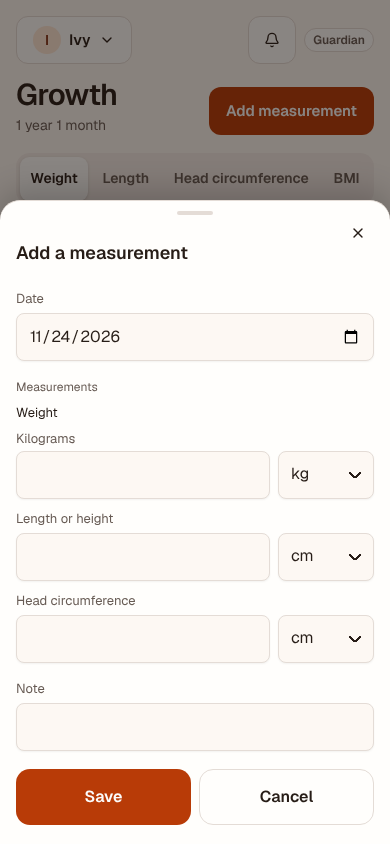
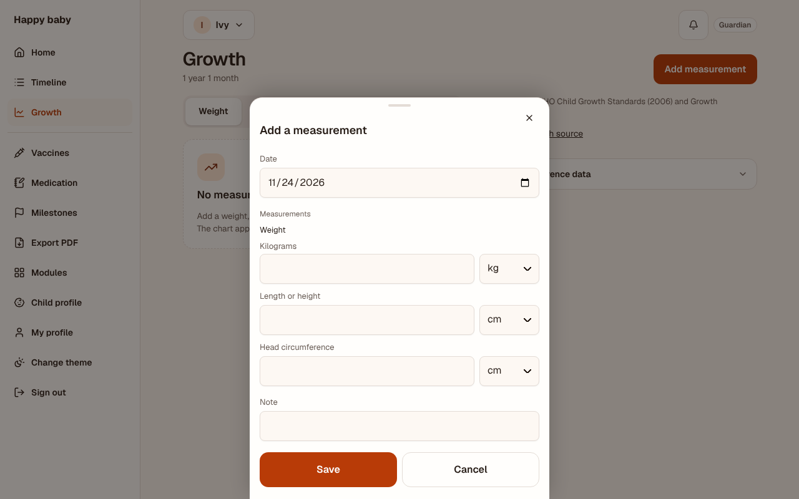
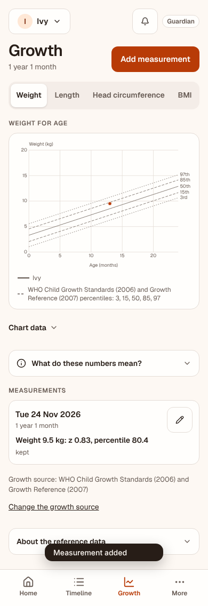
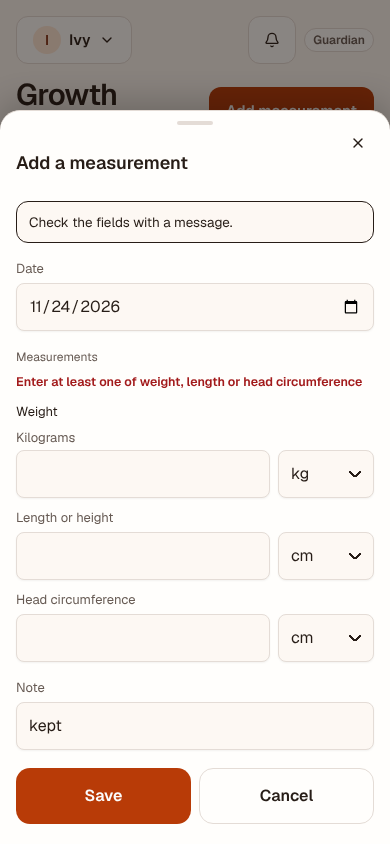
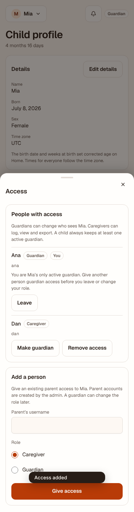
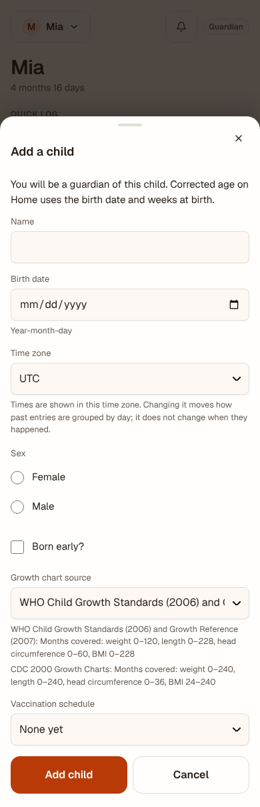

# Forms in sheets

Most forms in the app open in a sheet that slides up over the page you were on. This page explains how a sheet behaves and lists every form that uses one. The screenshots show fake data (for example Ivy, 1 year 1 month) and the frozen day 2026-11-24.

## Guide

### How does a form open?

1. Tap the link or button that starts the form, for example **Add measurement** on Growth.
2. A sheet opens from the bottom of the screen with the form's title, a **Close** button (the ×), the fields, **Save** and **Cancel**. The page you came from stays behind it, dimmed.
3. Fill in the fields and tap **Save**.

On a wide screen the sheet is centred and at most 480 pixels wide. If a form is taller than the screen, the sheet scrolls.

| Phone | Desktop |
|---|---|
|  |  |

### What happens when I save?

If the save works, the sheet closes, the page behind it shows the change and a short message appears at the bottom of the screen for about six seconds, above the tab bar. For example "Measurement added".

| Phone |
|---|
|  |

If the save is refused, the sheet stays open. A box at the top says "Check the fields with a message.", the field that needs attention shows its own message in red, and everything you typed is still there. Fix the field and tap **Save** again.

| Phone |
|---|
|  |

### How do I close a sheet without saving?

Tap **Cancel** or **Close**, press Escape, tap the dimmed page outside the sheet, or use the browser's Back button. The sheet closes, nothing is saved and no message appears. Focus returns to the link you opened it from.

### Do the sheets that change a list leave it open?

The **Access** sheet does. Giving access, changing a role or removing a person updates the list inside the open sheet and shows a message ("Access added", "Role changed", "Access removed"). Close it when you are done.

| Phone |
|---|
|  |

### What does Add a child do?

**Add a child** (from the Switch child sheet, the Choose a child page or Home when you have no child yet) opens in a sheet. When you tap **Add child** the sheet closes and you land on the new child's Home, with the message "Child added".

| Phone |
|---|
|  |

### What if the sheet does not open?

Every sheet is also an ordinary page, so nothing depends on it. Without JavaScript, when you open the link in a new tab or with Ctrl or Cmd held, or when you reload while a sheet is open, you get the page instead, with the same form. The steps are the same. After a save on the page you land where the page sends you, without the bottom message.

## Screens

| Form | Opened from | Page it is also at | Who can open it | Shots |
|---|---|---|---|---|
| Add a measurement, Edit measurement | Growth, a measurement's edit button | `/kids/[kid]/growth/new`, `/kids/[kid]/growth/[entry]` | guardian, caregiver | `sheets/01-growth-add`, `02-growth-refused`, `03-growth-saved` |
| Record a vaccination, Edit vaccination | Vaccines, a Record link, a "Given" link | `/kids/[kid]/vaccines/new`, `/kids/[kid]/vaccines/[administration]` | guardian, caregiver | `sheets/04-vaccine-record` |
| Add a course, Edit course, Edit dose | Medication, a course's edit button, a dose | `/kids/[kid]/medication/new`, `/kids/[kid]/medication/[medication]`, `/kids/[kid]/medication/doses/[dose]` | guardian, caregiver | `sheets/05-course-add`, `06-course-edit` |
| Add a visit, Edit visit, After the visit | Medical visits, a visit's page (Edit visit, Record the visit) | `/kids/[kid]/visits/new`, `/kids/[kid]/visits/[visit]/edit`, `/kids/[kid]/visits/[visit]/outcome` | guardian, caregiver | `visits/09-add-sheet`, `10-edit-sheet`, `11-outcome-sheet`, `12-outcome-refused` |
| Log and edit a tracker entry, including a symptom | Home quick-log tiles, Timeline rows, a running timer's "set the end time" link | `/kids/[kid]/log/[tracker]`, `/kids/[kid]/log/[tracker]/[entry]` | guardian, caregiver | `sheets/07-bottle-log`, `08-symptom-log` |
| Mark as reached, Add a milestone, Edit milestone | Milestones | `/kids/[kid]/milestones/new`, `/kids/[kid]/milestones/[entry]` | guardian, caregiver | `sheets/09-milestone-mark`, `10-milestone-add` |
| Edit details | Child profile: Edit details and the settings rows | `/kids/[kid]/settings` | guardian | `sheets/11-edit-details` |
| Modules for a child | Child profile: Trackers | `/kids/[kid]/modules` | guardian | `sheets/12-modules` |
| Access | Child profile: Manage access | `/kids/[kid]/access` | guardian | `sheets/13-access`, `14-access-added` |
| Add a child | Switch child sheet, Choose a child, Home with no child | `/kids/new` | guardian | `sheets/15-add-child` |

A caregiver gets the same "Not found" page as for an unknown child on the guardian pages, as before ([Error pages](Error-pages.md)).

The rules the sheets show:

- Title, **Close**, **Save** and **Cancel** are in every sheet. The sheet's name is the title of the page it also is (for example "Add a measurement").
- A refused save shows "Check the fields with a message." and the field messages, and keeps the values.
- A save that works shows one of these messages for about six seconds: Measurement added, saved or deleted; Vaccination recorded, saved or deleted; Course added, saved or deleted; Dose saved or deleted; Visit added, saved or recorded; Entry added, saved or deleted; Milestone saved or removed; Details saved; Modules saved; Access added; Role changed; Access removed; Child added; Child deleted; You left.
- Not every message is captured: the screenshots show Measurement added, Access added and the refused save.
- The Edit details sheet carries the delete-all-data section at its foot, as the page does. Deleting a child from the sheet has not been captured in a screenshot.
- The **Modules** entry in More and in the side navigation, and **Child profile**, open their pages, not sheets.

Not built yet: Undo in these messages, and the message after a save without JavaScript. See [Not built yet](Not-built-yet.md).

The full list of captures is in the [screenshot catalogue](../screenshots/README.md).

Back to the [wiki home](Home.md).
