# Growth

The Growth page plots a child's weight, length, head circumference and BMI against a reference chart (WHO or CDC) and lists every measurement with its score. The page states numbers and does not interpret them. All screenshots show fake data (for example Ivy, 1 year 1 month, or Uma, born at 30 weeks) on a frozen day, 24 November 2026. The full list of captured screens is in the [screenshot catalogue](../screenshots/README.md).

## Guide

### How do I read the Growth page?

1. Open **Growth** in the tab bar (phone) or the side navigation (wide screens).
2. Under the title you see the child's age, for example "1 year 1 month".
3. Pick a measure with the tabs: **Weight**, **Length**, **Head circumference** or **BMI**. The chart changes; the list of measurements stays.
4. The chart shows the reference percentile lines (dashed and dotted, labelled 3rd to 97th for WHO) and your child's measurements as a line with dots. The legend under the chart names the source.
5. Under **Measurements**, each card is one visit: the date, the age, and one line per measure with its z-score and percentile, for example "Weight 9.5 kg: z 0.83, percentile 80.4". The measure you are looking at is in bold. A note you typed shows at the bottom of the card.

BMI is worked out from the weight and length of the same visit. You never type it, and it has no unit setting.

| Phone | Desktop |
|---|---|
| 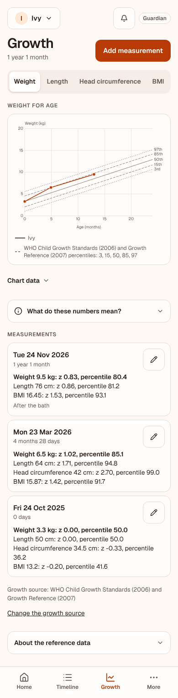 | 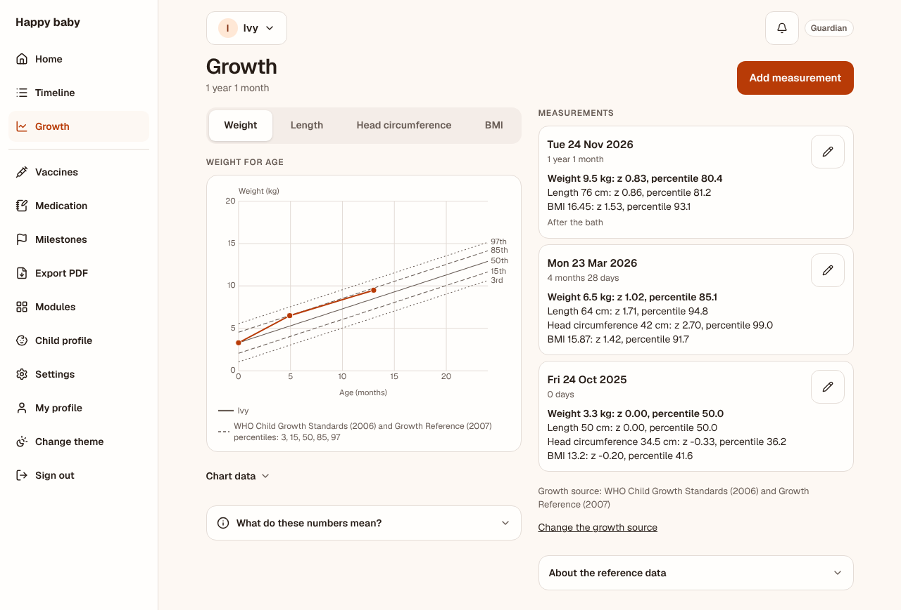 |

### What do the z-score and percentile mean?

Open **What do these numbers mean?** under the chart. It says that a percentile compares one measurement with a reference group of children of the same age and sex (50 is the middle of that group), and that a z-score counts the same comparison in steps from the middle (0 is the middle). It ends with: "This page shows the numbers and does not interpret them. Questions about what they mean for Ivy are for your clinic."

### Can I see the numbers behind the chart?

Open **Chart data** under the chart. It shows two tables: **Measurements plotted** (date, age in months, value) and **Percentile values** (the reference lines at 0, 5, 10, 15 and 20 months in this example). Chart data and the measure tabs work without JavaScript.

| Phone |
|---|
| 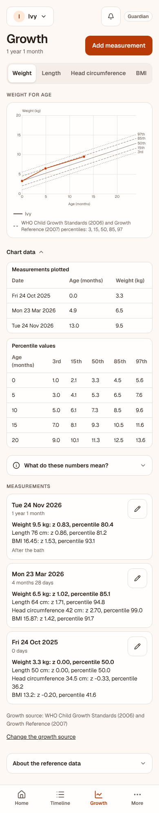 |

### How do I add a measurement?

1. On **Growth**, tap **Add measurement**.
2. Check the **Date**. It starts as the child's today. It cannot be in the future or before the birth date.
3. Type at least one of **Weight**, **Length or height** and **Head circumference**. Each has its own unit box, which starts in the unit set on your profile. For pounds, a **Pounds** box and an **Ounces** box appear. A decimal comma is read as a decimal point.
4. Add a **Note** if you want one.
5. Tap **Save**. You land back on the Growth page, on the chart of the first measure you typed.

Cancel, or the "Growth for ..." link at the top, returns without saving.

If something is wrong, a box at the top says "Check the fields with a message." and the field says what to fix. Your typed values stay.

| Phone |
|---|
| 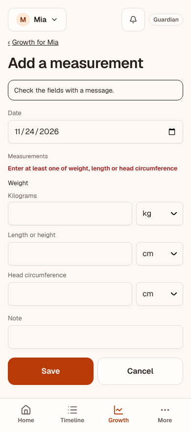 |

The messages you can meet:

- "Enter at least one of weight, length or head circumference" (nothing typed, shot `13-new-nothing-measured`).
- "Enter a date that is not in the future and not before the birth date" (shot `14-new-future-date`, where the typed 7.1 kg and the note were kept).
- "Enter a weight: kilograms with up to three decimals, or pounds and 0 to 15.99 ounces".
- "Enter a length: centimetres with one decimal, or inches with up to two", and the same for head circumference.
- For metric values outside the allowed range: "Enter a weight from 0.2 to 250 kg", "Enter a length from 15 to 250 cm", "Enter a head circumference from 15 to 80 cm".
- "This child has the maximum number of measurements" when no more can be added.

### How do I change or delete a measurement?

1. On the card of the visit, tap the pencil button ("Edit the measurement of ..."). A caregiver can do this too.
2. Change the boxes and tap **Save**. A box left empty removes that measure from the visit.
3. To delete the whole visit, tap **Delete this measurement**. A box opens that says "This removes the measurement for everyone with access to Ivy." Tap **Yes, delete this measurement** to confirm.

The edit page shows each measure in the unit it was typed in. To change the unit of a measure, pick the other unit in its box: the number is then read in the new unit. A measure the visit does not have starts in your profile's unit. In the example below (shot `08-edit-imperial`, for a parent who chose pounds and inches) the weight and length of the visit still show kg and cm because that is how they were typed, and only the empty head box shows "in".

| Phone | Desktop |
|---|---|
| 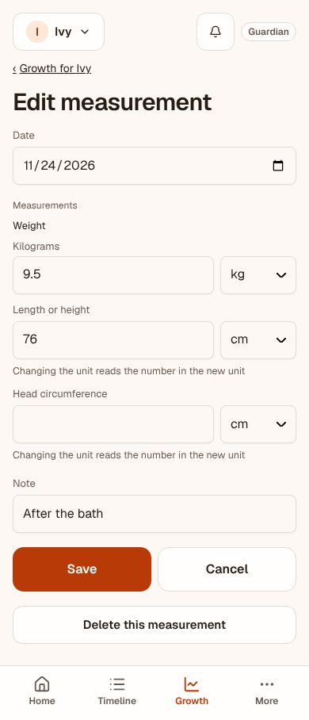 | 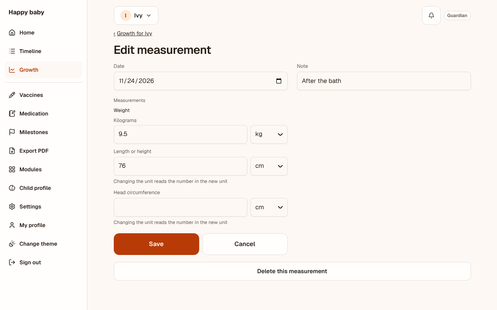 |

| Phone |
|---|
| 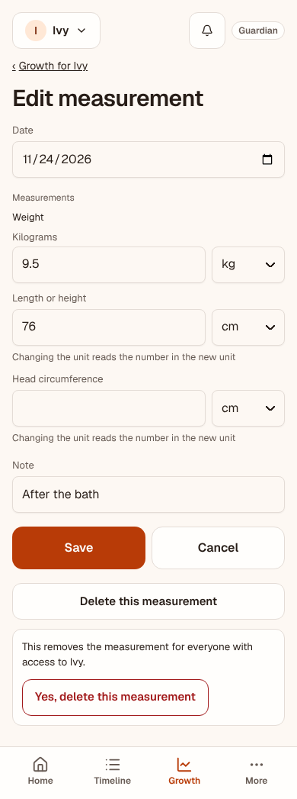 |

### Why are my values in pounds and inches?

The page shows the units chosen on your profile: kilograms or pounds and ounces for weight, centimetres or inches for length and head. The same visit shows "Weight 9.5 kg" to one parent and "Weight 20 lb 15.1 oz" to another (shot `07-ivy-imperial`). The chart axis follows the unit too.

### What do WHO and CDC mean, and which one is used?

Each child has a growth source, WHO or CDC. A new child starts with WHO. The page names it under the list ("Growth source: WHO Child Growth Standards (2006) and Growth Reference (2007)") and the legend under the chart names it too. **About the reference data** gives the version, the attribution and the licence.

A guardian changes the source with **Change the growth source**, which opens the child's settings. A caregiver sees the source name but not that link.

| Phone |
|---|
| 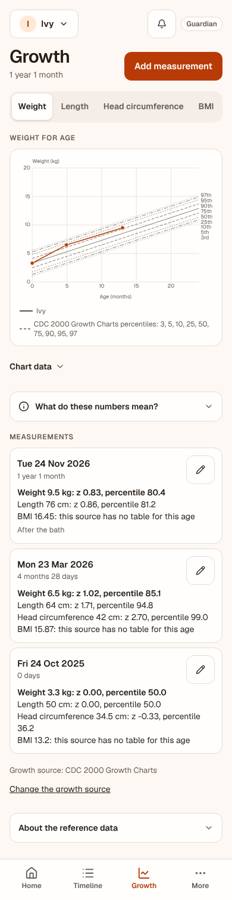 |

### What does "has no table for this age" mean?

A source does not cover every measure at every age. When it has no table for a measure at this age, the page says so above the chart: "CDC 2000 Growth Charts has no table for this measure at this age. Your measurements are listed below." The dots are still plotted and the visit's line reads "this source has no table for this age" instead of a z-score. Two examples in the captured screens: CDC has no BMI table under 24 months (shot `06-ivy-bmi-cdc-no-table`), and WHO has no head circumference table after five years (shot `18-who-head-after-5-unscored`).

| Phone |
|---|
| 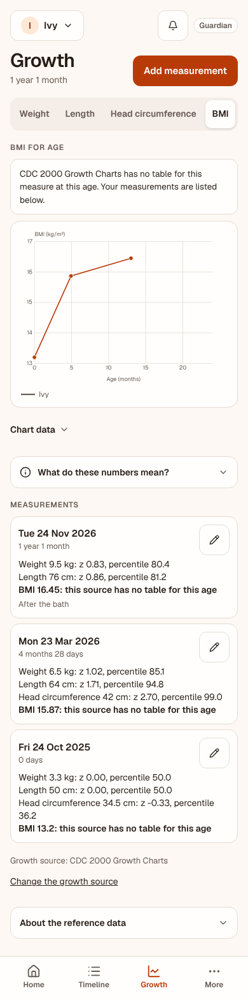 |

### How does the page treat a child born early?

For a child born before 37 weeks, the page shows both ages. The header reads, for example, "3 months (corrected 1 month 5 days)" (shot `19-remy-preterm-guardian`), and each visit shows the age lived and the corrected age. The chart plots a preterm child at corrected age until the second birthday, and its axis says "Corrected age (months)". The help text explains that the app subtracts the weeks of early birth from the age until the second birthday, and that WHO and CDC do not publish this rule: it is the app's own choice.

Until the due date the header reads, for example, "14 days (before expected term)". A visit dated before the due date is drawn hatched, reads "before expected term" instead of a score, and has no dot on the chart (shot `17-before-expected-term`). The page never shows a corrected age of zero.

| Phone | Phone |
|---|---|
| 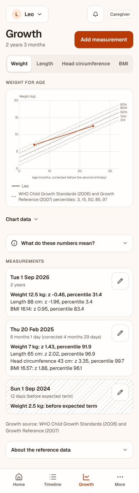 | 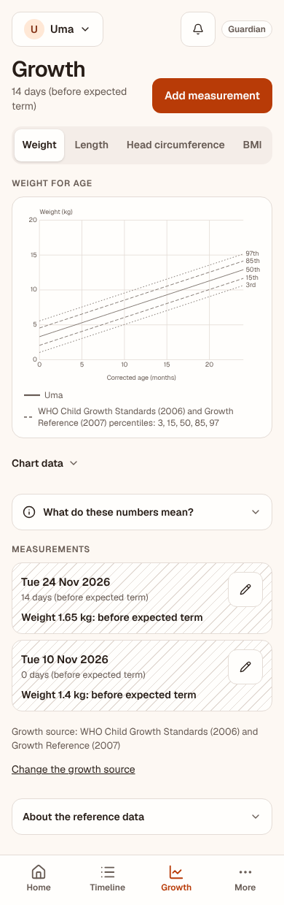 |

The left screenshot is a caregiver's view of Leo (born at 35 weeks; his latest visit is past the second birthday, so it shows one age). The right one is Uma, born at 30 weeks, two weeks ago.

### What if there is no measurement yet?

The page says "No measurements yet. Add a weight, length or head size from a check-up or from home. The chart appears with the first one." Tabs, the source line and **About the reference data** are still there (shot `11-empty`).

## Screens

| Screen | Route | Who can open it | States captured |
|---|---|---|---|
| Growth | `/kids/[kid]/growth` (`?measure=weight`, `length`, `head` or `bmi`) | Guardian, caregiver. Admin: sent to `/admin/parents`. Signed out: sent to the sign-in page. No grant: the 404 page, identical to an unknown child | `01-ivy-weight-who`, `02-ivy-length-who`, `03-ivy-head-who`, `04-ivy-bmi-who`, `05-ivy-weight-cdc`, `06-ivy-bmi-cdc-no-table`, `07-ivy-imperial`, `11-empty`, `16-leo-preterm-caregiver`, `17-before-expected-term`, `18-who-head-after-5-unscored`, `19-remy-preterm-guardian`, `20-ivy-chart-data-table` |
| Add a measurement | `/kids/[kid]/growth/new` | Guardian, caregiver (same access rules) | `12-new-empty`, `13-new-nothing-measured`, `14-new-future-date`, `15-new-filled` |
| Edit measurement | `/kids/[kid]/growth/[entry]` | Guardian, caregiver. No grant, an unknown entry and another child's entry are the same 404 page | `08-edit-imperial`, `09-edit`, `10-edit-delete-confirm` |

### Rules the screens show

- **Measures**: weight, length, head circumference and BMI. An unknown `?measure=` shows the weight chart.
- **Add and edit**: a visit needs at least one of weight, length and head circumference. The date has to fall between the birth date and the child's today.
- **Limits** (metric entries): weight 0.2 to 250 kg, length 15 to 250 cm, head circumference 15 to 80 cm. Imperial entries are converted and checked by the API. The messages are listed in the Guide above and never repeat what was typed.
- **Units**: kg or lb with oz, cm or in, from the viewer's profile. An existing visit keeps the unit it was typed in on the edit page. Changing a unit in the edit form reads the typed number in the new unit.
- **Scores**: z-score and percentile per measure and visit. A score is replaced by "this source has no table for this age" or "before expected term". Percentiles beyond the shown range read as a bound (for example "<0.1" in shot `18-who-head-after-5-unscored`).
- **Corrected age**: shown for children born before 37 weeks, until the second birthday; both ages wherever it applies.
- **Source**: WHO or CDC, set per child in the child's settings by a guardian. The page names the source and, in **About the reference data**, its version, attribution and licence.
- **Role difference**: a caregiver can add, edit and delete measurements, and sees the source name without the "Change the growth source" link (shot `16-leo-preterm-caregiver`).
- **Growth module switched off**: the Growth page still opens (checked by the end-to-end test "the page stays with the growth module switched off").
- **Without JavaScript**: measure tabs are links, the chart is built on the server, and the unit boxes follow the unit select.
- **Long text**: a long unbroken note wraps inside its card (shot `18-who-head-after-5-unscored`).

### Not built yet

The design also shows a segmented units control and selecting a chart point to highlight its row. The app has neither: units are plain selects and the chart points are not selectable. See [Not built yet](Not-built-yet.md).

Back to the [wiki home](Home.md).
