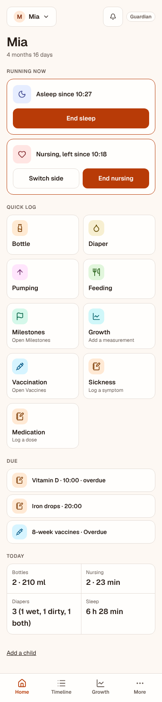
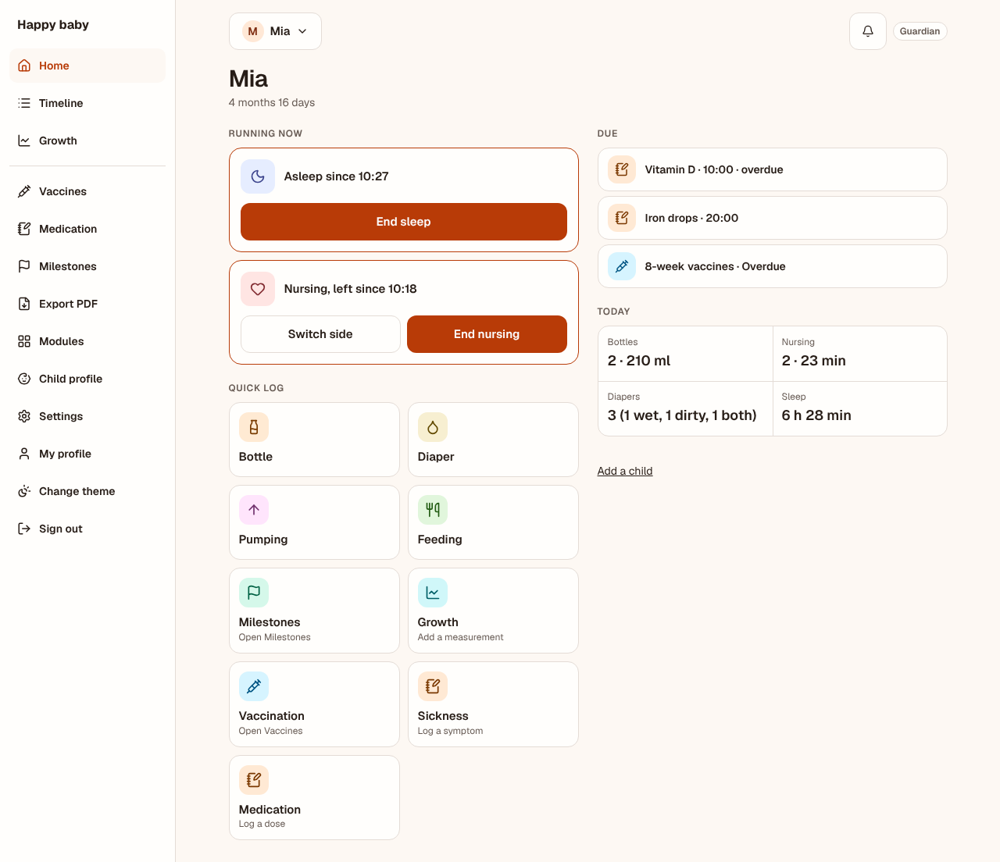

# happybabytracker wiki

A self-hosted tracker for a baby's feeds, sleep, diapers, growth, vaccines, medication and milestones. This wiki shows every screen of the redesigned app, as captured by the project's own end-to-end screenshot flow, and explains it twice: as a short guide for a parent and as a reference for owners and reviewers.

| Phone | Desktop |
|---|---|
|  |  |

## How the pages are built

Each page has a **Guide** (how do I...? in plain steps, for a parent) and a **Screens** section (route, who can open it, the states captured and the rules the screens show, for owners and reviewers). Every picture is a capture of the real user interface, running against a stub of the API that holds fake data, so what you see is what the interface does. The full list of 230 captured screens, with captions, is in the [screenshot catalogue](../screenshots/README.md).

## Pages

**Getting started**

- [Sign in and invites](Sign-in-and-invites.md): signing in, one-time invite and reset links.
- [Navigation and shell](Navigation-and-shell.md): the tab bar, the side navigation, the header, switching child, the More sheet and the theme.
- [Forms in sheets](Forms-in-sheets.md): how forms open over the page, what Save does, closing, and every form that uses a sheet.
- [Roles, layouts and conventions](Roles-and-layouts.md): who can see what, the three layouts, modules, units and times.

**Every day**

- [Kid home](Kid-home.md): the child's home, quick log, timers, what is due, today's totals.
- [Logging trackers](Logging-trackers.md): bottles, nursing, pumping, diapers, sleep, meals and symptoms.
- [Timeline](Timeline.md): every entry, by day, with filters.

**Health records**

- [Growth](Growth.md): charts and measurements.
- [Vaccines](Vaccines.md): the schedule, what is due, recording a vaccination.
- [Medication](Medication.md): courses and doses.
- [Milestones](Milestones.md): checklists by age.
- [Export PDF](Export-PDF.md): a PDF of a date range, for the modules you choose.

**Setup and account**

- [Children and access](Children-and-access.md): modules, child profile, edit details, who has access, adding a child.
- [My profile](My-profile.md): your name, units, password and devices.
- [Notifications](Notifications.md): reminders by Web Push and ntfy.

**Admin and errors**

- [Admin](Admin.md): the parents panel.
- [Error pages](Error-pages.md): not found, and the server being unreachable.

**About this wiki**

- [Before and after](Before-and-after.md): the first-pass design next to the redesign.
- [Not built yet](Not-built-yet.md): what the design shows that the app cannot do yet.
- [How these screenshots are made](How-these-screenshots-are-made.md): how to regenerate and check them.

The design itself, with its measured layouts and rules, is the [design export](../plans/ui-redesign/README.md).
