# Kid home

A child's home is the page you land on after signing in. It shows who the child is, runs the one-tap logging, lists the timers that are running, what is due and the totals for today. All screenshots show fake data (for example Mia, 4 months old, or Leo, a 2-year-old) on a frozen day, 24 November 2026. The full list of captured screens is in the [screenshot catalogue](../screenshots/README.md). The frame around the page (tab bar, header, sheets) is explained in [Navigation and shell](Navigation-and-shell.md).

## Guide

### What is on the home page?

From the top:

1. **The child's name and age**, for example "Mia" and "4 months 16 days". The age is written in the largest units that fit: days for a newborn ("10 days"), months and days under a year ("4 months 16 days", or "9 months" on the day it is exact), years and months after that ("1 year 1 month", "4 years 11 months"), and whole years on a birthday ("5 years").
2. **Running now**, only while a sleep or nursing timer is running.
3. **Quick log**, a grid of tiles, one per tracker or tool that is switched on for this child.
4. **Due**, only when a medication dose or a vaccine visit is due.
5. **Today**, the totals for the child's day, only when the child has a tracker that has totals.
6. For a guardian, an **Add a child** link at the bottom. For a caregiver, a **Leave this child** card instead.

On a phone these are one column. On a desktop (from 1280 px) Running now and Quick log are the left column and Due, Today and the link are the right column.

| Phone | Desktop |
|---|---|
| 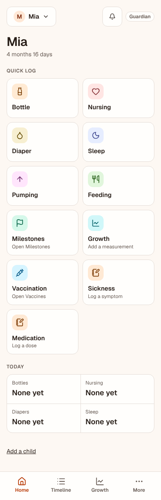 | 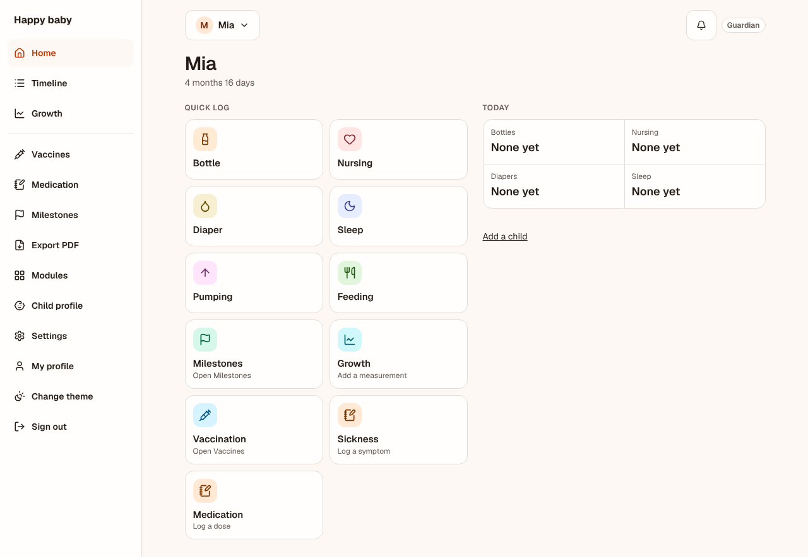 |

Nothing logged yet: the tiles and a Today card that says "None yet" for Bottles, Nursing, Diapers and Sleep.

### How do I log something?

1. Press a tile in **Quick log**.
2. Most tiles open a form for that entry; fill it in and press **Save** ([Logging trackers](Logging-trackers.md)). **Sleep** is different: one press starts a sleep timer at once, with no form.
3. Some tiles open a page instead of a form: **Growth** opens the form for a new measurement, **Vaccination** opens the vaccine schedule, **Medication** opens the medication page, **Milestones** opens the milestone checklist.

The small line under a tile says where it goes: "Open Milestones", "Add a measurement", "Open Vaccines", "Log a symptom" or "Log a dose". The Bottle, Nursing, Diaper, Sleep, Pumping and Feeding tiles have none.

| Tile | Opens |
|---|---|
| Bottle, Nursing, Diaper, Pumping | the form to log that entry |
| Feeding | the form "Log a meal" |
| Sickness | the form "Log a symptom" |
| Sleep | nothing to fill in: starts a timer now |
| Growth | the form for a new measurement ([Growth](Growth.md)) |
| Vaccination | the vaccine schedule ([Vaccines](Vaccines.md)) |
| Medication | the medication page ([Medication](Medication.md)) |
| Milestones | the milestone checklist ([Milestones](Milestones.md)) |

### Why do the tiles come in a different order for each child?

The first four tiles follow the child's age; the other tiles that are switched on follow in a fixed order.

| Age | First four tiles | Then |
|---|---|---|
| Under 12 months | Bottle, Nursing, Diaper, Sleep | Pumping, Feeding, Milestones, Growth, Vaccination, Sickness, Medication |
| 12 to 23 months | Feeding, Bottle, Sleep, Diaper | Nursing, Pumping, Milestones, Growth, Vaccination, Sickness, Medication |
| 24 months and older | Sickness, Medication, Growth, Vaccination | Milestones, when it is switched on |

For a child past two years the baby trackers (bottle, nursing, diaper, sleep and so on) start switched off, so the grid is short and there is no Today card ([Roles, layouts and conventions](Roles-and-layouts.md)). A guardian can switch modules on and off ([Children and access](Children-and-access.md)).

| Phone |
|---|
| 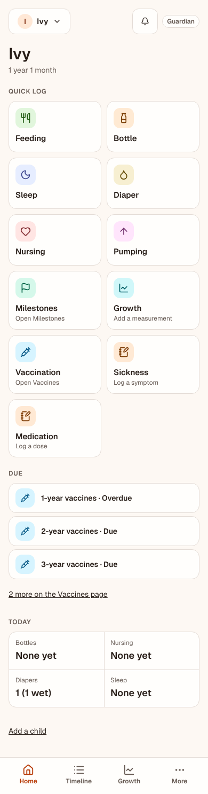 |

A 13-month-old (Ivy): Feeding leads the grid. The Due list under it is explained further down.

For a 10-day-old (`home/05-newborn`) and a 9-month-old (`home/12-nell-9-months`) the grid is the under-12-months one. A 4-year-11-month-old (`home/14-otto-4-years-11-months`) and a child on the 5th birthday (`home/15-pia-5th-birthday`) get Sickness, Medication, Growth, Vaccination and then Milestones, which is on for them, and no Today card.

### What are the running timers?

A sleep or nursing timer that is running appears under **Running now**. A sleep reads "Asleep since 10:27" with an **End sleep** button. A nursing timer reads "Nursing, left since 10:18" with **Switch side** (to the other breast) and **End nursing**. The times are on the child's own clock.

While a timer runs, its tile is not in Quick log (in the capture below there is no Sleep and no Nursing tile). When you end it, the tile comes back and the minutes join Today.

| Phone | Desktop |
|---|---|
| 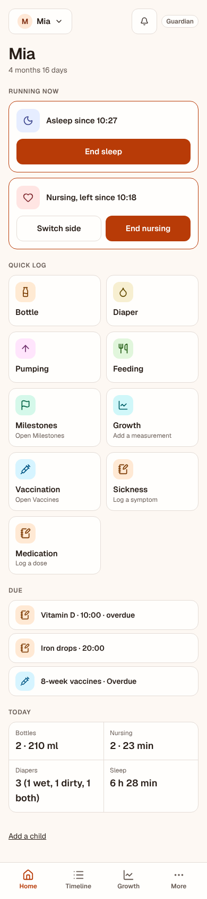 | 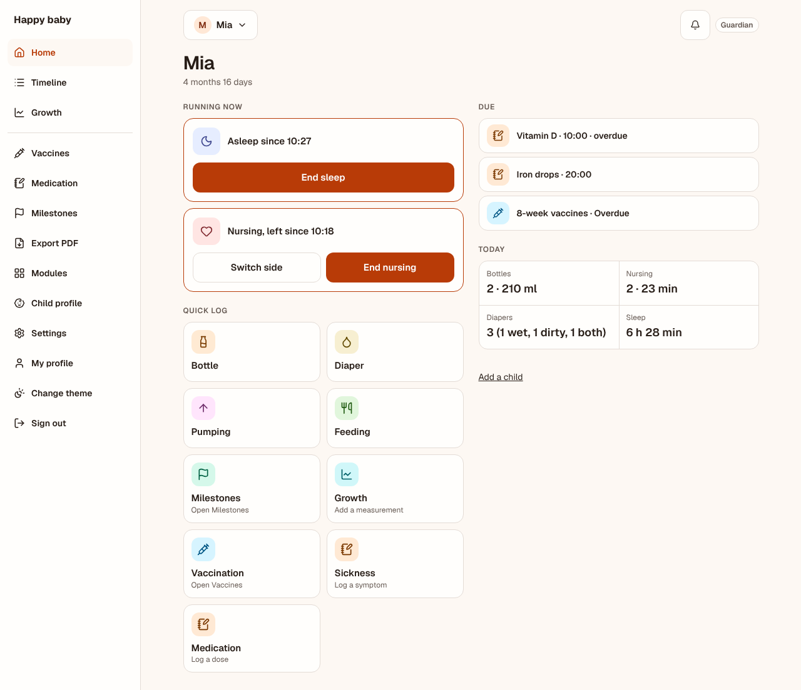 |

If you press **End sleep** or **End nursing** on a timer that has run for more than 24 hours, it does not end. The card says "This timer ran over 24 hours: set the end time" and the last words are a link to that entry, where you set the end time yourself or delete the entry ([Logging trackers](Logging-trackers.md)).

| Phone |
|---|
| 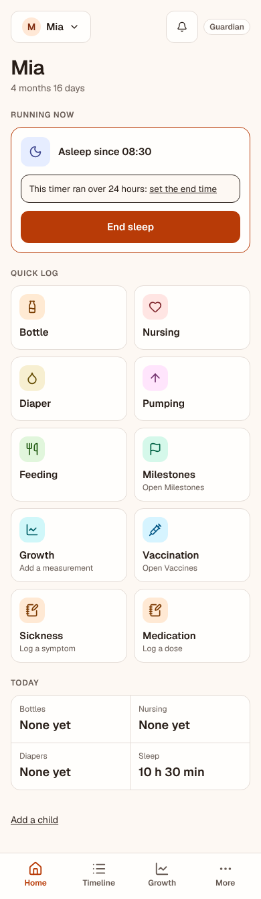 |

### What does Due show?

**Due** lists medication doses and vaccine visits that need attention, with the medication first. A line reads, for example, "Vitamin D · 10:00 · overdue", "Iron drops · 20:00" or "8-week vaccines · Overdue". Each line opens its own page. The state is in words, not only in colour.

Only three lines are shown. If more are due, a link follows for each kind that has more, for example "2 more on the Vaccines page" or "2 more on the Medication page".

When the Vaccination or Medication module is switched off for the child, its lines are not listed. With nothing due, the Due heading is not shown.

### What does Today show?

**Today** has one cell for each of Bottles, Nursing, Diapers and Sleep that is switched on, counted for the child's own day:

- Bottles and Nursing: a count and a total, for example "2 · 210 ml" and "2 · 23 min".
- Diapers: a count and the kinds, for example "3 (1 wet, 1 dirty, 1 both)".
- Sleep: the total time, for example "6 h 28 min".
- "None yet" when nothing is logged.

Volumes are in your own unit. For a parent who chose fluid ounces the same day reads "2 · 7.1 fl oz" (`home/03-mia-busy-day-imperial`). Change units on [My profile](My-profile.md).

### What do I see when I am a caregiver?

A caregiver logs and views like a guardian. The differences are:

- The badge in the header reads **Caregiver**.
- The More sheet and the side navigation have no **Modules**, **Child profile** or **Settings** ([Navigation and shell](Navigation-and-shell.md)).
- At the bottom there is a **Leave this child** card instead of the **Add a child** link.

| Phone |
|---|
| 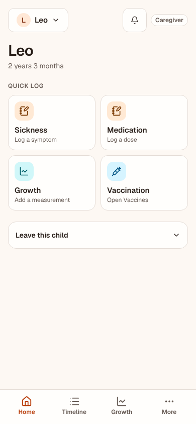 |

Leo is over two years old, so only four tiles show and there is no Today card.

### How do I leave a child?

You can leave a child you were added to as a caregiver. You lose access until a guardian adds you again.

1. Press **Leave this child**. The card opens.
2. Read the sentence: "You will lose access to Leo. A guardian has to add you again."
3. Press **Yes, leave Leo**. You land on Home, which opens your next child, or the welcome page if you have none.

| Phone |
|---|
| 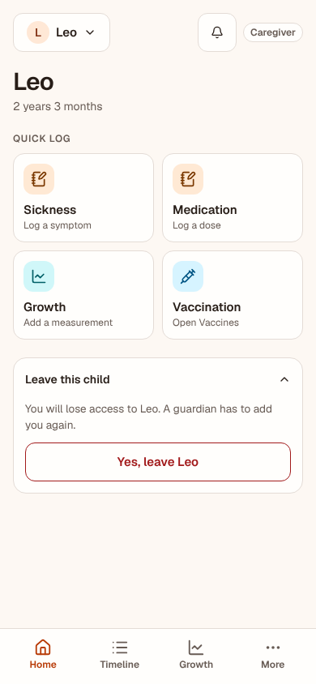 |

If the app cannot reach its server, the card stays open with the message "The app cannot reach its server, try again soon" above the sentence (`home/10-leo-leave-refused`), and nothing changes.

A guardian does not see this card. A guardian cannot leave as the child's only guardian; guardians manage who has access on the Access page ([Children and access](Children-and-access.md)).

### What about a child born early?

For a child born before 37 weeks, a second line under the age gives the corrected age and the weeks at birth, for example for Remy: "3 months" and then "Corrected age 1 month 5 days · born 32w 0d". The corrected age is shown until the child's second birthday. Leo was born at 35 weeks 2 days, but at 2 years 3 months his header shows no corrected age (`home/11-leo-guardian-24-plus`).

If the due date is still ahead, the second line reads "Before expected term" with the weeks at birth.

| Phone | Desktop |
|---|---|
| 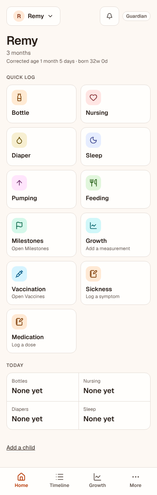 | 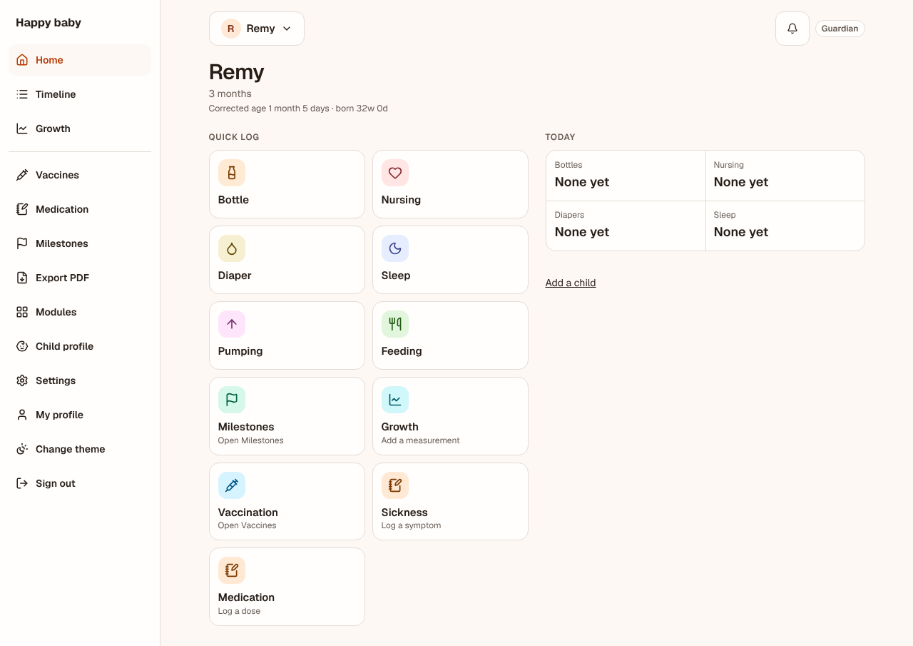 |

### What if a module is switched off?

A switched-off module has no tile in Quick log, no entry in More or the side navigation (Vaccines, Medication, Milestones), and, for Vaccination and Medication, no lines in Due. Its entries are not deleted. In the capture below a guardian switched off Pumping and Feeding for Mia, so the grid goes straight from Diaper and Sleep to Milestones. Sami (30 months, Milestones off by default) has no Milestones tile (`home/16-sami-30-months-milestones-off`).

| Phone |
|---|
| 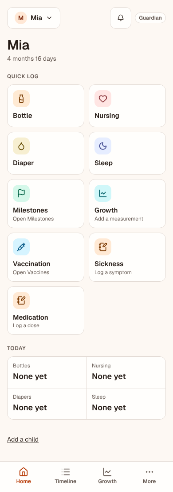 |

## Screens

| Screen | Route | Who can open it | States captured |
|---|---|---|---|
| Kid home | `/kids/[kid]` | Guardian, caregiver. No grant, or an unknown child, is the "Not found" page (`errors/01-404-unknown-kid`). The admin cannot open it. | `home/01-mia-nothing-logged`, `home/02-mia-busy-day`, `home/03-mia-busy-day-imperial`, `home/04-sleep-timer-overrun`, `home/05-newborn`, `home/06-ivy-13-months`, `home/07-due-many`, `home/08-leo-caregiver`, `home/09-leo-caregiver-leave-confirm`, `home/10-leo-leave-refused`, `home/11-leo-guardian-24-plus`, `home/12-nell-9-months`, `home/13-remy-preterm-corrected-age`, `home/14-otto-4-years-11-months`, `home/15-pia-5th-birthday`, `home/16-sami-30-months-milestones-off`, `kid-admin/03-home-with-modules-off` |
| Home entry point | `/` | Any parent. Redirects (303) to the remembered child, else the first child; with no child it shows the welcome page ([Navigation and shell](Navigation-and-shell.md)). | `shell/01-no-kids-welcome` |

### Rules the screens show

- **Quick log** lists the modules that are switched on, in the order of the child's age band (under 12 months, 12 to 23 months, 24 months and older), the first four by band and the rest in a fixed order. A module with neither a tracker nor a page has no tile.
- **A running timer replaces its tile.** Only one sleep timer and one nursing timer can run for a child; a second start is refused on the form with a link to the running one ([Logging trackers](Logging-trackers.md)).
- **One tap starts sleep:** the Sleep tile is a form post, so it works without JavaScript. So do End sleep, End nursing, Switch side and Leave this child, which is a two-step form (open the card, then confirm).
- **Timer limit:** a session can last at most 24 hours. Ending a longer one sends you to its entry to set the end time.
- **Due** shows at most three lines in the order the server returns them (medication, then vaccine visits), then one "N more on the ... page" link for each kind that has more. The server decides what is due; the page does not.
- **Today** has a row per switched-on module among Bottles, Nursing, Diapers and Sleep, for the child's own day, with volumes in the parent's unit. "None yet" is the empty value.
- **Times** on timers and Due medication are on the child's clock, not the viewer's.
- **Corrected age** is shown only for a child born before 37 weeks and until the second birthday.
- **Role differences:** guardian gets Add a child; caregiver gets Leave this child and no Modules, Child profile or Settings entries.
- **Failures** of Sleep, End, Switch side and Leave show their message on the page; the Leave failure reopens the card.
- **Catalogue caption that does not match its capture:** the caption for `home/11-leo-guardian-24-plus` mentions "the corrected age line"; the capture shows none, because the correction ends at two years.

### Not built yet

The design's home also shows a **Latest** list with a "See the Timeline" link, "1 h 34 min ago" subtitles on the tiles and "Last: ..." lines in the Today cards, a running timer's elapsed clock with a "Started on another phone" line, and Left and Right side tiles for nursing. None of these is in the app. See [Not built yet](Not-built-yet.md).

Back to the [wiki home](Home.md).
