# Logging trackers

How to log, edit and delete a bottle, nursing, pumping, diaper, sleep, meal or symptom entry, what each form refuses, and what the advanced modes add. All screenshots show fake data (for example Mia, 4 months old, on a frozen day, 24 November 2026, in the UTC time zone). The full list of 40 captured tracker screens is in the [screenshot catalogue](../screenshots/README.md); this page shows the most instructive ones and names the others by id.

The log and edit forms of every tracker open in a sheet over the page you were on: a log form over the child's home, an edit form over the [Timeline](Timeline.md). The sheet has the form's title, a **Close** button (the ×), the fields, **Save** and **Cancel**; saving closes it, the page underneath shows the change and a short message appears ([Forms in sheets](Forms-in-sheets.md)). Every form screenshot below is the open sheet, except **Log sleep**, which no link opens in a sheet and is shown as the page. Without JavaScript, in a new tab or when you open the address directly, the same form is a page with the same steps; after a save there you land where the steps say.

## Guide

### How do I open a log form?

1. Open the child's home ([Kid home](Kid-home.md)).
2. Press a tile in **Quick log**: **Bottle**, **Nursing**, **Pumping**, **Diaper**, **Feeding** (the meal form) or **Sickness** (the symptom form). **Sleep** is different: it starts a timer at once and opens no form (see [Sleep](#sleep)).
3. Fill in the form and press **Save**. The sheet closes, you stay on the child's home and the message "Entry added" appears. Without JavaScript you land on the [Timeline](Timeline.md) for the day of the entry, where the new entry is the newest. **Cancel** closes the sheet (on the page, it returns to the child's home).

| Phone | Desktop |
|---|---|
| 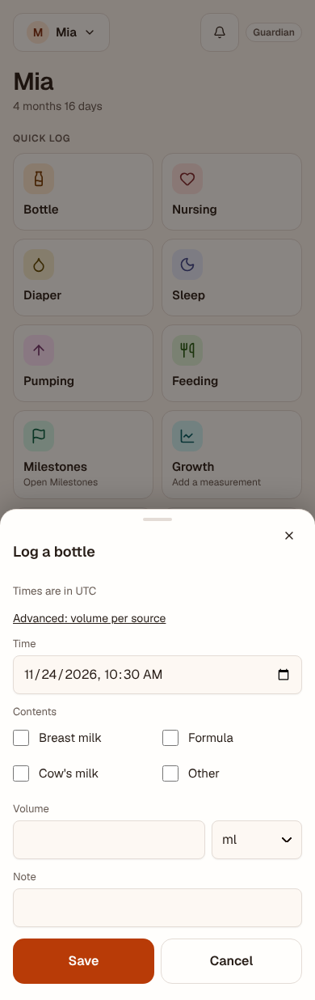 | 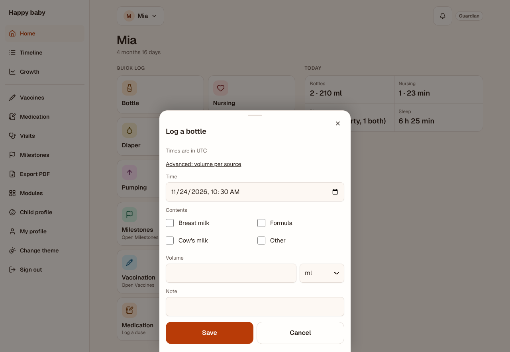 |

Every sheet has the same top: the title ("Log a bottle"), **Close**, and "Times are in UTC" (the child's own time zone, whichever it is); the page form also shows the child's age under the title. Every form ends with a **Note**, then **Save** and **Cancel**. A tracker whose module is switched off has no tile on the home page ([Kid home](Kid-home.md)).

The **Time** (or **Started at**) field is filled with the current time on the child's clock. Change it to log something that already happened. A time in the future, or before the child's birth date, is refused.

### What does a refused form look like?

When something is wrong, the sheet stays open with everything you typed, a box at the top that reads "Check the fields with a message.", and a red sentence under the field that is wrong. The form reports the first problem it finds; fix it and press **Save** again to see the next one, if any. The red sentences stay until you save again, even after you have corrected the field.

Two sentences are common to all forms:

- Time: "Enter a time that is not in the future and not before the birth date".
- Note: "The note is too long" (a note holds up to 500 characters).

### Bottle

1. Open the **Bottle** tile. The form is **Log a bottle**.
2. Tick what was in the bottle: **Breast milk**, **Formula**, **Cow's milk**, **Other**. You can tick several.
3. Type the **Volume** and pick its unit, **ml** or **fl oz**. The unit starts as the one chosen on [My profile](My-profile.md).
4. Add a note if you like, then press **Save**.

| Phone | Desktop |
|---|---|
| 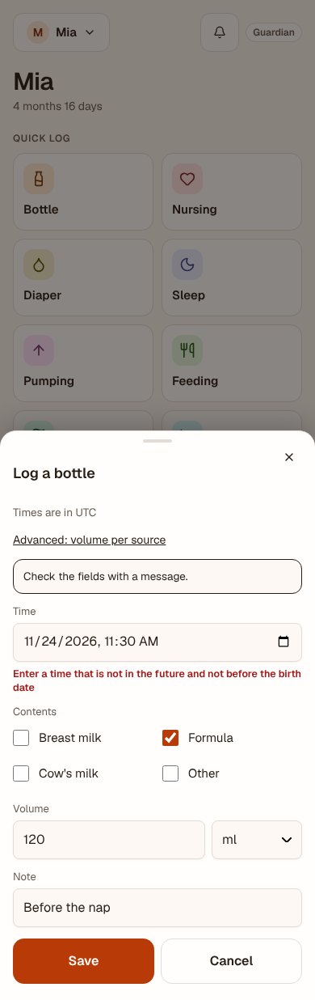 | 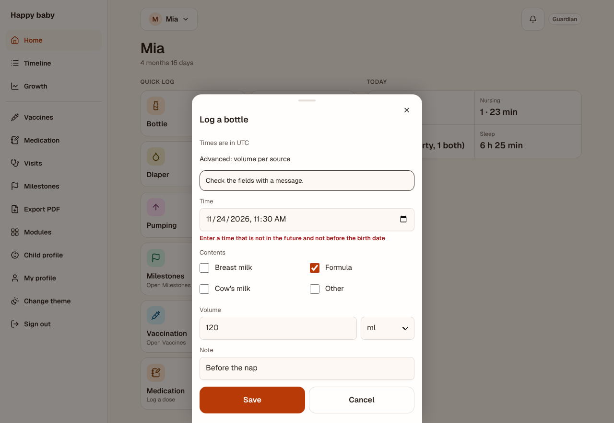 |

A time an hour ahead is refused, the sheet stays open and the other values stay. In the sheet the fields are one column on every screen; the page form puts the note in a second column on a wide screen.

What the form refuses:

| You did | It says |
|---|---|
| Ticked nothing | "Choose at least one", under the boxes (`trackers/03-bottle-new-no-contents`) |
| Typed 5000 ml | "Enter from 1 to 1000 ml" (`trackers/04-bottle-new-volume-range`) |
| Typed something that is not a number | "Enter a volume: whole millilitres, or ounces with up to two decimals" |

Millilitres are whole numbers from 1 to 1000. Fluid ounces take up to two decimals, with a point or a comma ("4.25" or "4,25"). A parent who uses fluid ounces gets that unit pre-selected (`trackers/10-bottle-new-imperial`); a 120 ml bottle then reads "4.06" fl oz in its edit sheet (`trackers/11-bottle-edit-imperial`).

**Advanced: volume per source.** Press the link at the top of the form, "Advanced: volume per source", to record how much of each source went in. Tick each source and a volume field appears under it ("Breast milk volume", "Formula volume"). Press **Use one total** to go back. The link swaps the form inside the same sheet, so type after you have chosen the mode: what you typed is not carried across.

| Phone |
|---|
| 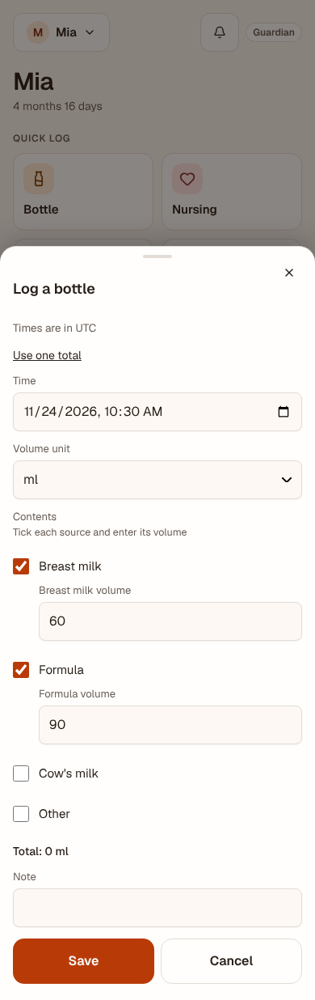 |

In the capture the **Total** line reads "0 ml" although 60 and 90 are typed: the total is worked out when you save (and shown again in an edit sheet, for example "Total: 90 ml" in `trackers/08-bottle-edit-advanced`). The total must be from 1 to 1000 ml, otherwise the form says "The total must be from 1 to 1000 ml". A source you ticked without a volume is refused with "Enter a volume for each source you ticked, in whole millilitres or ounces with up to two decimals".

To change an entry, press its row on the Timeline: the **Edit bottle** sheet opens over it. A bottle that has volumes per source opens in advanced mode (`trackers/08-bottle-edit-advanced`). If you press **Use one total** and save, the total replaces the volumes per source; the field says so: "Saving one total replaces the volumes per source".

### Nursing

1. Open the **Nursing** tile. The form is **Log nursing**, with two ways to use it.
2. **To run a timer:** choose the side you start on (**Left** or **Right**) and leave the end empty. Press **Save**. The timer shows under Running now on the home page ([Kid home](Kid-home.md)), where you switch side and end it.
3. **To record a session that already ended:** fill in **Ended at** and the minutes for each side (**Left minutes**, **Right minutes**) under "Or record a finished session", and leave the side empty. Whole minutes only.

| Phone |
|---|
| 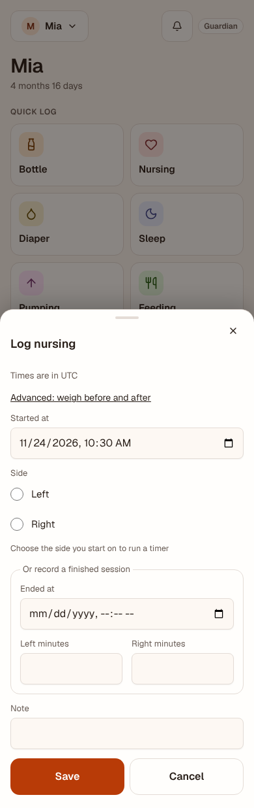 |

What the form refuses:

| You did | It says |
|---|---|
| Chose no side and gave no end | "Choose a side" (`trackers/13-nursing-new-error`) |
| Chose a side and gave an end | "A finished session has no side; clear the side or the end" |
| Gave an end before the start, over 24 hours after it, or in the future | "Enter an end after the start, within 24 hours of it and not in the future" |
| Typed minutes that are not whole numbers or do not fit the session | "Enter whole minutes that fit within the session" |
| Started a second timer | "A nursing timer is already running." with a link, "See Mia's timer", to the home page. The first timer keeps running. While a nursing timer runs the Nursing tile is hidden, so this happens when the timer was started on another phone while your sheet was open (`trackers/17-nursing-second-timer`). |

**Advanced: weigh before and after.** The link "Advanced: weigh before and after" adds **Weight before** and **Weight after** (kilograms, or pounds and ounces; the unit select follows your profile). The form says: "In your weight unit. These weights stay with this session; they are not added to growth. A single-feed reading from a home scale can be off by several grams." In the edit sheet of a session with both weights, a line gives the estimate, for example "Weight gain 62 g, about 60 ml." followed by the basis: the volume assumes about 1.03 g per ml, is not measured, and a single reading from a home scale can be off by several grams (`trackers/15-nursing-edit-estimate`). With both weights but no estimate the line reads "No estimate". **Hide weigh-ins** returns to the simple form; it never deletes a weight.

Editing a finished session shows the minutes per side as whole minutes (`trackers/15-nursing-edit-estimate`). If you do not touch a side's minutes, its exact stored seconds are kept. A running session shows no minutes and no side, only **Started at** and **Ended at** with the hint "Set the end to end the timer" (`trackers/16-nursing-edit-running`). Filling in **Ended at** and saving ends the timer.

A finished session cannot be re-opened: emptying **Ended at** is refused with "A finished session cannot be re-opened; set an end time or delete it". If the timer was ended on another phone while your edit sheet was open, saving shows "This timer has ended; check the times and save again" and the form reloads with the finished values.

### Pumping

1. Open the **Pumping** tile. The form is **Log pumping**.
2. Type **Minutes** (whole minutes, up to 24 hours), the **Volume** with its unit, and choose the **Side**: **Left**, **Right** or **Both**.
3. Press **Save**.

Volume is from 1 to 2000 ml ("Enter from 1 to 2000 ml"). A missing or invalid minutes value says "Enter whole minutes, up to 24 hours"; a missing side says "Choose a side". The capture shows the first of these only, because the form reports one problem at a time.

**Advanced: volume per side.** "Advanced: volume per side" replaces **Volume** and **Side** with **Left volume** and **Right volume** ("Enter at least one side; leave the other blank") and a **Total**. As with bottles, the total reads "0 ml" while you type and is worked out on save; a total outside 1 to 2000 ml says "The total must be from 1 to 2000 ml". **Use one total** goes back, and saving one total on an entry that had volumes per side replaces them ("Saving one total replaces the volumes per side").

| Phone |
|---|
| 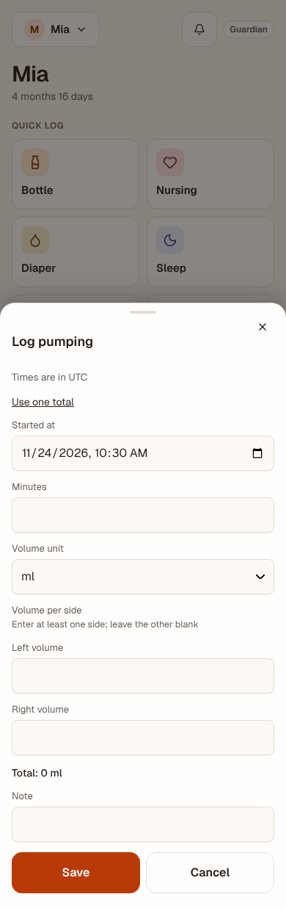 |

### Diaper

1. Open the **Diaper** tile. The form is **Log a diaper**.
2. Choose the **Kind**: **Wet**, **Dirty**, **Both** or **Dry**.
3. Press **Save**.

If you choose nothing the form says "Choose wet, dirty, both or dry" (`trackers/23-diaper-new-error`).

The form is a time, the four kinds as one-choice buttons, and a note (`trackers/22-diaper-new-empty`). An entry opened from the Timeline shows its kind selected in the Edit diaper sheet, for example Dirty with the note "Seedy" (`trackers/24-diaper-edit`).

### Sleep

The **Sleep** tile on the home page is a button, not a link: one press starts a sleep timer now, with no form. You end it from **Running now** on the home page ([Kid home](Kid-home.md)).

The **Log sleep** form, with **Started at** and **Ended at**, exists at the address `/kids/[kid]/log/sleep`, but no tile, button or link in the app opens it, so it is never a sheet: its two pictures below and `trackers/25-sleep-new-empty` show the page. To fix the times of a sleep, press its row on the [Timeline](Timeline.md): the **Edit sleep** sheet has the same two fields (`trackers/26-sleep-edit-finished`). Leaving **Ended at** empty on the Log sleep form starts a timer ("Leave blank to start a timer"). A sleep can run across midnight: an overnight sleep that started at 8:15 PM and ended at 5:40 AM is one entry.

What the form refuses:

| You did | It says |
|---|---|
| Gave an end before the start, over 24 hours after it, or in the future | "Enter an end after the start, within 24 hours of it and not in the future" |
| Started a second timer | "A sleep timer is already running." with the link "See Mia's timer" |
| Emptied the end of a finished sleep | "A finished session cannot be re-opened; set an end time or delete it" |

| Phone | Desktop |
|---|---|
| 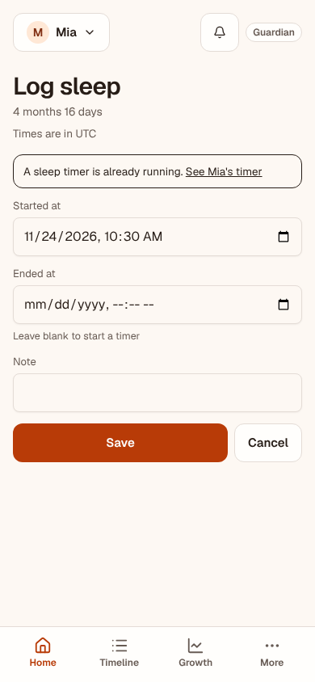 | 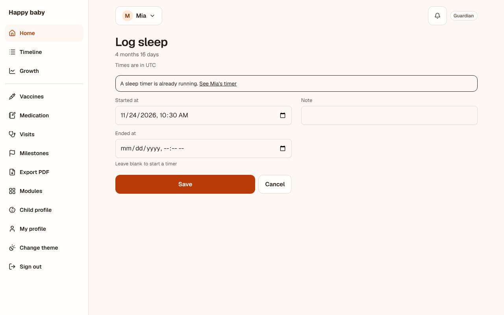 |

Only one sleep timer and one nursing timer can run for a child at a time.

**A timer that ran too long.** A sleep or nursing session can last at most 24 hours. When a timer has been running for longer, its edit sheet says "A timer can last at most 24 hours; set the end time or delete it" (`trackers/29-sleep-edit-overrun`). Set **Ended at** to a time within 24 hours of the start, or delete the entry.

### Meal

1. Open the **Feeding** tile. The form is **Log a meal**.
2. Type **What** was eaten (required, up to 200 characters), and optionally the **Reaction** and a **Note**.
3. Press **Save**.

If **What** is empty the form says "Enter what was eaten"; if it is longer than 200 characters, "Keep what was eaten to 200 characters".

| Phone |
|---|
| 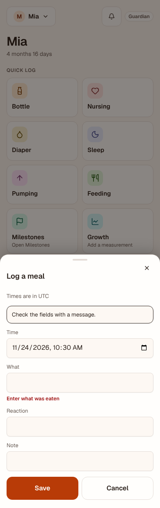 |

A very long word with no spaces stays inside its field: the capture `trackers/33-meal-edit-long-text` shows a 200-character "SweetpotatoSweetpotato..." in the What field and a 200-character note, each clipped to the width of its field, and the sheet does not widen.

### Symptom

1. Open the **Sickness** tile. The form is **Log a symptom**.
2. Choose the **Symptom** from the list: Congestion, Cough, Fever, Vomiting, Diarrhea, Constipation, Rash, Ear pain, Sore throat, Poor appetite, Unusually sleepy or Other.
3. Optionally choose the **Severity**: Mild, Moderate or Severe. It starts on **Not set**.
4. For **Fever**, two more fields appear and both are required: **Temperature** (with **°C** or **°F**) and **Method** (Oral, Rectal, Armpit, Ear, Forehead or Other). For **Other**, a field **Other symptom** appears and is required, up to 80 characters.
5. Press **Save**.

What the form refuses:

| You did | It says |
|---|---|
| Chose no symptom | "Choose a symptom" |
| Chose Fever with no temperature, or a temperature out of range | "Enter a temperature from 30 to 45 °C (86 to 113 °F), with up to two decimals" |
| Chose Fever with no method | "Choose how the temperature was taken" |
| Chose Other with no text, or more than 80 characters | "Enter what the symptom is, up to 80 characters" |

The temperature is shown and typed in your unit. A fever saved as 38.5 °C opens as "38.5 °C" for a parent who uses °C and as "101.3 °F" for one who uses °F, from the same entry (`trackers/39-symptom-edit-fever`, `trackers/40-symptom-edit-fahrenheit`). The form does not convert numbers itself: it shows the stored value for the unit you chose.

| Phone | Desktop |
|---|---|
| 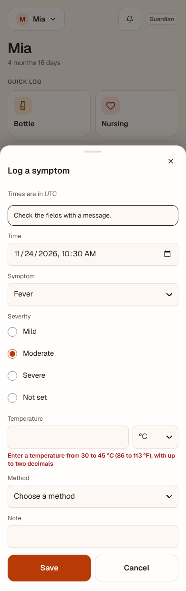 | 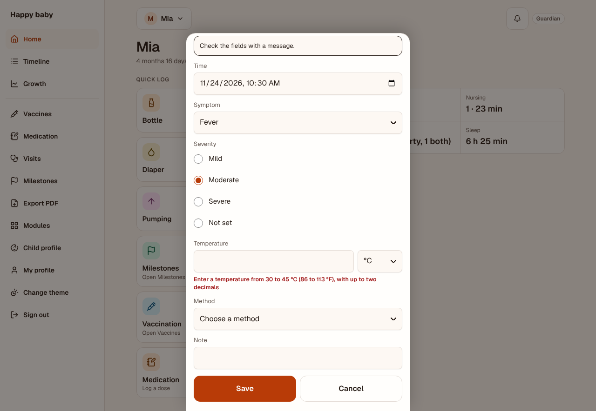 |

Choosing Fever reveals the temperature and method. The capture `trackers/37-symptom-fever-filled` (38.5 °C, oral, moderate) still shows the temperature sentence and the box at the top, because they stay until you save again.

### How do I change or delete an entry?

1. Open the [Timeline](Timeline.md) and press the entry's card. Its edit sheet opens over the Timeline (**Edit bottle**, **Edit nursing**, and so on).
2. Change what you need and press **Save**. The sheet closes, the Timeline shows the change and the message "Entry saved" appears. Only the fields you changed are sent: editing only the note leaves the time and the volume as they were.
3. To delete, press **Delete this entry** at the bottom. It opens a second step: "This removes the entry for everyone with access to Mia." Press **Yes, delete this entry**: the sheet closes and the message "Entry deleted" appears.

| Phone |
|---|
| 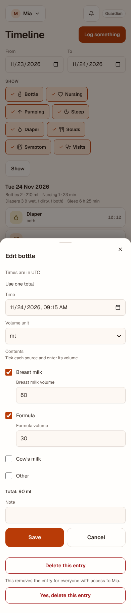 |

Guardians and caregivers can both edit and delete. If the entry no longer exists, or belongs to another child, the page is the same "Not found" page as for any unknown address ([Error pages](Error-pages.md)).

## Screens

| Screen | Route | Who can open it | States captured |
|---|---|---|---|
| Log an entry | `/kids/[kid]/log/[tracker]`, with `tracker` one of `bottles`, `nursing`, `pumping`, `sleep`, `diapers`, `meals`, `symptoms`; `?advanced=1` opens the advanced form for bottles, nursing and pumping | Guardian, caregiver. No grant, or an unknown child or tracker name, is the "Not found" page. | Bottle: `trackers/01-bottle-new-empty`, `02-bottle-new-filled`, `03-bottle-new-no-contents`, `04-bottle-new-volume-range`, `05-bottle-new-future-time`, `06-bottle-new-advanced`, `10-bottle-new-imperial`. Nursing: `12-nursing-new-empty`, `13-nursing-new-error`, `14-nursing-new-weigh-ins`, `17-nursing-second-timer`. Pumping: `18-pumping-new-empty`, `19-pumping-new-error`, `20-pumping-new-advanced`. Diaper: `22-diaper-new-empty`, `23-diaper-new-error`. Sleep: `25-sleep-new-empty`, `28-sleep-second-timer`. Meal: `30-meal-new-empty`, `31-meal-new-error`. Symptom: `34-symptom-new-empty`, `35-symptom-new-error`, `36-symptom-fever-no-temperature`, `37-symptom-fever-filled`, `38-symptom-other` |
| Edit or delete an entry | `/kids/[kid]/log/[tracker]/[entry]` | Guardian, caregiver. Another child's entry, another tracker's entry and a stale id are the same "Not found" page. | Bottle: `07-bottle-edit`, `08-bottle-edit-advanced`, `09-bottle-delete-confirm`, `11-bottle-edit-imperial`. Nursing: `15-nursing-edit-estimate`, `16-nursing-edit-running`. Pumping: `21-pumping-edit`. Diaper: `24-diaper-edit`. Sleep: `26-sleep-edit-finished`, `27-sleep-edit-running`, `29-sleep-edit-overrun`. Meal: `32-meal-edit`, `33-meal-edit-long-text`. Symptom: `39-symptom-edit-fever`, `40-symptom-edit-fahrenheit` |

All ids are under `trackers/`. Each shows the open sheet, over Home for a log form and over the Timeline for an edit, except `25-sleep-new-empty` and `28-sleep-second-timer`, which show the Log sleep page. Each exists as a phone (`-mobile`) and a desktop (`-desktop`) capture.

### Rules the screens show

- **Times** are typed and shown on the child's clock, and the form says which zone. A time in the hour skipped by a daylight-saving change is saved an hour later. A time must not be in the future or before the birth date.
- **Limits:** bottle volume 1 to 1000 ml; pumping volume 1 to 2000 ml; a session (sleep, nursing, pumping) at most 24 hours; what was eaten at most 200 characters, and the reaction at most 200; a note at most 500 characters; an "other" symptom at most 80 characters; a temperature 30 to 45 °C (86 to 113 °F) with up to two decimals. Millilitres are whole numbers; fluid ounces take up to two decimals.
- **Fixed sentences** (exact): "Check the fields with a message."; "Choose at least one"; "Enter from 1 to 1000 ml"; "Enter what was eaten"; "Choose wet, dirty, both or dry"; "Choose a symptom"; "Choose a side"; "A sleep timer is already running."; "A nursing timer is already running."; "See Mia's timer" (the child's name); "A timer can last at most 24 hours; set the end time or delete it"; "A finished session cannot be re-opened; set an end time or delete it"; "A finished session has no side; clear the side or the end"; "This timer has ended; check the times and save again"; "This removes the entry for everyone with access to Mia."
- **One refusal at a time.** The form names the first field the server would name; the order follows each form's field order.
- **A refusal keeps your values.** In a sheet the sheet stays open with everything you typed; without JavaScript the page reloads with them.
- **One running timer per kind.** A second sleep or nursing timer is refused on the form, with a link to the home page where the first one is. Home hides the Nursing tile while a nursing timer runs, and the Sleep tile is a button.
- **A timer ends by setting its end.** An end time in a running timer's edit sheet ends it. A finished session cannot be re-opened.
- **Advanced modes** (bottle, nursing, pumping) are opened by a link. In a sheet the link swaps the form inside the same sheet, and one Back or Close still closes it; on the page it reloads the form. Typed values are not carried across either way. An edit opens in advanced mode when the entry already has per-source or per-side volumes, or weigh-ins, unless the link is followed back to the simple form. Saving the simple form over an advanced entry replaces its parts with the one total; hiding the weigh-ins never deletes them.
- **Units** follow the parent's profile: volume ml or fl oz, weight kg or lb and oz, temperature °C or °F. An entry typed in one unit is shown in another from its stored columns, so the number can differ by rounding (120 ml reads 4.06 fl oz).
- **Delete** is two steps (open, then confirm) and works without JavaScript. It removes the entry for everyone with access.
- **After a save or delete** in a sheet you stay on the page you opened it from (Home or the Timeline), with a message; on the page you land on the Timeline for the entry's local day, not on the child's home.

### Observations

- The **Total** line of the advanced bottle and pumping forms reads "0 ml" while you type; it is computed on save (`trackers/06-bottle-new-advanced`, `trackers/20-pumping-new-advanced`).
- In `trackers/37-symptom-fever-filled` the fields are valid but the earlier temperature sentence and the "Check the fields with a message." box remain, until the next save.

### Not built yet

Nothing on these pages is listed as missing in [Not built yet](Not-built-yet.md), except the Left and Right side tiles for nursing on the home page ([Kid home](Kid-home.md)): a timer is started from this form by choosing a side, not from a tile.

Back to the [wiki home](Home.md).
