# Medical visits

Medical visits keeps a child's appointments: the ones coming up, with a calendar file for your phone, and the ones that happened, with what was said and what was measured, given or prescribed there. Every example below uses fake data: Mia, 4 months, on the frozen day 24 November 2026, with a well-child visit in three days, a dental visit, a cancelled specialist visit and two past visits.

With JavaScript, Add a visit, Edit visit and After the visit open in a sheet over the page you were on, and saving closes the sheet and shows a short message ([Forms in sheets](Forms-in-sheets.md)). The visit itself is a page, not a sheet: it is the visit's home, as the Medication page is for courses.

## Guide

### How do I open Medical visits?

- On a phone: open **More** in the bottom bar, then **Visits**.
- On a desktop: choose **Visits** in the left menu, under Medication.

Visits does not appear in either menu while the module is switched off for the child (see [the module is off](#what-do-i-see-if-medical-visits-is-switched-off)). A guardian and a caregiver both see the pages and can use everything on them.

The page is titled **Medical visits** and shows the child's age and the line "Times are in" followed by the child's time zone: every date and time on these pages is on the child's clock, not yours.

| Phone | Desktop |
|---|---|
| 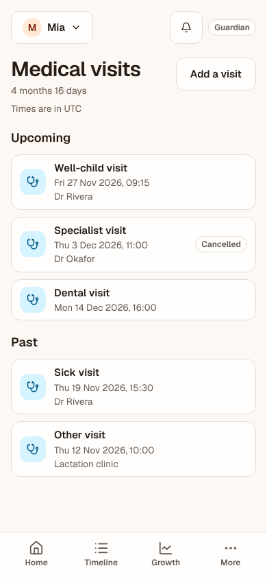 | 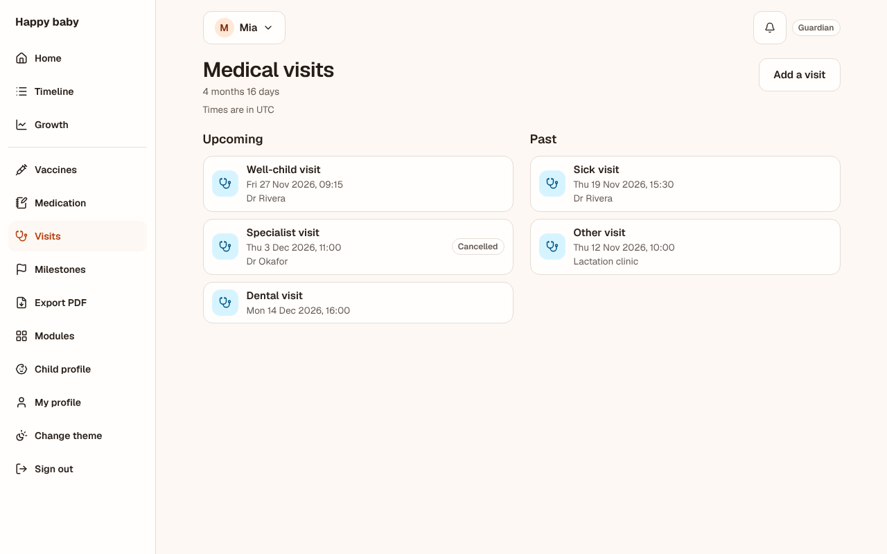 |

### How do I read the list?

The list has two groups:

- **Upcoming**: the visits still to come, soonest first.
- **Past**: the visits that have happened, newest first.

Each row shows the kind of visit ("Well-child visit", "Sick visit", "Specialist visit", "Dental visit", "Emergency visit" or "Other visit"), the date and time, for example "Fri 27 Nov 2026, 09:15", and the doctor or clinic when one was typed. A cancelled visit keeps its place in the list with a **Cancelled** badge. Tap a row to open the visit.

With no visit yet, the page says "No visits yet." with an **Add a visit** button (shot `01-no-visits`).

### How do I add a visit?

1. On Medical visits choose **Add a visit**.
2. Fill in:
   - **Date and time**: it starts at now. A visit can be from the child's birth date up to 731 days ahead.
   - **Length (minutes)**: 30 to begin with, from 5 to 720.
   - **Kind**: one of the six kinds above. You must choose one.
   - **Doctor or clinic (optional)**, up to 120 characters.
   - **Place (optional)**, up to 200 characters.
   - **Reason (optional)**, up to 500 characters.
3. Choose **Save**. The sheet closes, the visit is in the list and the message "Visit added" appears. Without JavaScript you land on the list.

| Phone | Desktop |
|---|---|
| 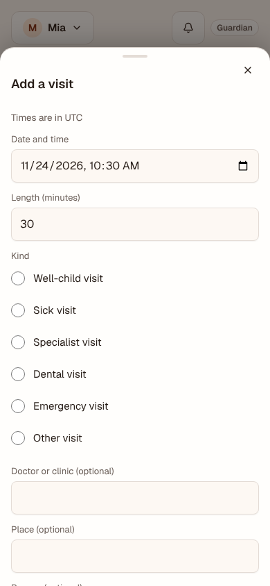 | 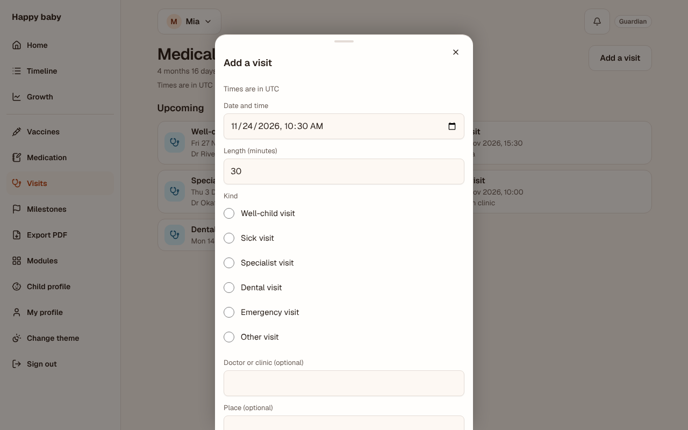 |

A refused save keeps what you typed, shows "Check the fields with a message." and puts the message under the field:

- "Enter a date and time from the birth date to 731 days from now"
- "Enter a length from 5 to 720 minutes"
- "Choose a kind"
- "Enter a doctor or clinic of up to 120 characters"
- "Enter a place of up to 200 characters"
- "Enter a reason of up to 500 characters"

A child can have at most 2,000 visits. Past that, Save is refused with "This child has the most visits the app keeps (2,000)."

### How do I read a visit?

The visit's page shows the kind as its title with a badge (**Upcoming**, **Past** or **Cancelled**), then:

- the day, the time and the length, for example "Friday 27 November 2026, 09:15 · 30 min";
- the doctor or clinic and the place, for example "Dr Rivera · Northside Clinic, room 4";
- "Reason:" and the reason;
- "Times are in UTC" (the child's zone).

Below are **Edit visit**, **Cancel visit** (or **Restore visit** on a cancelled visit) and, at the foot, **Delete visit**.

| Phone | Desktop |
|---|---|
| 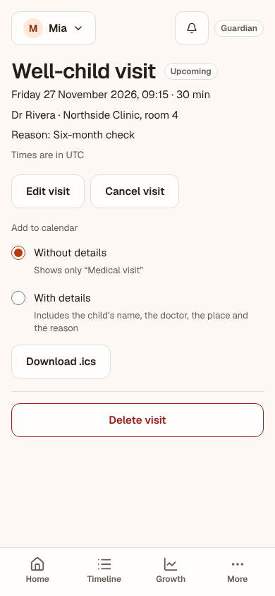 | 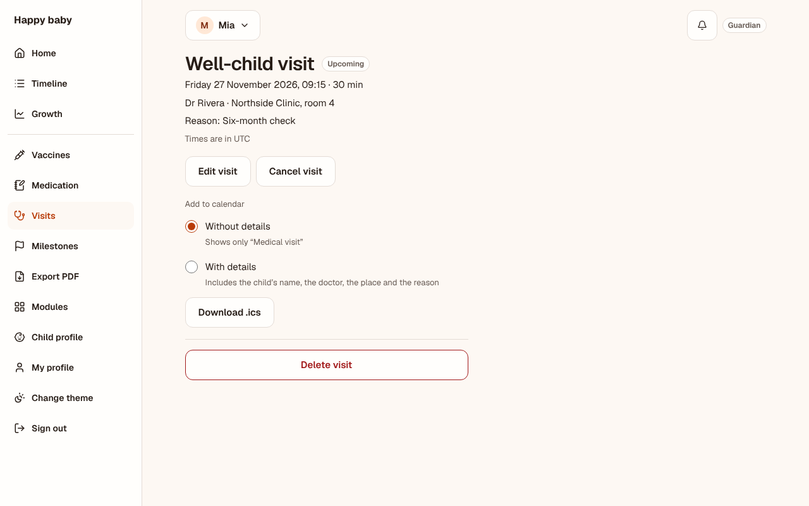 |

### How do I put a visit in my phone's calendar?

On an upcoming or cancelled visit, **Add to calendar** offers two choices:

- **Without details** (chosen to begin with): "Shows only “Medical visit”". The calendar entry carries no name, doctor, place or reason, so a shared or synced calendar shows nothing private.
- **With details**: "Includes the child’s name, the doctor, the place and the reason".

Choose **Download .ics** and open the file with your calendar. The file names the visit, not the download, so after a change you can download it again for the same entry; a cancelled visit's file says the entry is cancelled. How a calendar app handles a second file for the same entry is up to the app. A past visit has no calendar choice.

### How do I change or cancel a visit?

- **Edit visit** opens the same fields as Add a visit, holding the stored values. Choose **Save**; the message is "Visit saved".
- **Cancel visit** marks the visit cancelled at once ("Visit cancelled"). It stays in the list with its badge, and **Restore visit** brings it back ("Visit restored").

| Phone |
|---|
| 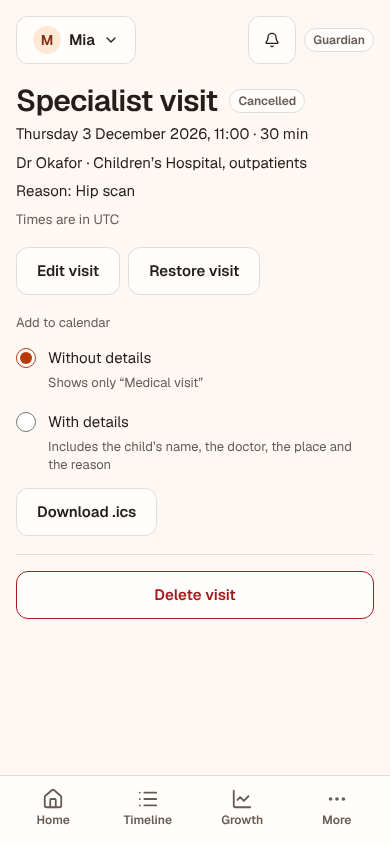 |

A visit that has notes or records from the visit cannot be cancelled, or moved to a date that has not come yet. Both are refused with "This visit has notes or records from the visit. Remove them first, or delete the visit." If someone changed the visit on another phone while you had it open, the save shows "Someone changed this visit on another phone. It’s shown now; your entries are kept."

### How do I record what happened at the visit?

Once a visit is past, its page has a **Record the visit** link. It opens **After the visit**:

1. **Notes from the visit**: what the doctor said, up to 4,000 characters.
2. Tick **Add a growth measurement** to show the Growth fields, with the visit's date filled in.
3. Tick **Add vaccines given** to show the vaccination fields. **Add another vaccine** adds a block, up to 10.
4. Tick **Add a medication** to show the course fields. **Add another medication** adds a block, up to 5.
5. Choose **Save**. The message is "Visit recorded".

A box is offered only when its module is on for the child. What you add is saved in Growth, Vaccines and Medication as if you had added it there, and each record remembers the visit.

| Phone | Desktop |
|---|---|
| 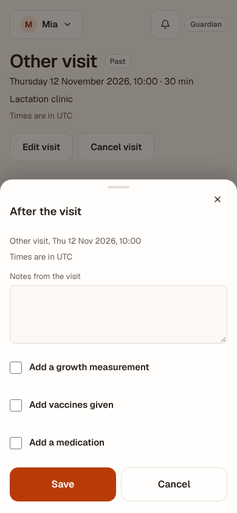 | 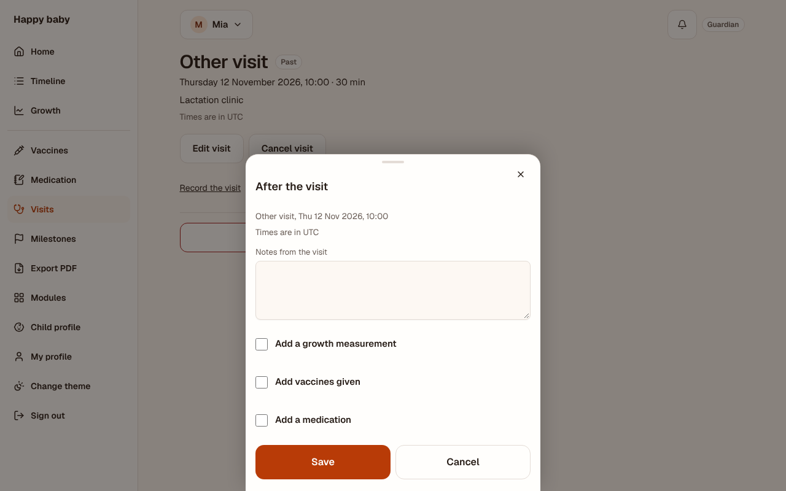 |

If a field is refused, the sheet stays open with "Check the fields with a message." and the message names the block it belongs to, for example "Vaccine 2: Enter a lot number of up to 40 characters". Nothing is saved until every block is right. Saving with no notes and nothing ticked is refused with "Write notes from the visit, or tick something to add". An upcoming visit refuses the form with "This visit hasn’t happened yet."

| Phone |
|---|
| 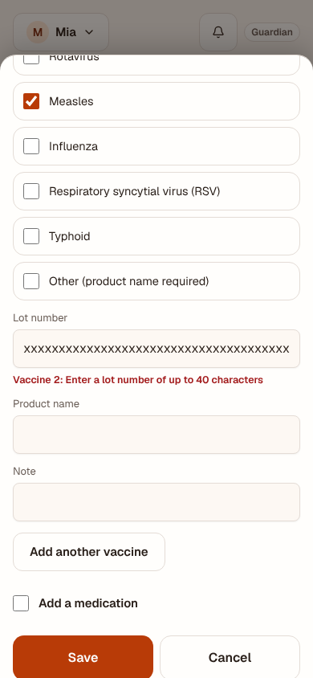 |

Afterwards the visit's page shows **After the visit** with the notes and **Recorded at this visit** with one row per record (Growth and its date, Vaccines and its date, Medication and the course's name), each opening that record. The link is now **Add more from the visit**.

| Phone | Desktop |
|---|---|
| 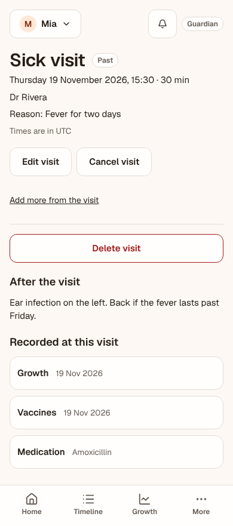 | 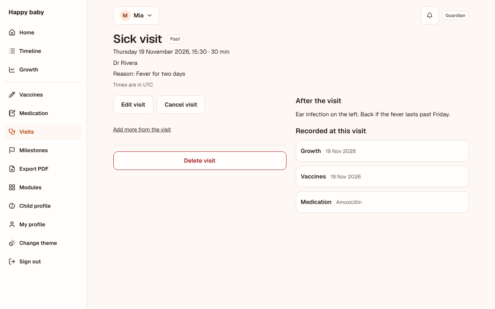 |

A record made at a visit says so on its own edit sheet in Growth, Vaccines or Medication: a **Recorded at a visit** link at the top opens the visit (shot `15-recorded-at-a-visit`).

### How do I delete a visit?

1. At the foot of the visit's page choose **Delete visit**. A confirm step opens under it.
2. If the visit recorded something, the step lists it first, for example "This visit recorded: 1 growth measurement, 1 vaccine, 1 medication, with its 1 logged dose", and a box **Also delete these records**, ticked. Untick it to keep them: the line "The records stay in Growth, Vaccines and Medication." appears. A visit with nothing recorded says only "This deletes the visit."
3. Choose **Yes, delete this visit**, or **Cancel** to close the step. The message is "Visit deleted" and you are back on the list.

| With records | Nothing recorded |
|---|---|
| 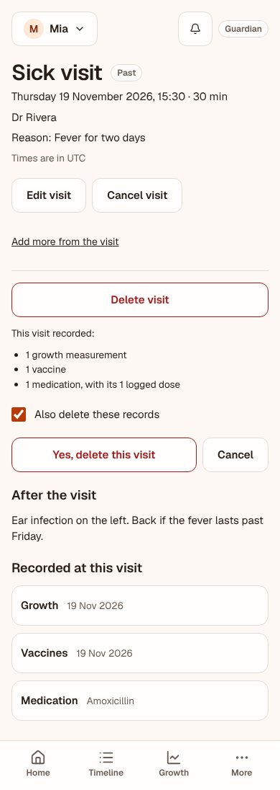 | 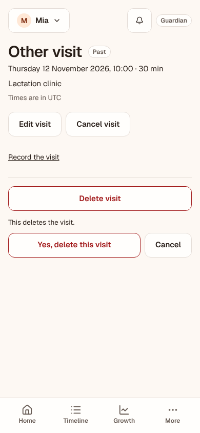 |

### Where else do visits appear?

- **Home**: an upcoming visit in the next seven days is a line in **Due**, for example "Well-child visit, Fri 27 Nov, 09:15", after the medication and vaccine lines; it opens the visit. When Due is full, the rest are counted as "N more on the Visits page". See [Kid home](Kid-home.md).
- **Timeline**: a **Visits** chip shows one row per visit on its day, "Cancelled" under a cancelled one; the row opens the visit. See [Timeline](Timeline.md).
- **Export PDF**: a **Medical visits** chip adds the visits of the range to the PDF. See [Export PDF](Export-PDF.md).

| Home's Due | Timeline, Visits only |
|---|---|
| 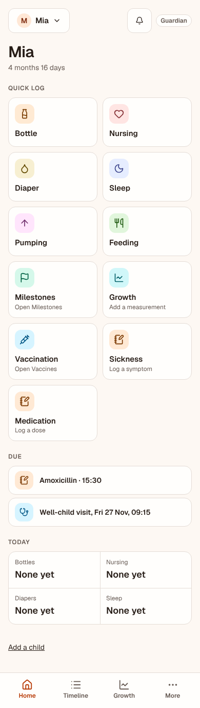 | 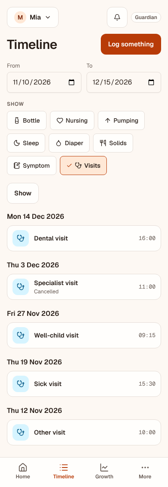 |

### What do I see if Medical visits is switched off?

A guardian can switch Medical visits off on [Children and access](Children-and-access.md#how-do-i-turn-a-module-on-or-off). The visits are kept; nothing is deleted. The page then shows a card: "Medical visits is switched off for Mia" and "Visits are kept. Nothing is deleted.", with **Open modules** for a guardian and "A guardian can switch it on." for a caregiver. Home's Due list no longer shows them, and the Timeline's **Visits** chip starts unticked.

| Phone |
|---|
| 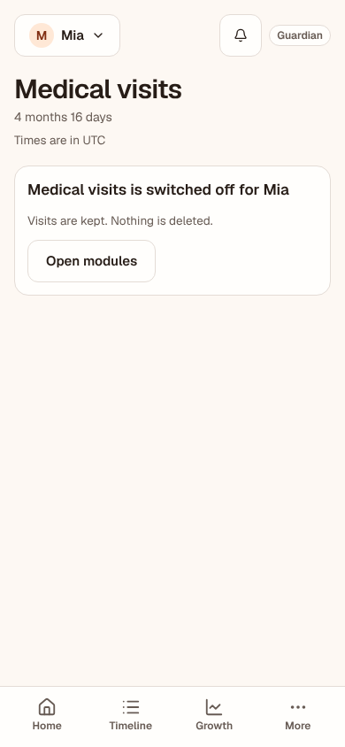 |

### Does it work without JavaScript?

Yes. Each sheet is also a page: `/visits/new`, `/visits/[visit]/edit` and `/visits/[visit]/outcome`. Cancel, Restore and Delete are form posts; the delete confirm is a disclosure, and the line under **Also delete these records** follows the box without a script. **Add to calendar** is a plain form that downloads the file. Without JavaScript, After the visit offers one vaccine block and one medication block per save; save again to add more.

## Screens

| Screen | Route | Who can open it | States captured |
|---|---|---|---|
| Medical visits | `/kids/[kid]/visits` | guardian, caregiver | `01-no-visits`, `02-list`, `16-module-off`, `17-caregiver` |
| A visit | `/kids/[kid]/visits/[visit]` | guardian, caregiver | `03-visit-upcoming`, `04-visit-past-no-outcome`, `05-visit-past-outcome`, `06-visit-cancelled`, `07-delete-confirm-linked`, `08-delete-confirm-plain` |
| Add a visit (sheet) | `/kids/[kid]/visits/new` | guardian, caregiver | `09-add-sheet` |
| Edit visit (sheet) | `/kids/[kid]/visits/[visit]/edit` | guardian, caregiver | `10-edit-sheet` |
| After the visit (sheet) | `/kids/[kid]/visits/[visit]/outcome` | guardian, caregiver | `11-outcome-sheet`, `12-outcome-refused` |
| Calendar file | `/kids/[kid]/visits/[visit]/calendar` | guardian, caregiver | a download, not captured |
| Home, Timeline, Growth | see the pages | guardian, caregiver | `13-home-due`, `14-timeline-visits`, `15-recorded-at-a-visit` |

Nobody else can open these pages: a parent with no grant on the child, an unknown child, and a visit that is not the child's all get the same 404 page (see [Error pages](Error-pages.md)). The admin never sees a child. All the shots are in the [screenshot catalogue](../screenshots/README.md#visits).

### Rules the screens show

- Kinds: well-child, sick, specialist, dental, emergency, other. Status is worked out on every read: upcoming until the start, then past; cancelled when cancelled.
- Date and time from the birth date to 731 days ahead; length 5 to 720 minutes (30 by default); doctor or clinic up to 120 characters, place up to 200, reason up to 500, notes from the visit up to 4,000.
- Limits: 2,000 visits per child; up to 10 vaccines and 5 medications in one After the visit save.
- Notes and records can be added only once the visit is past. A visit with notes or records cannot be cancelled or moved ahead of now.
- Delete asks first, and says what the visit recorded; the records go with it only while **Also delete these records** is ticked.
- The calendar file is private by default ("Without details").
- Switching child on a visit page lands on the other child's Home, not on their visits.
- Every time is on the child's clock ("Times are in Europe/Madrid" for Leo, shot `17-caregiver`).

Not built yet: looking up a doctor in the US provider registry (NPI). See [Not built yet](Not-built-yet.md).

Back to the [wiki home](Home.md).
