# Medication

Medication keeps a list of **courses** (a medicine, its dose and when it is given) and a log of the **doses** given. Every example below uses fake data: Mia, 4 months, and her courses Calpol, Amoxil and Vitamin D.

With JavaScript, the Add a course, Edit course and Edit dose forms open in a sheet over the page you were on, and saving closes the sheet and shows a short message ([Forms in sheets](Forms-in-sheets.md)). The steps are the same. Pictures of the open sheet are marked as such; the other form screenshots below show the same form as a page, which is what you get without JavaScript, in a new tab or when you open the address directly. After a save in a sheet you stay on the Medication page; after a save on the page you land where the steps say.

## Guide

### How do I open the Medication page?

- On a phone: open **More** in the bottom bar, then **Medication**.
- On a desktop: choose **Medication** in the left menu.

Medication does not appear in either menu while the module is switched off for the child (see [the module is off](#what-do-i-see-if-medication-is-switched-off)). A guardian and a caregiver both see the page and can use everything on it.

The page shows the child's age, the line "Times are in" followed by the child's time zone (every time on these pages is on the child's clock, not yours), the **Courses** and the **Recent doses**.

| Phone | Desktop |
|---|---|
| 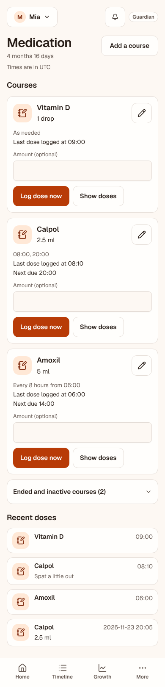 | 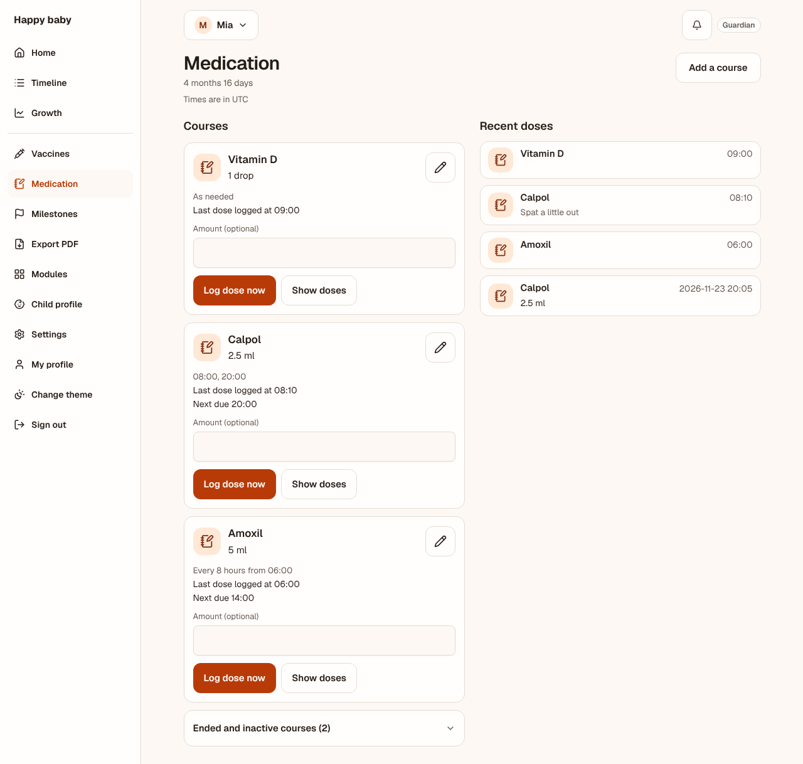 |

On the phone the courses come first and the recent doses below. On the desktop they sit side by side.

### How do I read a course?

Each course card shows:

- the name and the dose, for example "Calpol" and "2.5 ml";
- the schedule: "As needed", the times such as "08:00, 20:00", or "Every 8 hours from 06:00";
- "Last dose logged at 08:10", or "No dose logged yet";
- "Next due 20:00" for a course that has a schedule. An "As needed" course never shows a next due.

A time that is not today shows its date first, for example "2026-11-23 20:05", so a time is never read as today's.

### How do I add a course?

1. On the Medication page choose **Add a course**.
2. Type a **Name** and a **Dose**. Each can be up to 80 characters.
3. Under **Schedule** pick one of three ways to give it:
   - **As needed** (the default): no times, no next due.
   - **At fixed times**: twelve time fields appear (Time 1 to Time 12). Fill the ones you want; each time of day can be used once.
   - **Every few hours**: an **Hours between doses** field appears. Enter a whole number from 1 to 168. The hours are counted from **Start**.
4. Optional: **Start** (leave it blank to start now), **Last day (optional)**, **Active** (ticked by default) and a **Note**.
5. Choose **Save**. The sheet closes, the course is on the page and the message "Course added" appears. Without JavaScript you land back on the Medication page.

| Phone, the sheet |
|---|
| 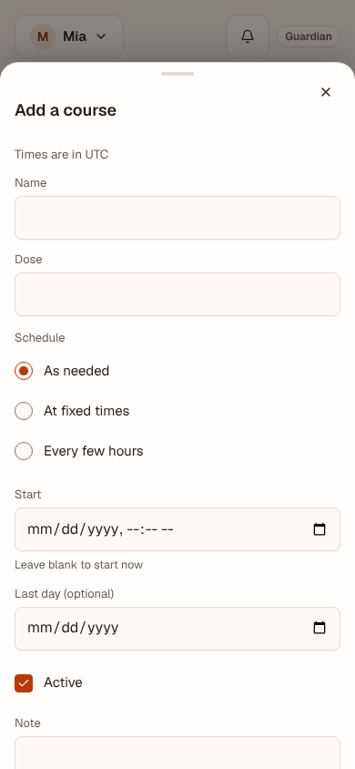 |

A course prescribed at a medical visit can also be added from the visit, with **Record the visit** ([Medical visits](Medical-visits.md)); its edit sheet then has a **Recorded at a visit** link that opens it.

Choosing another schedule kind keeps what you typed in the other kind, so you can switch back.

Shot `14-new-course-fixed-times` shows this with 08:00 AM, 02:00 PM and 08:00 PM filled in. The Name field in it still shows "Enter a name of up to 80 characters" from the earlier refused save: the message stays until the next save.

For every few hours, the form shows the field "Hours between doses" with the hint "A whole number from 1 to 168, counted from the start below" (shot `15-new-course-every-hours`).

A child can have at most 50 courses. Past that, Save is refused with "This child has the maximum number of medication courses" and what you typed is kept.

### What does a refused course look like?

The form does not save and keeps everything you typed; in a sheet, the sheet stays open. The message sits under the field that failed, and only the first failing field is marked (checked in the order Name, Dose, Schedule, Start, Last day, Active, Note). For an empty form the message is "Enter a name of up to 80 characters" under Name.

| Phone, the page |
|---|
| 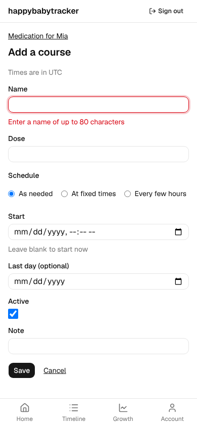 |

The other messages are:

- Dose: "Enter a dose of up to 80 characters"
- Schedule: "Choose as needed, up to 12 different times of day, or a whole number of hours from 1 to 168"
- Start: "Enter a start that is not before the birth date"
- Last day: "Enter a last day that is a real date and not before the start"
- Note: up to 500 characters

### How do I log a dose now?

1. On the course card, optionally type an **Amount (optional)**, up to 80 characters.
2. Choose **Log dose now**.

The dose is recorded at the current time. The card then shows "Last dose logged at" with that time, and the dose appears first in **Recent doses**, with the amount if you typed one. The field is emptied for the next dose. In the picture, Vitamin D was logged with "2 drops" at 10:30.

| Phone |
|---|
| 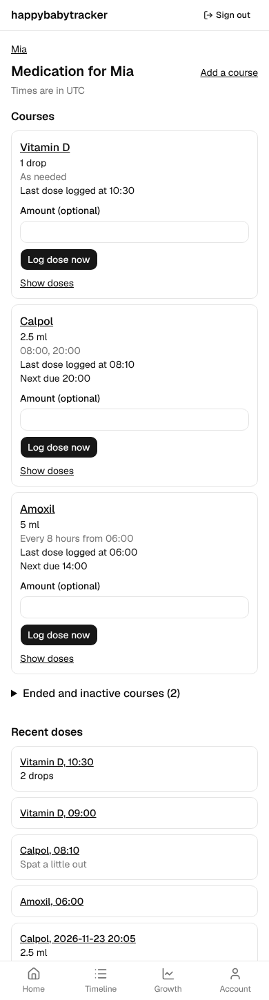 |

If the amount is longer than 80 characters, the message "Enter an amount of up to 80 characters" appears on that course's card only and the other cards are untouched. A course that was deleted from another device gives "This course is no longer in the list" above the list. At 5000 logged doses for a child, the message is "This child has the maximum number of logged doses".

### How do I see the doses of one course?

Choose **Show doses** on its card. The list below becomes "Doses of Calpol" (the course's name), with a **Show all doses** link above it. Log dose now keeps the filter. Choose **Show all doses** to go back to **Recent doses**.

| Phone |
|---|
| 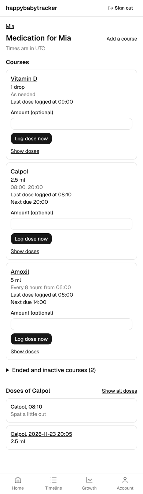 |

### Where are paused and ended courses?

Below the active courses, a collapsed row reads "Ended and inactive courses (2)", where the number is how many there are. Open it to see them. A course is listed there when it is not **Active**, or when its **Last day** is before today (the last day itself still counts as running). These courses keep **Log dose now** and **Show doses** but show no "Next due".

Shot `03-ended-courses-open` shows it open with "Paused cream" (an inactive course) and "Old antibiotic" (an every-12-hours course).

### How do I change or delete a course?

1. On the course card choose the pencil button (named "Edit" followed by the course name).
2. Change the fields. The form opens with the stored values, and the Start hint reads "Leave blank to keep the current start".
3. Choose **Save**, or **Cancel** to leave.

To delete it, choose **Delete this course**. This opens a second step that says "This removes the course for everyone with access to Mia." and, for example, "This also deletes the 2 doses logged for this course." Choose **Yes, delete this course** to confirm. The doses of the course go with it. To keep the history but stop the course, untick **Active** instead.

| Phone, the sheet | Phone, the page |
|---|---|
| 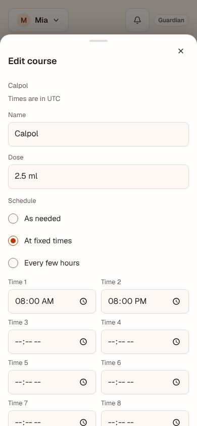 | 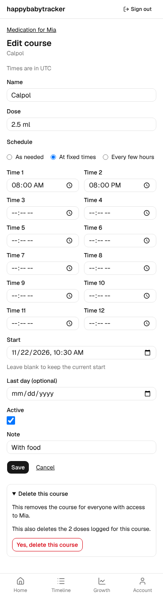 |

### How do I change or delete a dose?

1. In **Recent doses**, choose the dose.
2. On **Edit dose**, change **Given at**, **Amount** or **Note**, then choose **Save**.
3. To delete it, choose **Delete this dose**, then **Yes, delete this dose** ("This removes the dose for everyone with access to Mia."). The dose is removed and the course's "Last dose" follows.

A refused edit keeps what you typed and shows the message under the field: "Enter an amount of up to 80 characters" for the amount.

| Phone, the page |
|---|
| 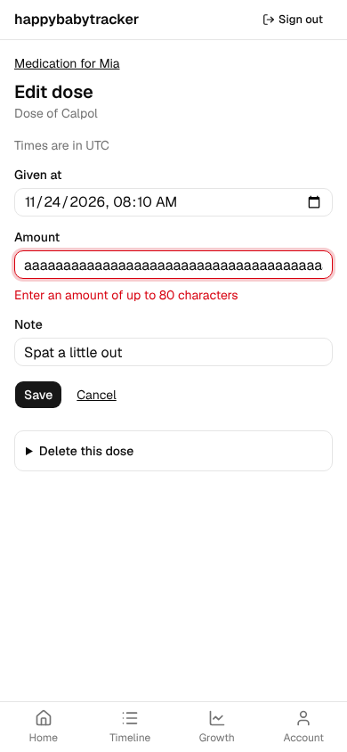 |

### What do I see if Medication is switched off?

A guardian can switch Medication off for a child on [Children and access](Children-and-access.md#how-do-i-turn-a-module-on-or-off). The courses and doses are kept; nothing is deleted. The Medication page then shows a card instead of the courses:

- Heading: "Medication is switched off for Mia" (the child's name).
- "Courses and doses are kept. Nothing is deleted."
- A **guardian** also sees an **Open modules** button.
- A **caregiver** sees "A guardian can switch it on." and no button.

| Guardian (phone) | Guardian (desktop) | Caregiver (phone) |
|---|---|---|
| 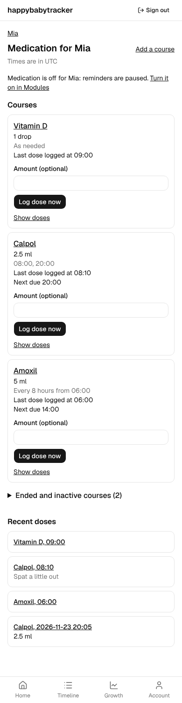 | 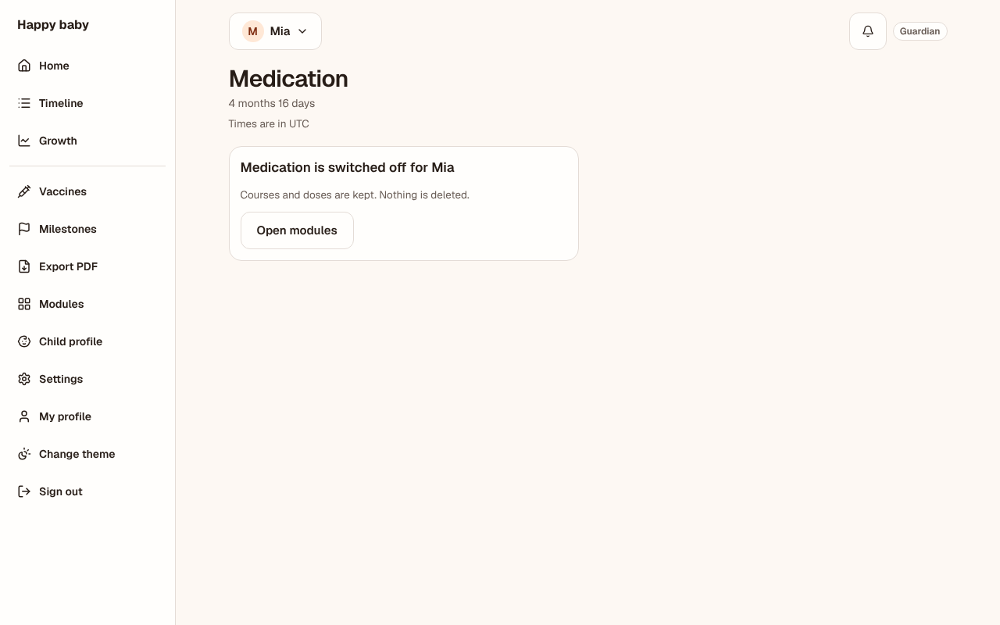 | 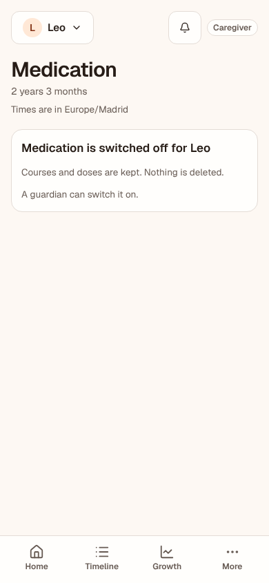 |

## Screens

| Screen | Route | Who can open it | States captured |
|---|---|---|---|
| Medication | `/kids/[kid]/medication` | guardian, caregiver | `01-no-courses`, `02-courses`, `03-ended-courses-open`, `04-doses-filtered-by-course`, `05-dose-logged-now`, `16-module-off-guardian`, `17-module-off-caregiver-long-name` |
| Add a course | `/kids/[kid]/medication/new` | guardian, caregiver | `12-new-course-empty`, `13-new-course-errors`, `14-new-course-fixed-times`, `15-new-course-every-hours` |
| Edit course | `/kids/[kid]/medication/[medication]` | guardian, caregiver | `09-course-edit`, `10-course-delete-confirm`, `11-course-edit-every` |
| Edit dose | `/kids/[kid]/medication/doses/[dose]` | guardian, caregiver | `06-dose-edit`, `07-dose-edit-error`, `08-dose-delete-confirm` |

Nobody else can open these pages: a parent with no grant on the child, an unknown child, and a course or dose that is not the child's all get the same 404 page (see [Error pages](Error-pages.md)). The admin never sees a child. All the shots are in the [screenshot catalogue](../screenshots/README.md#medication).

### Rules the screens show

- Name, dose and a dose's amount: 1 to 80 characters (the dose's amount is optional). Note: up to 500 characters.
- Schedule: as needed, 1 to 12 different times of day (HH:MM), or every 1 to 168 whole hours counted from the start.
- Start must not be before the child's birth date. Last day must be a real date, not before the start, and is inclusive.
- Limits per child: 50 courses and 5000 doses.
- An edit sends only the fields that changed. A blank Start on edit keeps the stored start.
- Courses and doses are editable and deletable by a guardian and a caregiver alike. Deleting needs two steps (open the delete section, then the confirm button), and works without JavaScript.
- "Next due" is read from the schedule; the app shows the schedule and never suggests one.
- With the module off, the nav hides Medication; the page itself answers with the switched-off card, the Add a course button is not shown, and data is kept.
- Every time is on the child's clock (the line "Times are in Europe/Madrid" for Leo, "Times are in UTC" for Mia).

Back to the [wiki home](Home.md).
