# Milestones

The Milestones page holds the checklists of things many children do by a given age (from the catalogue the app ships), lets you record the day a child did one, and keeps your own milestones. All screenshots show fake data (for example Nell, 9 months, with placeholder items such as "Stub item 9m-se-1") on a frozen day, 24 November 2026. The full list of captured screens is in the [screenshot catalogue](../screenshots/README.md).

With JavaScript, the Mark as reached, Add a milestone and Edit milestone forms open in a sheet over the page you were on, and saving closes the sheet and shows a short message ([Forms in sheets](Forms-in-sheets.md)). The steps are the same. Pictures of the open sheet are marked as such; the other form screenshots below show the same form as a page, which is what you get without JavaScript, in a new tab or when you open the address directly. After a save in a sheet you stay on the page you opened it from; after a save on the page you land where the steps say.

The app never judges development. The page states facts and the next action only: a milestone is either unmarked or it carries the line "Reached on 24 November 2026". There is no colour, icon, check, count or progress on a milestone, and the page's own words are tested to keep to this (see section 9 of the [design rules](../plans/ui-redesign/design-system/DESIGN.md)). Questions about what a list means for your child are for your clinic.

## Guide

### How do I find my child's list?

1. Open **Milestones**: it is in **More** on a phone, and in the side navigation on wider screens.
2. Under the title you see the child's age ("9 months").
3. The checklists are folded cards in age order: "By 2 months", "By 4 months", "By 6 months", "By 9 months", "By 1 year", "By 15 months", "By 18 months", "By 2 years", "By 30 months", "By 3 years", "By 4 years" and "By 5 years".
4. The list for the child's age is open and says "Current list for this age". The link **Go to the current list** jumps to it. Tap any other card to open or close it.
5. Inside a list the items are grouped under four headings: **Social/Emotional**, **Language/Communication**, **Cognitive (learning, thinking, problem-solving)** and **Movement/Physical Development**.

Beside the lists (below them on a phone) the page always shows the catalogue's screening note and its attribution. They cannot be folded away. In these screenshots they read "Stub screening note." and "Stub attribution, not reference data." because the data is fake.

| Phone | Desktop |
|---|---|
| 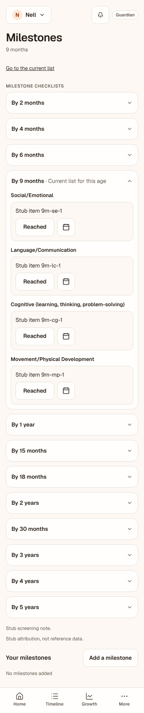 | 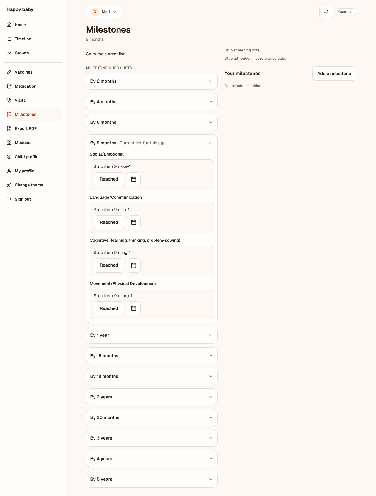 |

### How do I mark a milestone as reached?

**With one tap** (the day is today):

1. Open the list and tap **Reached** on the item.
2. The item now reads "Reached on 24 November 2026" with a pencil button to edit it.

| Phone |
|---|
| 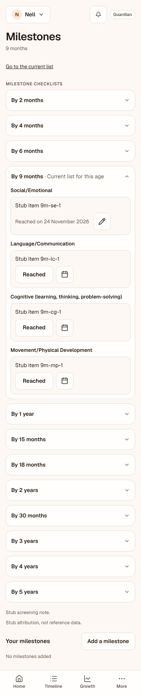 |

**With another date or a note** (for something that happened earlier):

1. Tap the calendar button next to **Reached** ("Choose a date for ..."). **Mark as reached** opens with the item's text.
2. Change **Date reached**. It starts as today and cannot be in the future or before the birth date.
3. Add a **Note** if you want one.
4. Tap **Save**. The sheet closes (without JavaScript, you return to the list). The list shows the date; the note is kept on the item's edit form.

| Phone, the sheet |
|---|
| 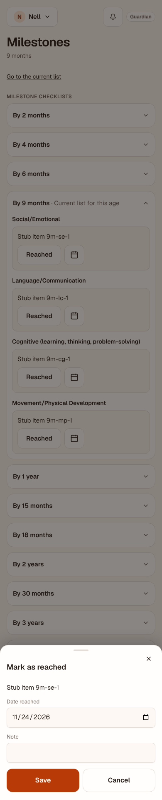 |

If the date is wrong, a box at the top says "Check the fields with a message." and the field says "Enter a date that is not in the future and not before the birth date" (shot `12-mark-future-date`).

| Phone | Phone |
|---|---|
| 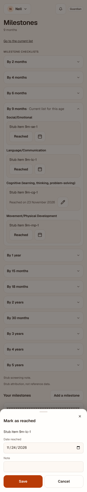 | 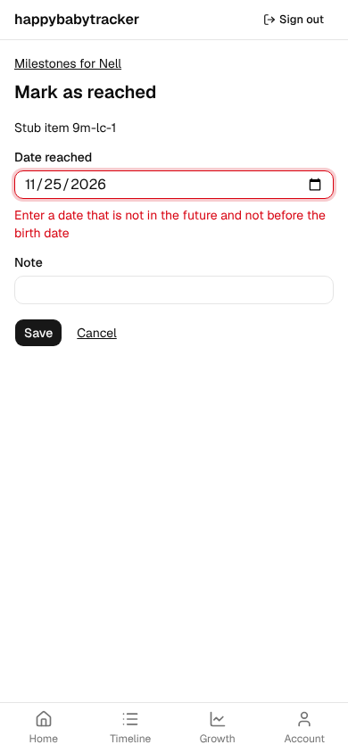 |

If someone marked the same item on another device in the meantime, the item shows "Already marked as reached" in its own row (shot `04-already-reached`). Reload the page to see the date.

### How do I change a date or note, or undo a mark?

1. Tap the pencil button on a reached item. The **Edit milestone** page shows the item's text, **Date reached** and **Note**.
2. Change them and tap **Save**.
3. To undo, tap **Undo reached**. A box opens: "This removes the date for everyone with access to Nell." Tap **Yes, undo reached**. The item goes back to its list with its **Reached** button.

The app does not show an undo toast after marking. Undo is on the edit page. See [Not built yet](Not-built-yet.md).

| Phone | Phone |
|---|---|
| 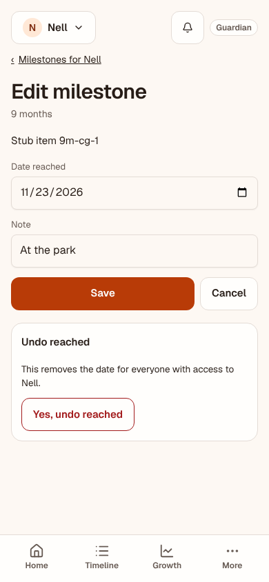 | 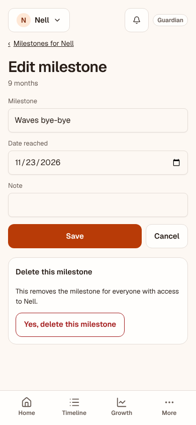 |

### How do I add a milestone of my own?

1. Under **Your milestones**, tap **Add a milestone**.
2. Type the **Milestone** (at most 200 characters), check **Date reached** and add a **Note** if you want one.
3. Tap **Save**. It appears under **Your milestones** with its date.

A text over 200 characters is refused with "Enter a milestone of up to 200 characters" and your text stays (shot `14-new-custom-201-chars`). A long text without spaces wraps inside its card (shot `10-reached-and-custom`).

To change a milestone of your own, tap its pencil. You can edit the text, the date and the note, or tap **Delete this milestone** and then **Yes, delete this milestone** ("This removes the milestone for everyone with access to Nell.", shot `17-edit-custom-delete-confirm`). The shot `13-new-custom` shows the empty form.

Both kinds of change can also hit these messages: "This milestone is no longer in the list" and "This child has the maximum number of recorded milestones".

### What does the page show for a child close to 5 years?

At 4 years 11 months the **By 4 years** list is the current one and **By 5 years** can already be used. A mark you made on an item that has since left the lists stays under **Reached, no longer in the lists**, with its text and date, and you can still edit or undo it.

From the 5th birthday there are no lists. The page then shows **Reached**, the catalogue items you marked (each with its list and heading, for example "By 5 years · Language/Communication") or "No milestones recorded", and **Your milestones** below.

| Phone | Phone |
|---|---|
| 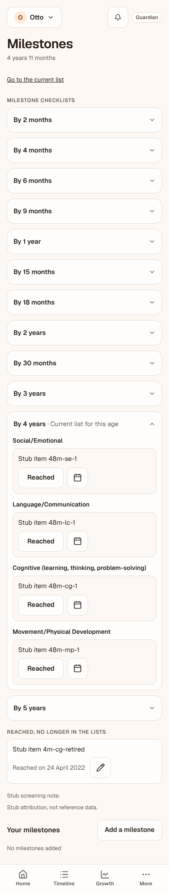 | 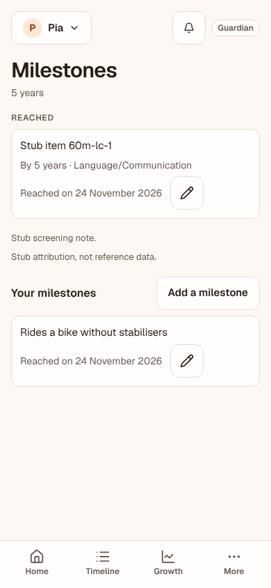 |

### What if my child was born early?

For a child born early the header shows both ages, for example "3 months (corrected 1 month 5 days)". The current list follows the corrected age. Until the corrected age reaches the first list, the first list is open and marked **Next list**, and the link reads **Go to the next list** (shot below). Once the corrected age reaches a list's age, that list is the current one.

| Phone |
|---|
| 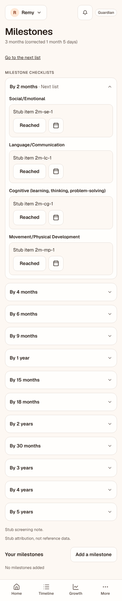 |

### What if the Milestones module is switched off?

A guardian can switch Milestones off for a child on the Modules page. The Milestones entry then leaves the navigation, but the page still opens when you go to it. At the top it says "Milestones are off for Sami." A guardian also sees the link **Turn it on in Modules**. A caregiver sees only the sentence.

In the captured states the lists are still shown under that sentence. The end-to-end test then marks an item: the sentence disappears and Milestones is back on the child's Home page.

| Guardian | Caregiver |
|---|---|
| 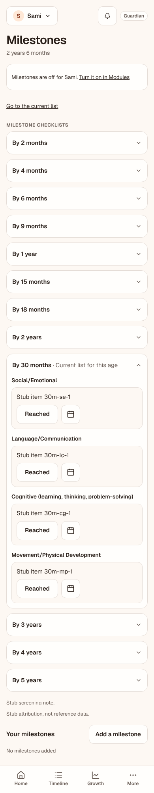 | 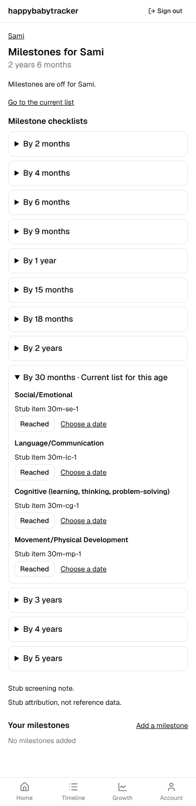 |

### Can a caregiver use Milestones?

Yes. A caregiver can mark, edit, undo and add milestones.

## Screens

| Screen | Route | Who can open it | States captured |
|---|---|---|---|
| Milestones | `/kids/[kid]/milestones` | Guardian, caregiver. Admin: sent to `/admin/parents`. Signed out: sent to the sign-in page. No grant: the 404 page, identical to an unknown child | `01-nell-9-months`, `02-nell-all-lists-open`, `03-one-tap-reached`, `04-already-reached`, `05-otto-4-years-11-months`, `06-pia-5th-birthday`, `07-remy-preterm`, `08-sami-off-guardian`, `09-sami-off-caregiver`, `10-reached-and-custom` |
| Mark as reached / Add a milestone | `/kids/[kid]/milestones/new` (with `?item=` for a list item; without it, the custom form) | Guardian, caregiver | `11-mark-with-date`, `12-mark-future-date`, `13-new-custom`, `14-new-custom-201-chars` |
| Edit milestone | `/kids/[kid]/milestones/[entry]` | Guardian, caregiver. No grant, an unknown entry and another child's entry are the same 404 page | `15-edit-item-mark`, `16-undo-reached-confirm`, `17-edit-custom-delete-confirm` |

### Rules the screens show

- **No judgement**: reached and not reached differ only by the "Reached on {day month year}" line. No colour, icon, check, count or progress. The e2e test "the page's own words avoid every judgement word" asserts it on the lists, the forms and the edit page.
- **Lists**: twelve, at 2, 4, 6, 9, 12, 15, 18, 24, 30, 36, 48 and 60 months, titled "By ..." and grouped under four domain headings. Only the current list (or the next one) starts open.
- **Age used**: the corrected age for a child born early, so the page shows both ages.
- **After the 5th birthday**: no lists; reached catalogue items and the child's own milestones are listed.
- **Catalogue text**: the screening note and the attribution are shown in full beside the lists, never folded.
- **Marking**: one tap records today in the child's calendar; the date form accepts a date from the birth date to today. An item already marked says "Already marked as reached" in its row.
- **Custom milestones**: text of up to 200 characters, a date and an optional note. Messages: "Enter a milestone of up to 200 characters", "Enter a date that is not in the future and not before the birth date", "The note is too long", "This milestone is no longer in the list", "This child has the maximum number of recorded milestones".
- **Edit**: a list item can change only its date and note; its text comes from the catalogue. Removing a list item's mark is called "Undo reached"; removing a custom milestone is "Delete this milestone". Both are two steps.
- **Module off**: the sentence "Milestones are off for {child}." with a Modules link for a guardian only. The page is reachable by address, and the Milestones entry leaves the navigation.
- **Without JavaScript**: every list is a disclosure, Reached is a form post, and the calendar button is a link to the Mark as reached page.

### Not built yet

The design shows undo toasts after marking a milestone. The app has none; undo is on the edit page. See [Not built yet](Not-built-yet.md).

Back to the [wiki home](Home.md).
