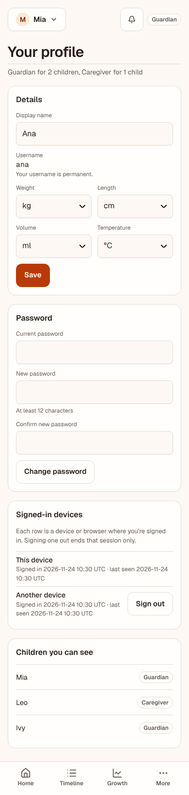
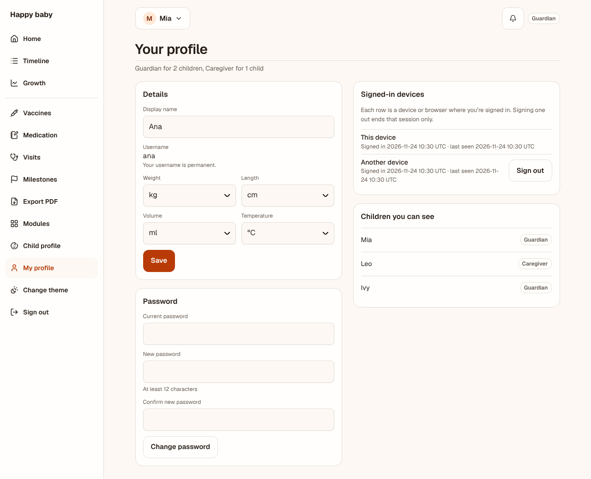
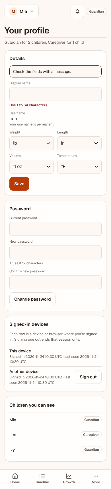
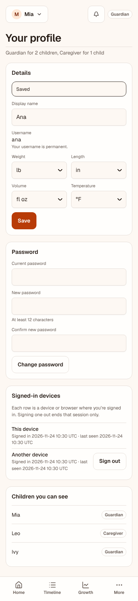
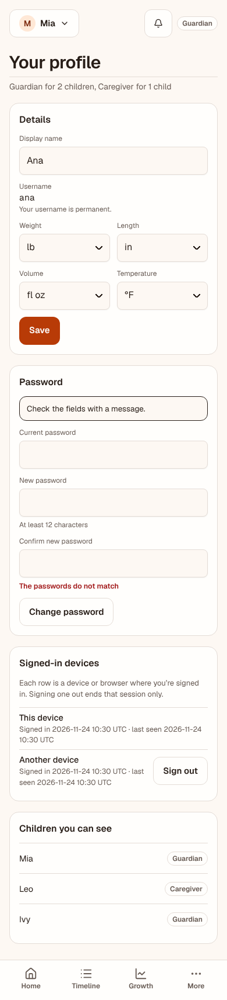
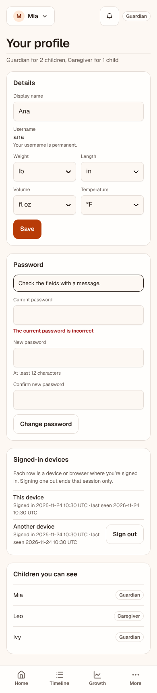
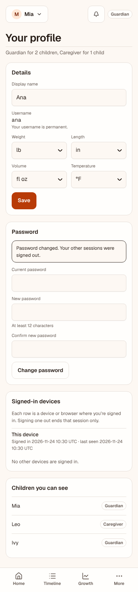

# My profile

The account page of the signed-in parent. It is titled "Your profile" and opened from **My profile** in the menu. It holds your display name, the units you read measurements in, your password, the devices you are signed in on and the children you can see. Examples use a fake parent, Ana (Mia and Ivy as guardian, Leo as caregiver).

Every signed-in parent (guardian or caregiver) has this page. The admin does not: the admin can only open the [Admin](Admin.md) panel.

## Guide

### How do I open it?

- On a phone: **More**, then **My profile**.
- On a desktop: **My profile** in the left menu.

The line under the title summarises your access, for example "Guardian for 2 children, Caregiver for 1 child" ("No children yet" if you have none).

| Phone | Desktop |
|---|---|
|  |  |

### How do I change my display name?

1. In **Details**, edit **Display name** (1 to 64 characters).
2. Choose **Save**. A box above the field says "Saved".

Your **Username** is shown below it, with the note "Your username is permanent." It cannot be changed.

An empty name is refused: the page keeps your units, shows "Check the fields with a message." and the red message "Use 1 to 64 characters" under the name.

| Phone |
|---|
|  |

### How do I change my units?

In **Details**, four lists set how measurements are shown to you:

- **Weight**: kg or lb
- **Length**: cm or in
- **Volume**: ml or fl oz
- **Temperature**: °C or °F

Choose the units, then **Save**. In the picture the four are set to lb, in, fl oz and °F and the page says "Saved". The setting belongs to you, not to the child: two parents can read the same child in different units. If a unit is not one of the listed values, the message is "Choose one of the listed units".

| Phone |
|---|
|  |

### How do I change my password?

1. In **Password**, type your **Current password**.
2. Type a **New password** (at least 12 characters, and up to 256) and type it again in **Confirm new password**.
3. Choose **Change password**.

The page says "Password changed. Your other sessions were signed out." You stay signed in on this device; every other device is signed out and must sign in again with the new password. The three fields are always emptied after you send them.

If the new password and the confirmation differ, the page says "The passwords do not match" under the confirmation, without leaving the page. A password under 12 characters gives "Use at least 12 characters".

| Phone |
|---|
|  |

If the current password is wrong, the message is "The current password is incorrect" under **Current password**, and the password is not changed.

| Phone |
|---|
|  |

After a successful change:

| Phone |
|---|
|  |

### How do I sign out another device?

**Signed-in devices** says "Each row is a device or browser where you're signed in. Signing one out ends that session only." Each row shows "This device" or "Another device" and when it was signed in and last seen. On another device, choose **Sign out** on its row. Your own device has no button here; use **Sign out** in the menu.

If no other device is signed in the card says "No other devices are signed in."

### Which children can I see?

**Children you can see** lists each child with a "Guardian" or "Caregiver" badge. To change who has access, a guardian uses [Children and access](Children-and-access.md). With no children it says "None yet. A guardian can invite you."

## Screens

| Screen | Route | Who can open it | States captured |
|---|---|---|---|
| Your profile | `/account` | guardian, caregiver (not the admin) | `01-account`, `02-units-imperial-saved`, `03-display-name-blank`, `04-password-mismatch`, `05-wrong-current-password`, `06-password-changed` |

All the shots are in the [screenshot catalogue](../screenshots/README.md#account). In the shots the other device is a second session opened for the same parent, so its times equal this device's ("2026-11-24 10:30 UTC").

### Rules the screens show

- Display name: 1 to 64 characters. Username: permanent.
- Units: weight kg or lb, length cm or in, volume ml or fl oz, temperature °C or °F. They set how measurements are shown to this parent.
- Password: 12 to 256 characters (counted as characters, not bytes), checked in the browser and again by the server. A change ends every other session and keeps this one.
- Times of sign-in are shown in UTC, as "2026-11-24 10:30 UTC".
- No password, current or new, is ever kept in the page after it is sent.

### Not built yet

The design shows separate sheets for editing the name and changing the password, "last changed N days ago", device names and places, and "sign out all other devices". The forms are on the page instead and the others do not exist: see [Not built yet](Not-built-yet.md).

Back to the [wiki home](Home.md).
