# Navigation and shell

The frame around every signed-in page: the tab bar or side navigation, the header with the child switcher, the notification bell and your role, and the three sheets that open from it (Switch child, More, Change theme). All screenshots show fake data (for example Leo, a 2-year-old, or Dan, a parent with no child yet) on a frozen day, 24 November 2026. The full list of captured screens is in the [screenshot catalogue](../screenshots/README.md). The three layouts (phone, side navigation, wide) are explained in [Roles, layouts and conventions](Roles-and-layouts.md).

## Guide

### Where do I find things?

On a phone (under 768 px wide) a tab bar sits at the bottom with four buttons: **Home**, **Timeline**, **Growth** and **More**. Everything else is in the More sheet.

From 768 px the tab bar is replaced by a column on the left, the side navigation. It holds Home, Timeline and Growth, a divider, then every entry that is behind More on a phone. There is no More button there.

The entry for the page you are on is highlighted. Home is highlighted on a child's home and on the forms that log a new entry; Timeline is highlighted on the timeline and on the page of an entry you opened to edit it; Growth on the growth pages.

The header sits at the top of every page: the child switcher on the left, the bell and your role on the right.

| Phone | Desktop |
|---|---|
| 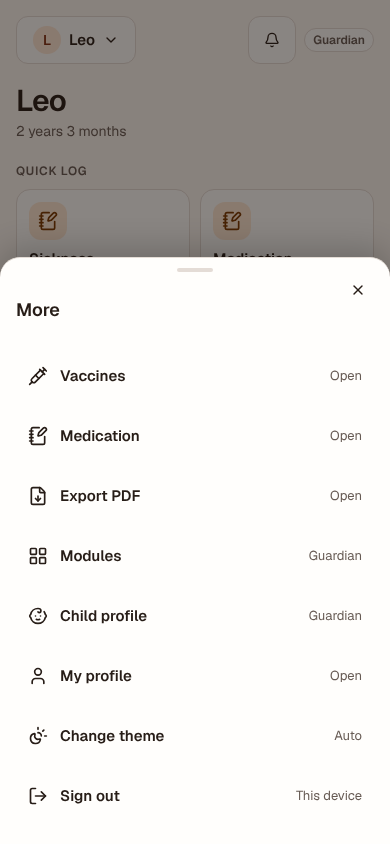 | 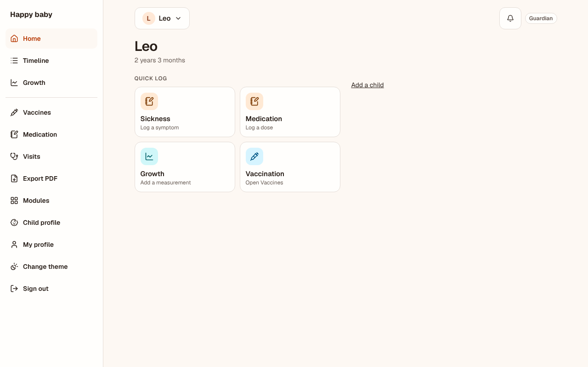 |

The same entries, as the More sheet on a phone and inline on a desktop. This is a guardian's view of Leo, which is why Modules and Child profile are there.

### How do I open the More sheet?

1. On a phone, press **More** at the right of the tab bar.
2. Press an entry to open its page, or press the **x** (or the Escape key on a keyboard) to close the sheet.

Each row shows a short note on the right: "Open" for a page, "Guardian" for a page only a guardian can open, the current theme (for example "Auto") on **Change theme**, and "This device" on **Sign out**. **Sign out** is always last. Opening any page closes the sheet.

### Which entries do I see?

What the list holds depends on your role for the child you are looking at, and on which modules are switched on for that child:

| Entry | Guardian | Caregiver |
|---|---|---|
| Vaccines | yes, unless the Vaccination module is off | same |
| Medication | yes, unless the Medication module is off | same |
| Milestones | yes, unless the Milestones module is off | same |
| Export PDF | yes | yes |
| Modules, Child profile | yes | not shown |
| My profile, Change theme, Sign out | yes | yes |

An entry for a module that is switched off is not shown at all, rather than greyed out. In the screenshots, Leo is over two years old, so Milestones is off by default and the list has no Milestones entry; for Mia (4 months, `shell/06-choose-a-child-many`) the side navigation does list it. If the app cannot read a child's modules, nothing is hidden.

A caregiver sees the same list without Modules and Child profile. Those pages answer a caregiver with the same "Not found" page as for a child that does not exist ([Error pages](Error-pages.md)).

| Phone | Desktop |
|---|---|
| 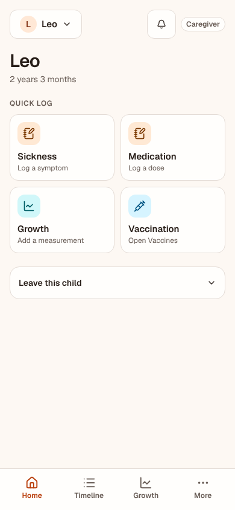 | 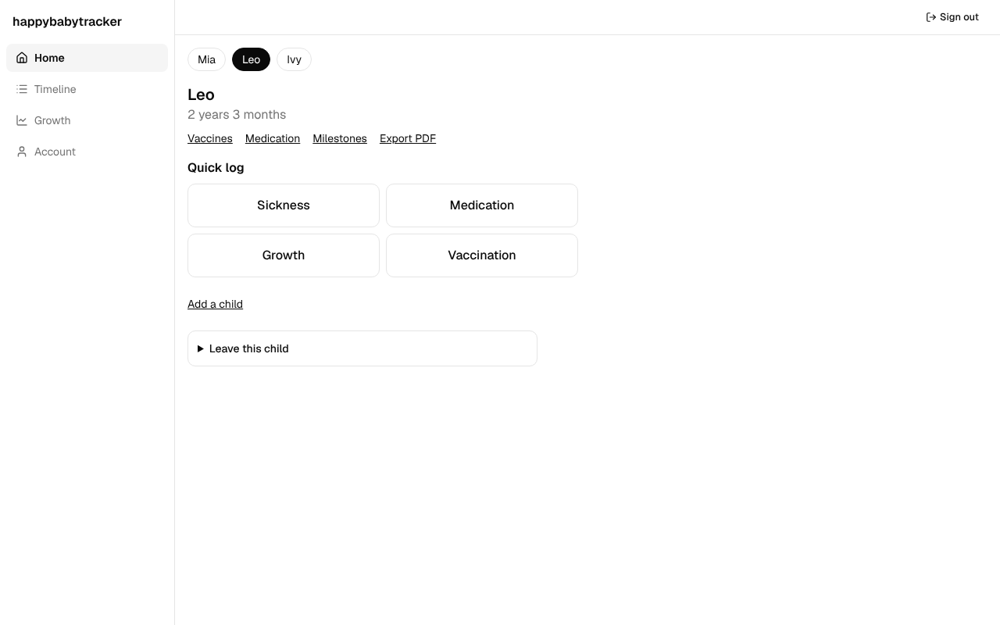 |

A caregiver's view of Leo: the same frame, without the three guardian entries (and, as for every view of Leo, without Milestones).

### How do I switch to another child?

1. Press the child's name at the left of the header (a button with the child's initial, name and a small arrow).
2. In the **Switch child** sheet, press a child. Each row shows the child's name and age; the current child has a check mark and an orange border.
3. The sheet closes and the page of that child opens. If you were on the Timeline, Growth, Vaccines, Medication, Milestones or Export page, you land on the same page for the other child; from anywhere else you land on the child's Home.

The app remembers the last child you opened. Opening the app, or Home, goes back to that child, or to your first child when it has no memory of one.

| Phone | Desktop |
|---|---|
| 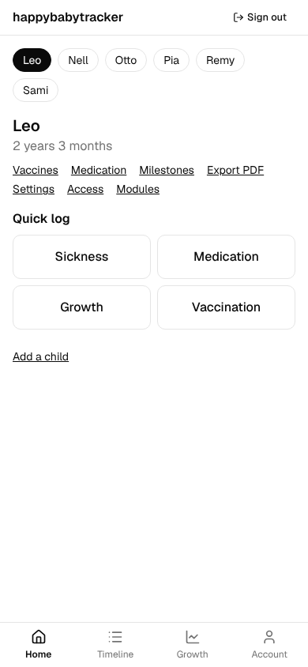 | 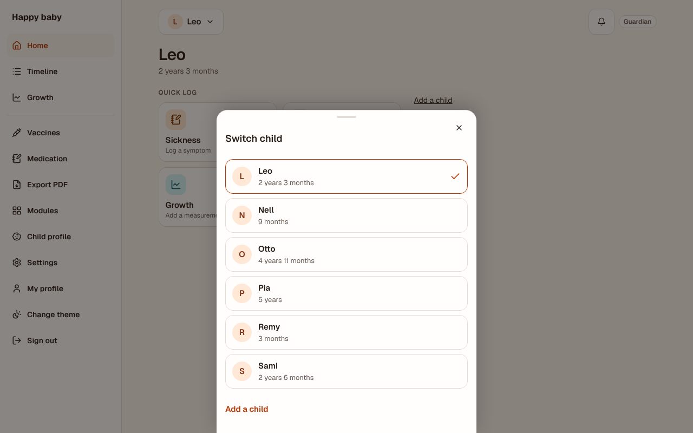 |

A guardian of six children. At the bottom, **Add a child** appears if you are a guardian of at least one child; otherwise the sheet says "Ask a guardian to add a child."

With more than six children the sheet has a **Find a child** field above the list that filters as you type; when nothing matches, the list says "No child matches".

### What if the Switch child sheet does not open?

The child button is also a plain link. If the sheet cannot open (for example JavaScript is off), the link opens the **Choose a child** page instead: the same list with the same rows, a button **Add a child** (guardians) or the sentence "Ask a guardian to add a child.", and the same rule about returning to the section you were on.

| Phone |
|---|
| 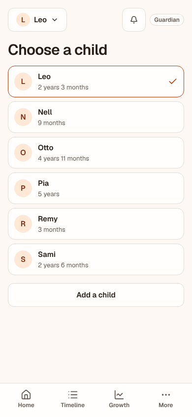 |

With more than six children this page has a **Find a child** field and a **Find** button above the list. Press **Find** to filter by name.

| Phone | Desktop |
|---|---|
| 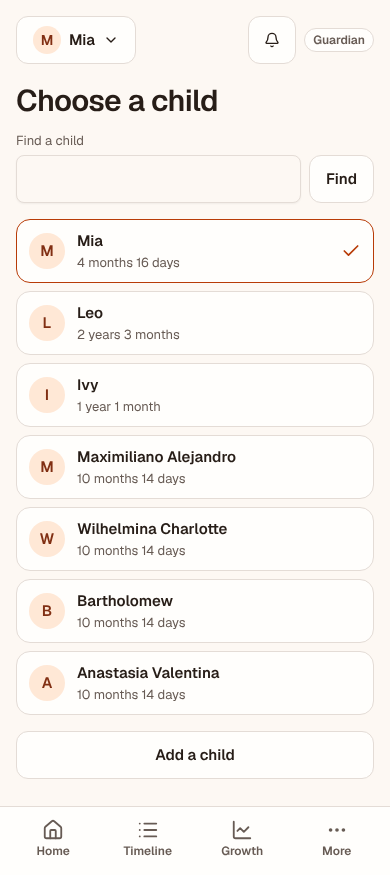 | 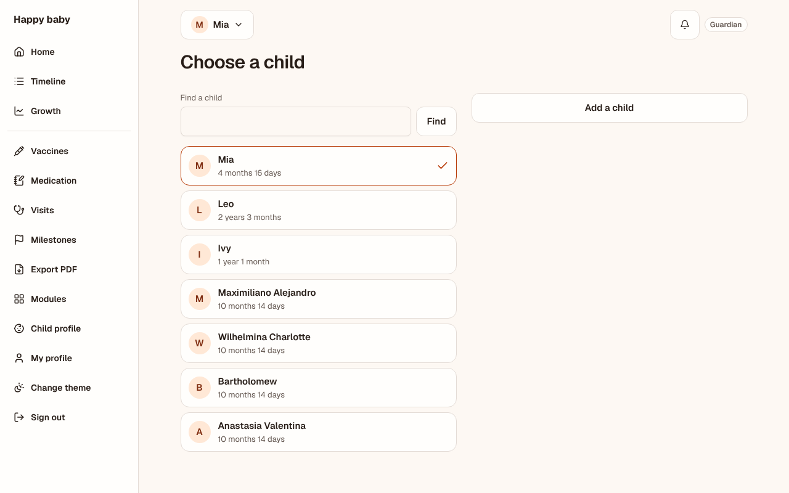 |

### How do I change the theme?

1. Open **Change theme**: it is in the More sheet on a phone and in the side navigation on a wider screen.
2. Choose **Light** ("Bright background."), **Dark** ("Dimmed background, easier at night.") or **Auto** ("Follows your device setting."). The change applies at once and is remembered the next time you open the app.
3. Press **Done** (or close the sheet).

| Phone | Desktop |
|---|---|
| 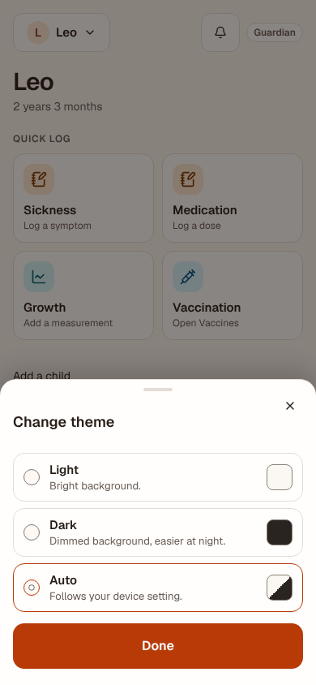 | 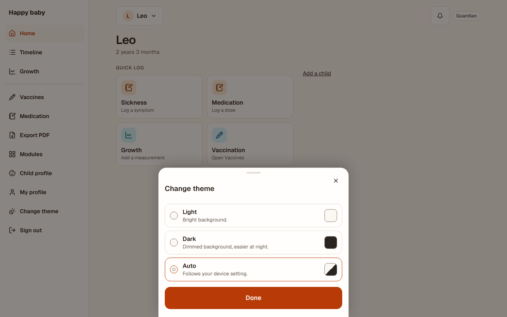 |

Every screenshot in this wiki is the light theme.

### What is the bell, and what is the badge?

The bell at the top right opens your notification settings ([Notifications](Notifications.md)). It is highlighted while you are on that page. The badge beside it reads **Guardian** or **Caregiver** and is your role for the child you are looking at. One person can be a guardian of one child and a caregiver of another, so the badge changes when you switch child.

### What do I see before I have added a child?

A parent with no child sees a welcome page: "Welcome, Dan", the sentence "Add a child to start logging feeds, sleep and diapers. Everyone you invite sees the same entries.", and an **Add your first child** button. There is no child switcher and no role badge, and the navigation holds only what does not need a child: Home, Timeline and Growth, then My profile, Change theme and Sign out. The bell is there.

| Phone | Desktop |
|---|---|
| 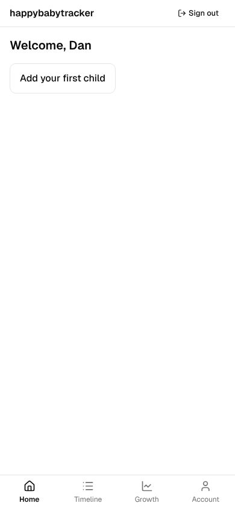 | 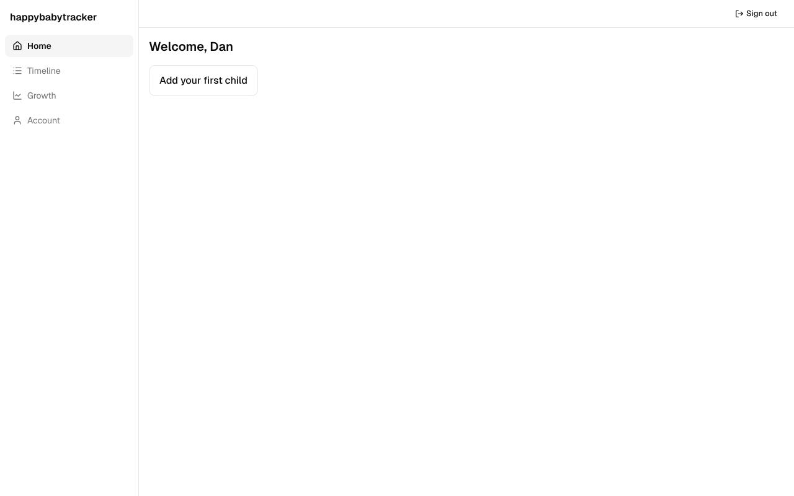 |

## Screens

| Screen | Route | Who can open it | States captured |
|---|---|---|---|
| Welcome (no child yet) | `/` | Any parent with no child. A parent with a child is redirected to the remembered or first child. | `shell/01-no-kids-welcome` (also `auth/09-invite-success-welcome`) |
| Switch child sheet | on every page with a child | Guardian, caregiver | `shell/02-six-kids-switcher` |
| More sheet / side navigation | on every signed-in page | Guardian, caregiver (the entries differ) | `shell/03-more-sheet`, `home/08-leo-caregiver` |
| Change theme sheet | on every signed-in page | Guardian, caregiver, a parent with no child | `shell/04-theme-sheet` |
| Choose a child | `/kids` (`?to=<section>`, `?q=<text>`) | Guardian, caregiver | `shell/05-choose-a-child`, `shell/06-choose-a-child-many` |

The admin has no shell: an admin session only reaches `/admin/parents`, and error pages stand alone, outside the shell.

### Rules the screens show

- **Primary navigation** is fixed: Home (`/`), Timeline (`/timeline`), Growth (`/growth`). The last two redirect to the current child's page, or to Home when there is no child.
- **More, in order:** Vaccines, Medication, Milestones, Export PDF; for a guardian Modules, Child profile; then My profile, Change theme, Sign out. The notes are "Open", "Guardian", the current theme and "This device".
- **Hidden, not disabled.** Vaccines, Medication and Milestones are hidden when that module is off for the child; the guardian-only entries are hidden from a caregiver. Entries that need a child (everything but My profile, Change theme and Sign out) are hidden when there is no child.
- **Roles are per child.** The badge and the guardian entries follow the child shown in the header.
- **The switcher keeps your place.** The target section is one of timeline, growth, vaccines, medication, milestones or export; anything else returns to the child's Home. The `to` value of the Choose a child page accepts only those names.
- **Find a child** appears above the list when there are more than six children, on the sheet (live) and on the page (a form with a Find button).
- **Add a child** is offered to anyone who is a guardian of at least one child; otherwise the sentence is "Ask a guardian to add a child."
- **Theme** is Light, Dark or Auto. The choice applies at once, is stored in the browser and is shared between open tabs.
- **Breakpoint** at 768 px: below it the tab bar and the More sheet; from it the side navigation (225 px wide).
- **Known defect:** the header switcher does not truncate a 64-character child name, so such a name widens the page on a phone: the capture `kid-admin/20-long-kid-name-home` is 947 px wide instead of 390, with the bell and the role badge pushed to the right edge. On a desktop the button stretches across the header and the badge ends past the right edge of the content. The rows of the Switch child sheet and of the Choose a child page are built to wrap long names.

### Not built yet

On a phone without JavaScript the More tab has only a plain list of links below the page; the design leaves that case undefined. The admin has no notification bell. Both are listed in [Not built yet](Not-built-yet.md).

Back to the [wiki home](Home.md).
