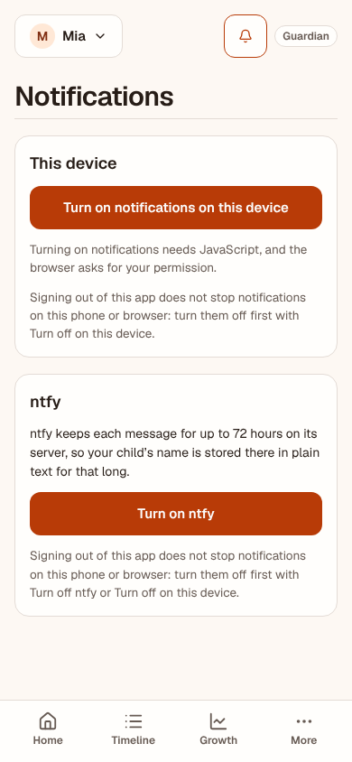
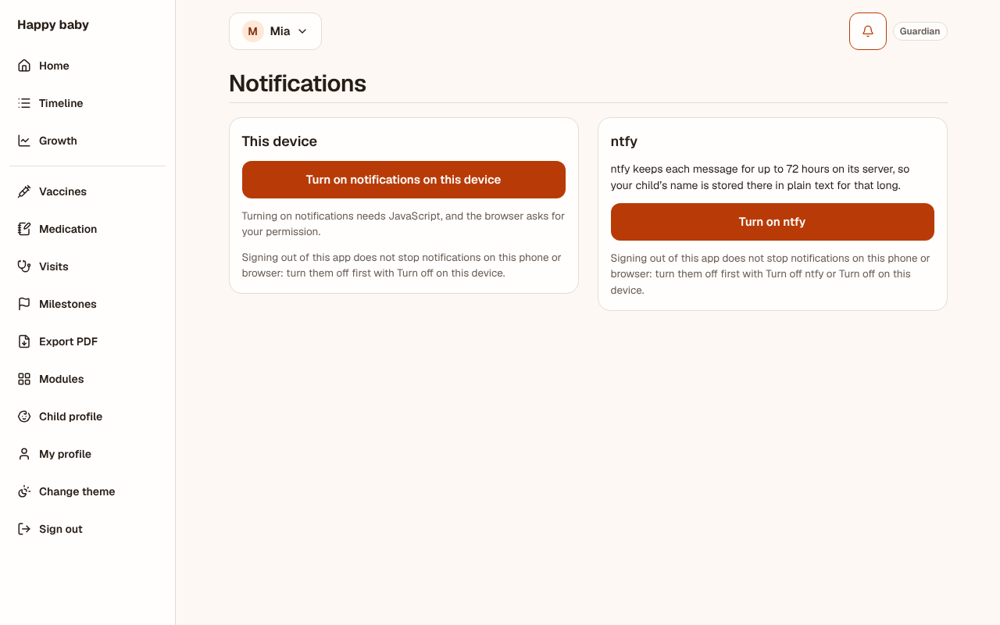
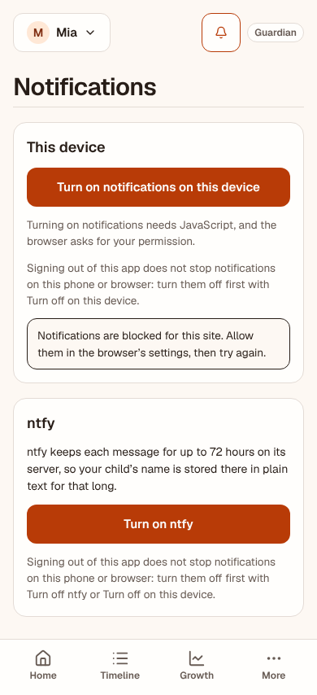
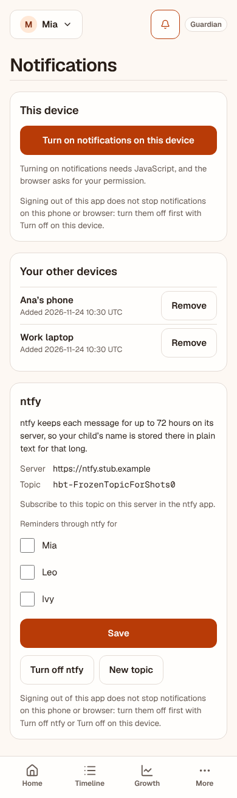
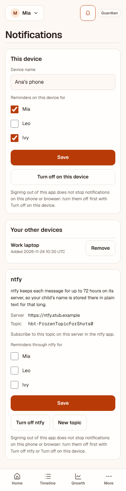
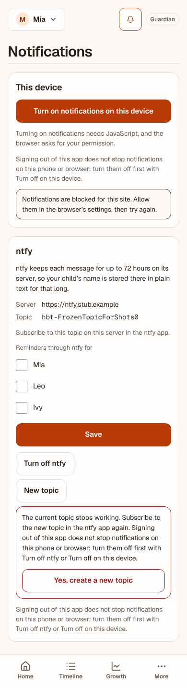
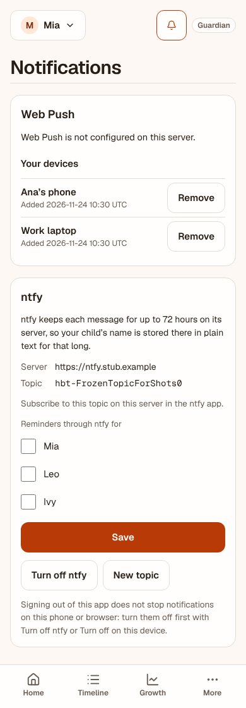
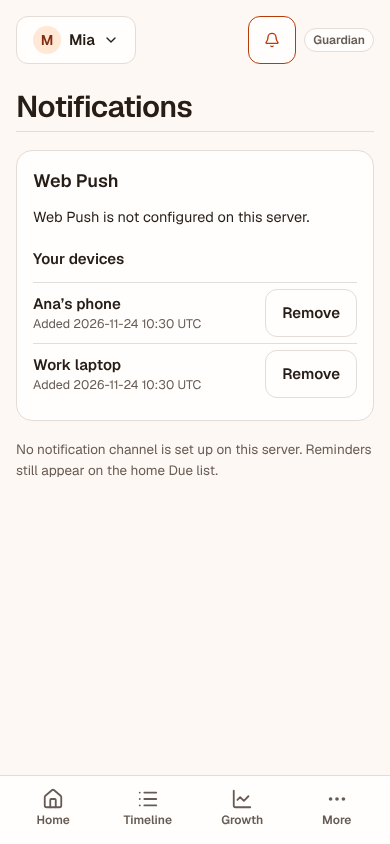
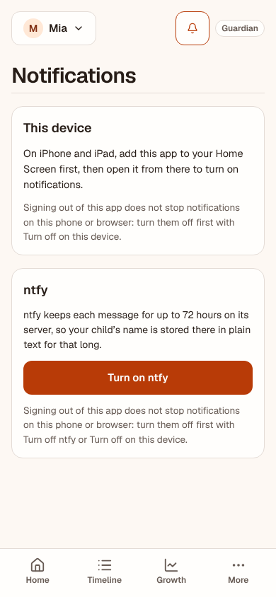

# Notifications

Reminders can reach you in two ways: **Web Push** (a notification from this app on a phone or browser) and **ntfy** (messages through the ntfy app). The page shows only what the server offers. Examples use fake data: the parent Ana, with Mia, Leo and Ivy.

Both channels need the server to be set up for them; the page says so when one is not. With no channel set up, reminders still appear on the home Due list.

## Guide

### How do I open it?

Choose the bell in the header ("Notification settings"). Every signed-in parent has it. The admin has no bell.

### What do I see?

Two cards: **This device** (Web Push) and **ntfy**. With nothing turned on, each has one button: **Turn on notifications on this device** and **Turn on ntfy**.

| Phone | Desktop |
|---|---|
|  |  |

Both cards end with the same warning: "Signing out of this app does not stop notifications on this phone or browser: turn them off first with Turn off ntfy or Turn off on this device." Turn them off before you sign out of a phone you hand on.

### How do I turn on notifications on this device?

1. Choose **Turn on notifications on this device**. The browser asks for permission. This needs JavaScript.
2. Allow it.

The card then shows **Device name** and **Reminders on this device for** with a tick for each child, a **Save** button and **Turn off on this device**. Tick the children you want reminders about and choose **Save** ("Saved"). The name can be 1 to 40 characters.

If the browser has blocked notifications for the site, the card says "Notifications are blocked for this site. Allow them in the browser's settings, then try again." Allow them there, then try again. If you close the prompt without choosing: "Notifications were not turned on. You can try again."

| Phone |
|---|
|  |

If the browser cannot receive notifications the card says "This browser cannot receive notifications." (not captured).

### What is the difference between this device and other devices?

**This device** is the browser you are using. Only here can you rename the device and change its children. **Your other devices** lists every other phone or browser you turned notifications on for, with its name and the date it was added and a **Remove** button. To change an other device's name or children, open this page on that device.

| Phone | Phone |
|---|---|
|  |  |

The left picture is a browser that has not turned notifications on itself; the right one is the browser of "Ana's phone". Turn off on this device removes only this device.

### How do I use ntfy?

1. Choose **Turn on ntfy**. The card shows the ntfy **Server** and your **Topic**, a long random name.
2. In the ntfy app, subscribe to that topic on that server.
3. Under **Reminders through ntfy for**, tick the children you want and choose **Save**.

The card warns: "ntfy keeps each message for up to 72 hours on its server, so your child's name is stored there in plain text for that long." In the picture below no child is ticked yet. **Turn off ntfy** stops it. The topic shown in these pictures is a fixed fake one.

### How do I get a new topic?

Choose **New topic**. A red box opens: "The current topic stops working. Subscribe to the new topic in the ntfy app again." and the sign-out warning. Choose **Yes, create a new topic** to go ahead; nothing changes until you do.

| Phone |
|---|
|  |

The picture still shows the blocked-notifications message in the card above it, left from the previous step of the capture.

### What if my server does not offer one of them?

| If the server has | The page shows |
|---|---|
| Web Push and ntfy | both cards |
| ntfy but not Web Push | a **Web Push** card: "Web Push is not configured on this server." and, if you have devices, **Your devices** with a Remove button each; the ntfy card works as usual |
| Web Push but not ntfy | the This device card. If an ntfy topic from earlier is still stored for you, an ntfy card says "A topic from earlier is still stored for your account. Remove it." with **Remove the stored topic**. Otherwise there is no ntfy card |
| neither | the Web Push card above and the line "No notification channel is set up on this server. Reminders still appear on the home Due list." |

| Web Push off | Both off |
|---|---|
|  |  |

If ntfy turns off while you are on the page, the message is "ntfy is not configured on this server." Shot `08-ntfy-off-stale-topic` shows the stored-topic card: ntfy is off on the server, the registered device is still listed, and the only ntfy action is **Remove the stored topic**.

### What about iPhone and iPad?

On an iPhone or iPad in Safari, notifications work only for an app added to the Home Screen. Instead of the turn-on button the card says: "On iPhone and iPad, add this app to your Home Screen first, then open it from there to turn on notifications." After adding the app, open it from the Home Screen and come back here. The ntfy card is unchanged.

| Phone |
|---|
|  |

## Screens

| Screen | Route | Who can open it | States captured |
|---|---|---|---|
| Notifications | `/account/notifications` | guardian, caregiver | `01-nothing-on`, `02-permission-blocked`, `03-ntfy-on`, `04-ntfy-new-topic-confirm`, `05-other-devices`, `06-this-device`, `07-web-push-off`, `08-ntfy-off-stale-topic`, `09-both-off`, `10-iphone-add-to-home-screen` |
| Subscribe | `POST /account/notifications/subscribe` | the page's script | not a page |

The shots are in the [screenshot catalogue](../screenshots/README.md#notifications). The browser's own permission prompt and a real subscription cannot be captured in a headless browser: "This device" is shown by registering a device through the stub.

### Rules the screens show

- The cards follow the server: Web Push and ntfy each appear, or say they are off, according to what the server is configured for.
- A device belongs to one parent. Another parent's device is the 404 page ([Error pages](Error-pages.md)).
- Device name: 1 to 40 characters ("Enter a name of 1 to 40 characters"). A child that is not yours is refused with "Choose from your children".
- Limits and refusals: "You have the most devices allowed. Remove one, then try again." and "The server refused this browser's notification address. Try again later."
- ntfy keeps each message up to 72 hours, with the child's name in plain text. Signing out does not stop notifications; turn them off first.
- Without JavaScript everything works except the one button that turns on this device.

Back to the [wiki home](Home.md).
