# Sign in and invites

How you get into happybabytracker: the sign-in page, the one-time invite link that sets your first password, and the reset link that sets a new one. All screenshots show fake data (for example the parents Ana and Bo) on a frozen day, 24 November 2026. The full list of captured screens is in the [screenshot catalogue](../screenshots/README.md).

## Guide

### How do I get an account?

You cannot create one yourself. The sign-in page says so under the form: "No account yet? A guardian or the administrator sends you a one-time link." There is no sign-up button and no link to an invite page. Ask a guardian of the child, or the administrator, to send you an invite link, then follow [How do I use an invite link?](#how-do-i-use-an-invite-link).

### How do I sign in?

1. Open the app's address. If you are not signed in you land on **Sign in**.
2. Type your username and your password.
3. Press **Sign in**.

You land on the home of the child you looked at last, or the first child you have. A parent with no child yet lands on a welcome page ([Navigation and shell](Navigation-and-shell.md)). The administrator lands on the parents panel ([Admin](Admin.md)).

If you tried to open a page before signing in, for example your profile, you go to that page after signing in. Only a page of this app counts; an address that points elsewhere is ignored and you land on the home.

You stay signed in on that device for 30 days (12 hours for the administrator). **Sign out** is in the More sheet on a phone and in the side navigation on a wider screen; it ends the session on this device only.

| Phone | Desktop |
|---|---|
| 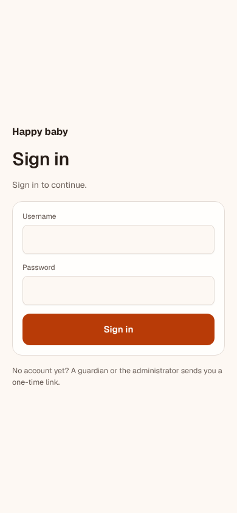 | 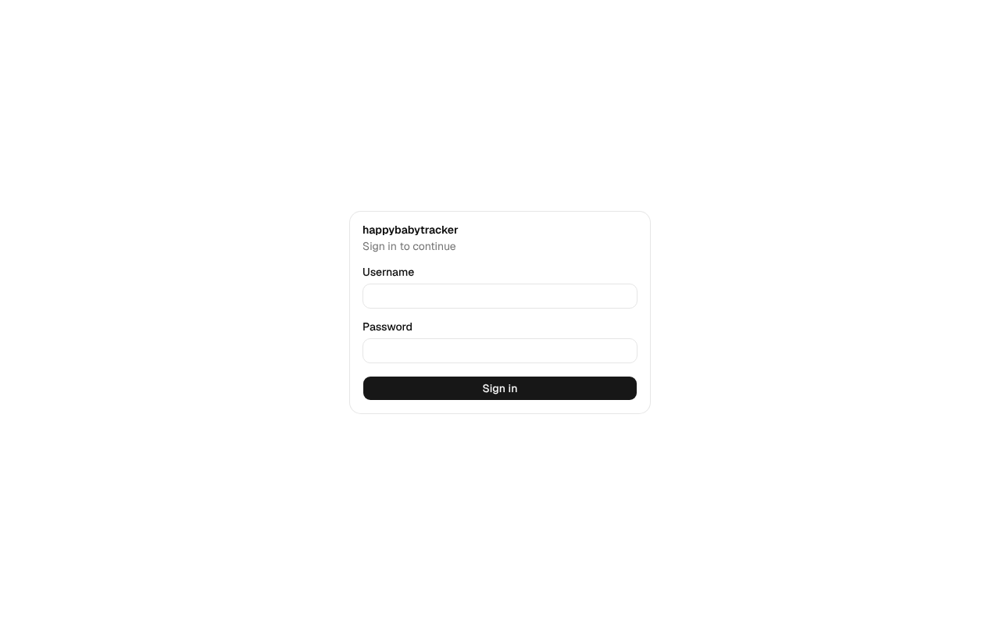 |

The page has no "show password" button and no "forgot password" link. A forgotten password is fixed with a reset link ([How do I reset my password?](#how-do-i-reset-my-password)).

### What if it does not let me in?

| What you see | What it means |
|---|---|
| "Enter your username" or "Enter your password" under a field | You left it empty. Nothing was sent. |
| "Incorrect username or password" | The username or the password is wrong. The page does not say which, and says the same for a username that does not exist. Your username stays in the field; the password field is cleared. |
| "Too many attempts, try again in a minute" | The server limits sign-in attempts. Wait a minute and try again. |
| "The app cannot reach its server, try again soon" | The app's server is down or unreachable. Nothing is wrong with your details; try again later. |

| Phone |
|---|
| 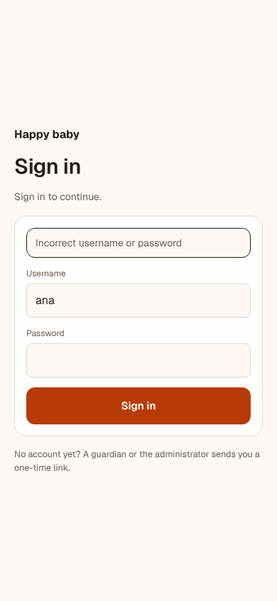 |

Wrong password. The message sits at the top of the card, above the fields.

| Phone |
|---|
| 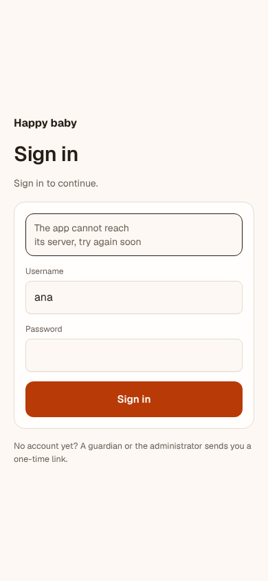 |

The server cannot be reached. The rate-limit page (`auth/03-login-rate-limited`) looks the same with the other sentence.

### How do I sign in with single sign-on?

Some deployments let you sign in with the single sign-on account your household already uses. The deployment's sign-in mode decides which buttons the sign-in page shows:

| Mode | What the card shows |
|---|---|
| Passwords only (the default) | The username and password fields and **Sign in**, as above. No single sign-on button. |
| Single sign-on only | One button, **Continue with single sign-on**, in place of the fields. |
| Both | The password card as above, then an outline **Continue with single sign-on** button under it. |

| Single sign-on only | Both |
|---|---|
| 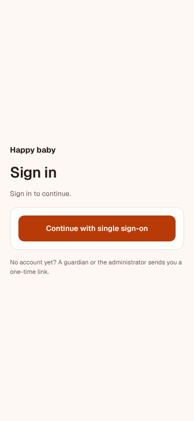 | 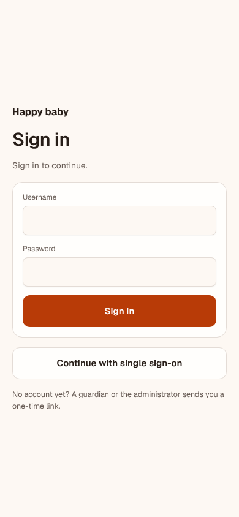 |

1. Press **Continue with single sign-on**. Your browser goes to the sign-in page of your single sign-on account.
2. Sign in there (if you are already signed in there, this step can pass by itself).
3. You come back to a short page, **Signing you in**, which moves on by itself to the same page a password sign-in lands on. If it does not, press **Continue**.

This works only for an account that is already linked to single sign-on. If you tried to open a page before signing in, you land on it afterwards, as with a password.

### What if single sign-on does not complete?

| Did not complete | Unavailable |
|---|---|
| 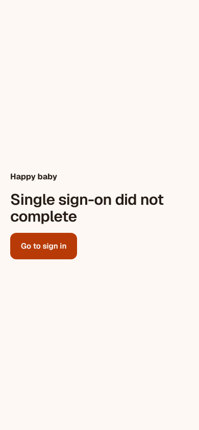 | 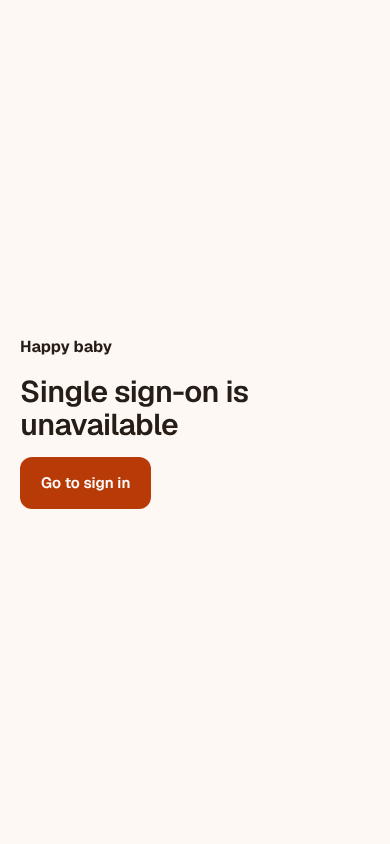 |

- **"Single sign-on did not complete"**: the round trip came back but could not sign you in. The single sign-on account is not linked to an account here, you declined or are not allowed in at the single sign-on page, the attempt took longer than 10 minutes, or the same return page was opened twice. You are not signed in. Press **Go to sign in** and try again; if it keeps happening, ask the administrator whether your account is linked.
- **"Single sign-on is unavailable"**: the app cannot reach the single sign-on service, or single sign-on is turned off on this deployment. Press **Go to sign in**; in a deployment with both modes, your password still works.
- **"Sign-in is unavailable"** in the card, with no button: the deployment allows single sign-on only but is not set up for it. Nobody can sign in until the operator fixes it.
- **"Password sign-in is turned off"** on the sign-in page: the deployment allows single sign-on only, so a password is refused. Use **Continue with single sign-on**.

The page never says which of the causes it was, and nothing about your single sign-on account is kept in the app's logs.

### How do I use an invite link?

A guardian or the administrator gives you a link. It works once and lasts 72 hours.

1. Open the link. The page is titled **Set your password** and shows your username (read-only, for example "bo") above two empty password fields.
2. Type a password of at least 12 characters in **New password**, and the same password in **Confirm password**.
3. Press **Set password**. You are signed in and land on the app. A parent with no child yet sees the welcome page, "Welcome, Bo", with an **Add your first child** button.

| Phone | Desktop |
|---|---|
| 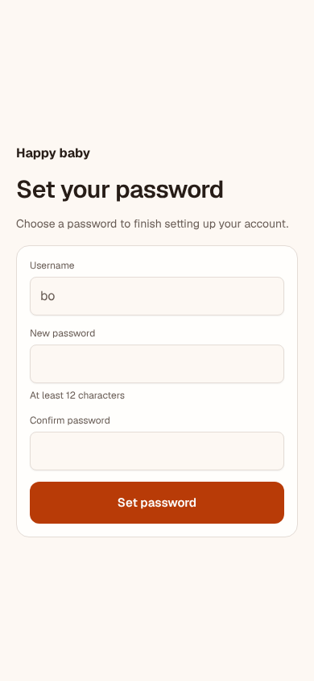 | 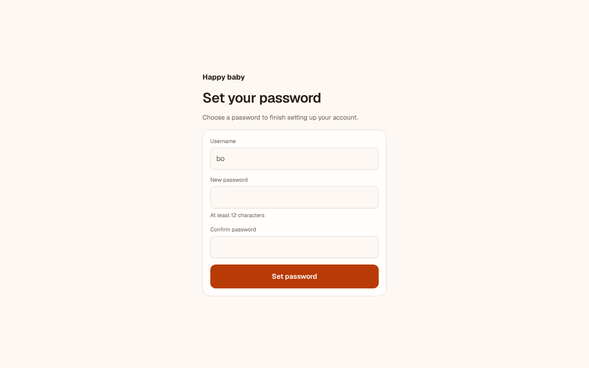 |

The password rules, checked in the browser before anything is sent:

- "Use at least 12 characters" for a shorter password (an 11-character password is refused).
- "Use at most 256 characters" for a longer one. Characters are counted as you see them, so an emoji counts as one.
- "The passwords do not match" under **Confirm password** if the two differ.

| Phone |
|---|
| 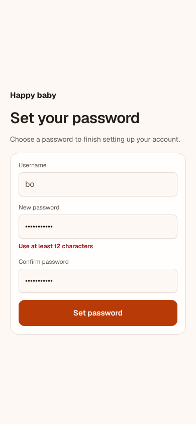 |

An 11-character password is refused on the field. The mismatch case (`auth/06-invite-mismatch`) puts "The passwords do not match" under the second field instead. Both fields keep what you typed.

If the server limits the attempts, a message at the top of the form says "Too many attempts, try again in a minute" and both password fields are emptied (`auth/08-invite-rate-limited`). If the server cannot be reached the message is "The app cannot reach its server, try again soon".

| Phone | Desktop |
|---|---|
| 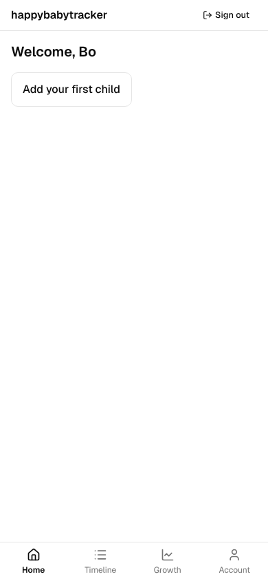 | 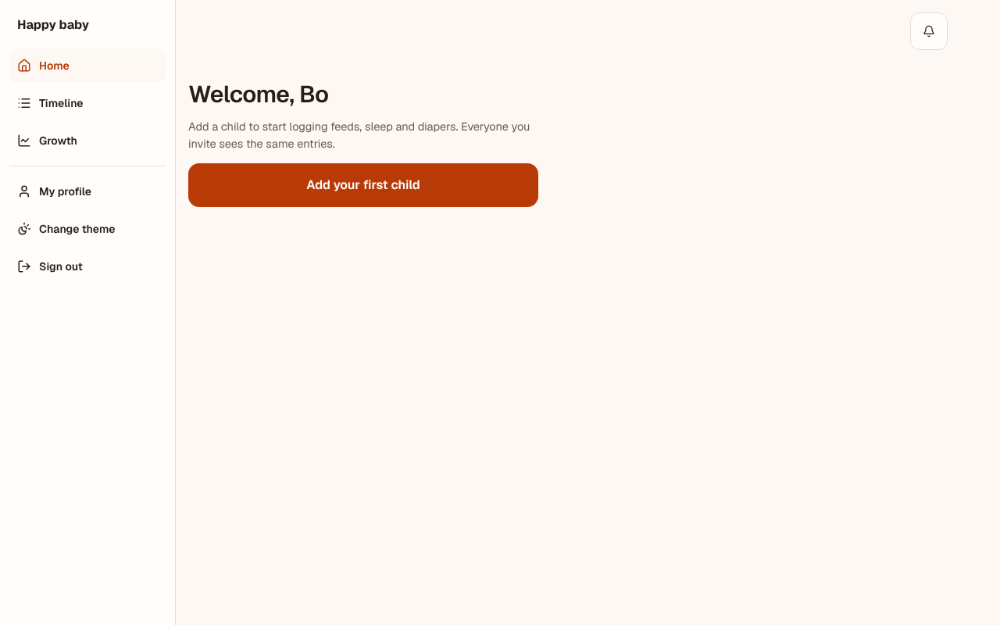 |

After a successful invite: signed in, and no child yet.

### What if the link says it is no longer valid?

| Phone |
|---|
| 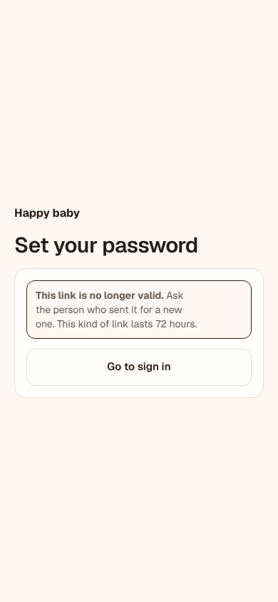 |

The page reads: "This link is no longer valid. Ask the person who sent it for a new one. This kind of link lasts 72 hours." Press **Go to sign in**, or ask whoever sent the link for a new one.

The page gives one answer for every cause: the link was already used, it expired, it was mistyped, the account was disabled, or it is a reset link opened as an invite. It never says which, so it cannot be used to find out whether an account exists.

### How do I reset my password?

A guardian or the administrator issues you a reset link. It lasts 1 hour, so use it soon after you get it.

1. Open the link. The page is titled **Set a new password** and says "Choose a new password. Your other devices will be signed out." Your username is shown, read-only.
2. Fill in **New password** and **Confirm password** with the same rules as above (at least 12 characters, both the same).
3. Press **Set password**. You are signed in on this device and land on your child's home. The page has already told you that your other devices will be signed out.

| Phone |
|---|
| 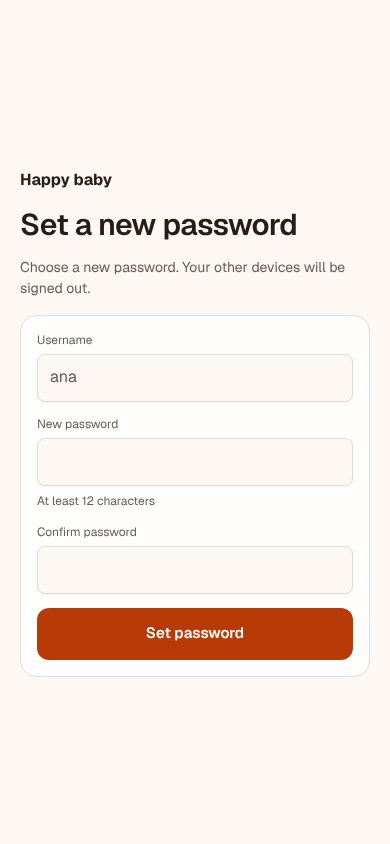 |

An expired or already used reset link gives the same message as the invite, with "This kind of link lasts 1 hour." and the heading **Set a new password** (`auth/13-reset-invalid`). A short password is refused on the field (`auth/12-reset-too-short`).

## Screens

| Screen | Route | Who can open it | States captured |
|---|---|---|---|
| Sign in | `/login` | Signed out. A signed-in visit goes to the landing page instead. | `auth/01-login-empty`, `auth/02-login-wrong-password`, `auth/03-login-rate-limited`, `auth/04-login-api-down` |
| Set your password (invite) | `/invite/[token]` | Anyone holding the link; the link is the only credential. | `auth/05-invite-valid`, `auth/06-invite-mismatch`, `auth/07-invite-too-short`, `auth/08-invite-rate-limited`, `auth/10-invite-invalid` |
| Single sign-on outcome | `/auth/callback` (the return from single sign-on), `/auth/sso` | Anyone; answers with a page, never a redirect | `sso/03-did-not-complete`, `sso/04-sso-unavailable`; the sign-in page by mode is `sso/01-login-oidc`, `sso/02-login-both` |
| Welcome after the invite | `/` | Signed in, no child yet | `auth/09-invite-success-welcome` |
| Set a new password (reset) | `/reset/[token]` | Anyone holding the link | `auth/11-reset-valid`, `auth/12-reset-too-short`, `auth/13-reset-invalid` |
| Sign out | `/logout` (POST only) | Signed in; ends the session and lands on `/login` | Not a page; the landing is `auth/01-login-empty`. A GET to `/logout` is refused (405). |

### Rules the screens show

- **Accounts come only from a link.** The sign-in page carries a sentence about it and no link to an invite page. The wording is fixed: "No account yet? A guardian or the administrator sends you a one-time link."
- **One generic failure.** A wrong password and an unknown username both read "Incorrect username or password". The username is kept and the password is cleared. Blank fields are refused on the field ("Enter your username", "Enter your password") and no sign-in is sent.
- **Rate limit and server-down have their own sentences:** "Too many attempts, try again in a minute" and "The app cannot reach its server, try again soon". The same two sentences appear on the set-password forms.
- **Password length** is 12 to 256 characters, counted as characters, not bytes. The form checks length and match in the browser; the server checks them again, so the page also works without JavaScript. A server refusal of the length reads "Use 12 to 256 characters".
- **Link lifetimes** are 72 hours for an invite and 1 hour for a reset, and the invalid-link message names the lifetime of the link kind that was opened. A link works once. The two kinds are not interchangeable: an invite opened under `/reset/` (or the reverse) shows as invalid.
- **One answer for every bad link:** used, expired, unknown, malformed, for a disabled account, or of the other kind. The heading stays that of the page that was opened ("Set your password" or "Set a new password").
- **Redeeming a link signs you in.** The invite lands on `/` (the welcome page, or the child's home when you already have a child). The reset page tells you "Your other devices will be signed out."
- **Sessions:** a parent's cookie lasts 30 days, the administrator's 12 hours. The cookie is HTTP-only, secure and same-site strict. After signing in, `next` is followed only for a path on this app; anything else (another host, `//host`, a backslash, `javascript:`) is ignored. The administrator only ever lands inside `/admin/`.

### Not built yet

The design's sign-in prototype lists an "Open an invite link" entry. The app's sign-in page has none: an invite is only the one-time link a guardian or the administrator sends. See [Not built yet](Not-built-yet.md).

Back to the [wiki home](Home.md).
