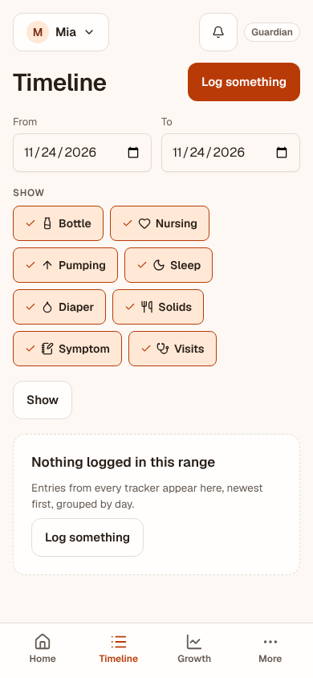
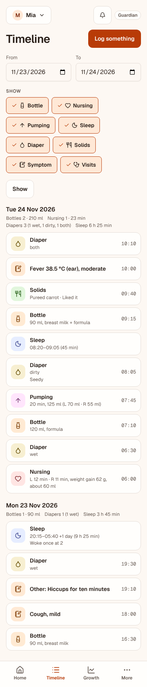
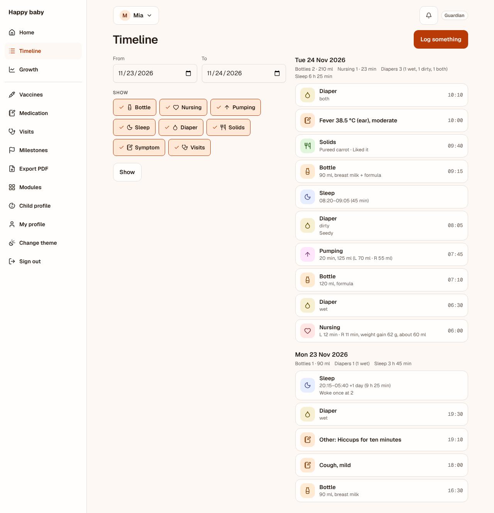
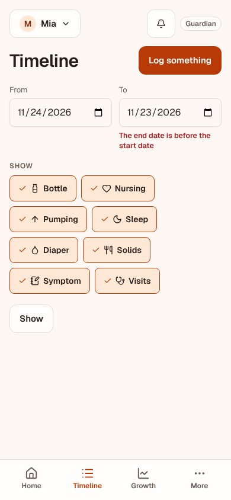
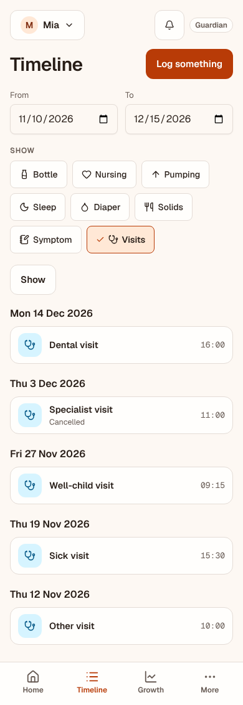
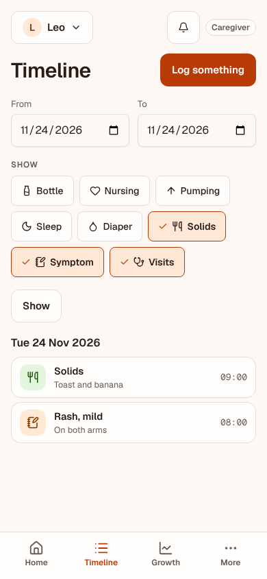
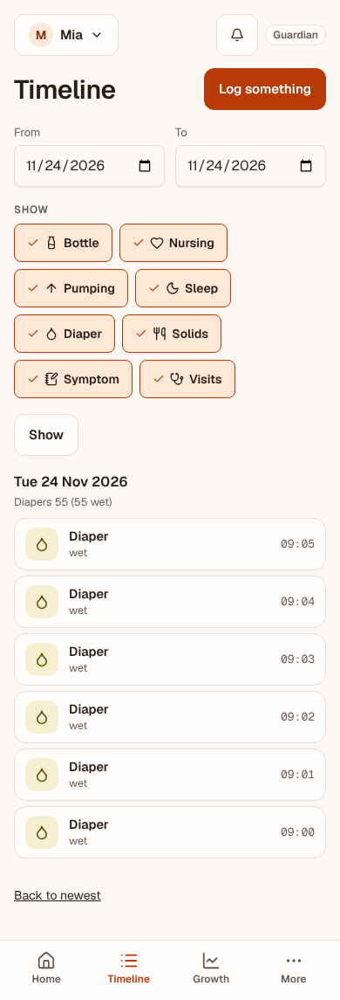
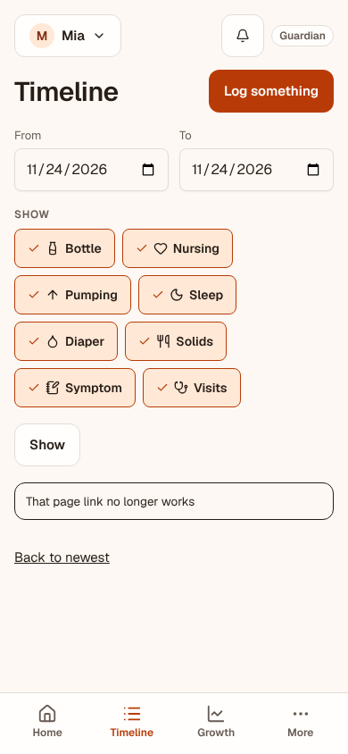
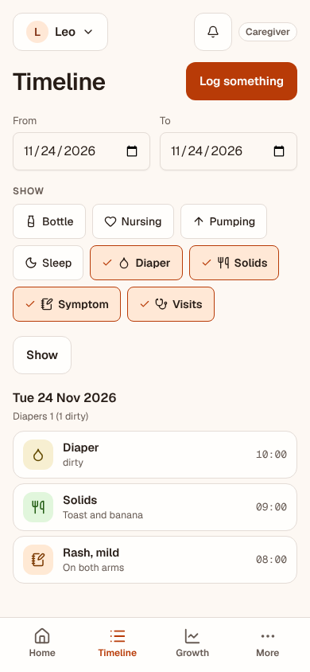
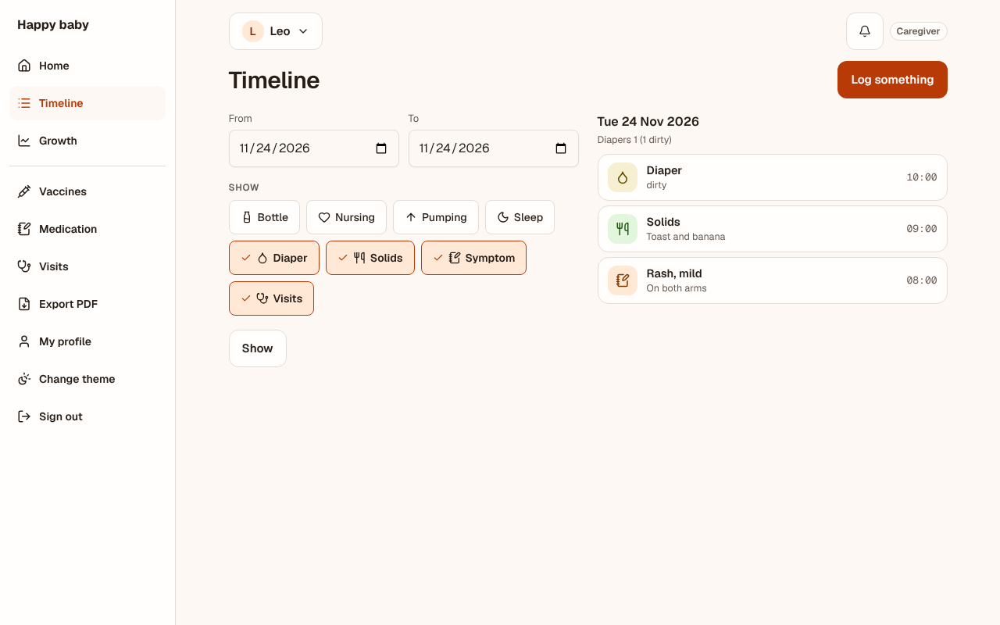

# Timeline

The Timeline lists everything logged for a child, newest first, grouped by day. All screenshots show fake data (for example Mia, or Leo, a 2-year-old) on a frozen day, 24 November 2026. The full list of captured screens is in the [screenshot catalogue](../screenshots/README.md).

With JavaScript, the edit form a row leads to open in a sheet over the page you were on, and saving closes the sheet and shows a short message ([Forms in sheets](Forms-in-sheets.md)). The steps are the same. The form screenshots below show the same form as a page, which is what you get without JavaScript, in a new tab or when you open the address directly; after a save on the page you land where the steps say.

## Guide

### How do I see what happened today?

1. Open **Timeline** in the tab bar (phone) or the side navigation (wide screens).
2. The page opens on the child's today. Both date fields hold today's date and every tracker the child uses is ticked.
3. Entries sit under a heading such as "Tue 24 Nov 2026", newest first. Under the heading, a line of day totals sums what the day holds, for example bottles and millilitres, nursing minutes, diapers, sleep.

With nothing logged, the page says "Nothing logged in this range" and offers a **Log something** button.

| Phone |
|---|
|  |

The timeline of an empty day. The **Log something** button at the top and in the card goes to the child's Home page, where the trackers are.

### How do I read an entry?

Each entry is one card: an icon and a name (Bottle, Nursing, Pumping, Sleep, Diaper, Solids, the symptom's name, or the kind of a medical visit), a detail line, and the time on the right. A sleep shows its start and end instead of a single time. A sleep that ends on a later day reads, for example, "20:15–05:40 +1 day (9 h 25 min)" and stays under the day it began. A note you typed appears as a last line on the card.

Tap a card to open that entry on its edit page, where you can change or delete it.

| Phone | Desktop |
|---|---|
|  |  |

On a wide screen the filter sits on the left and the entries on the right.

### How do I look at other days?

1. Change **From** and **To**. They are the child's calendar dates.
2. Press **Show**.

The range can be at most 93 days. If **To** is before **From**, the page shows "The end date is before the start date" under **To** and lists nothing. A date that is not a date shows "Enter a valid date" under the field. A range longer than 93 days shows "Pick at most 93 days".

| Phone |
|---|
|  |

### How do I show only some kinds of entry?

The **Show** row has one chip per tracker: Bottle, Nursing, Pumping, Sleep, Diaper, Solids, Symptom and Visits. A ticked chip has a check mark and a coloured border.

1. Tap a chip to tick or untick it.
2. Press **Show**.

For example, with only Symptom ticked the page lists the fever, cough and other symptoms of the range (shot `04-symptoms-only`), and with Bottle, Nursing and Pumping ticked it lists the feeds (shot `05-feeding-only`). The day totals follow the chips: only the trackers you show are summed.

If you untick every chip and press **Show**, the page goes back to the trackers the child uses.

### Where are medical visits?

Each medical visit is a row on its day, at its time, named by its kind ("Well-child visit", "Sick visit" and so on), with "Cancelled" under a cancelled one. Tick only **Visits** to list them alone. Tapping the row opens the visit's page, not an edit form ([Medical visits](Medical-visits.md)).

| Phone |
|---|
|  |

### What if a tracker is switched off for this child?

A guardian can switch a tracker off for a child. Its chip then starts unticked and its entries are hidden. Tick the chip and press **Show** to see them anyway.

| Phone |
|---|
|  |

In this example Diapers has been switched off for Leo. His diaper entry from the earlier screenshot (`11-caregiver`) is gone from the list, and nothing was deleted.

### What do I do when there are many entries?

A page holds 50 entries. When there are more, the page ends with an **Older** button.

1. Tap **Older** to see the next 50.
2. Tap **Back to newest** to return to the first page.

On the example below the first page ends with Older (shot `09-first-page-older`). The second page holds the remaining six diapers and has **Back to newest**. The day totals ("Diapers 55 (55 wet)") count the whole day, not only the entries on the page.

| Phone |
|---|
|  |

If an Older link is old or damaged, the page says "That page link no longer works" and shows **Back to newest**.

| Phone |
|---|
|  |

### Why are my amounts in fluid ounces or °F?

Volumes, weights and temperatures follow the units you chose on your profile. The same two days for a parent who chose pounds, fluid ounces and °F show "3.04 fl oz", "2.19 oz" and "101.3 °F" where another parent sees "90 ml", "62 g" and "38.5 °C". Day totals follow the same units.

| Phone |
|---|
|  |

### Can a caregiver use the Timeline?

Yes. A caregiver reads and opens the entries of the children they were added to, as a guardian does. In this example a caregiver reads Leo's day. Leo is 2, so only the trackers he uses are ticked.

| Phone | Desktop |
|---|---|
|  |  |

## Screens

| Screen | Route | Who can open it | States captured |
|---|---|---|---|
| Timeline | `/kids/[kid]/timeline` | Guardian, caregiver. Admin: sent to `/admin/parents`. Signed out: sent to the sign-in page. A parent with no grant on the child: the 404 page, identical to an unknown child | `01-empty-today`, `02-today`, `03-two-days`, `04-symptoms-only`, `05-feeding-only`, `06-reversed-range`, `07-invalid-cursor`, `08-two-days-imperial`, `09-first-page-older`, `10-second-page`, `11-caregiver`, `12-module-off-unticked` |
| Entry edit (opened from a row) | `/kids/[kid]/log/[tracker]/[entry]` | Guardian, caregiver | Not part of this area |

### Rules the screens show

- **Default range**: the child's today in the child's time zone, with every tracker the child uses ticked. A day is the child's calendar day, so a 23-hour day (a clock change) still sits under one heading.
- **Query**: the filter is a plain form (`from`, `to`, repeated `types`) so it works without JavaScript, and **Older** and **Back to newest** are plain links.
- **Order and paging**: newest first, 50 entries per page. Totals per day come from a separate summary of the whole range and cover the trackers shown.
- **Validation messages**: "Enter a valid date" (a date that cannot be read), "The end date is before the start date" (on **To**), "Pick at most 93 days" (on **To**), "That page link no longer works" (an Older link the API refuses, with **Back to newest**). None of them is an error page.
- **Filter chips**: Bottle, Nursing, Pumping, Sleep, Diaper, Solids, Symptom, Visits. With no chip ticked, the child's enabled trackers apply. A switched-off module starts unticked.
- **Sleep**: shows `start–end`, plus `+N day` when it ends on a later day, and "Sleep since HH:MM" while it runs. It sits under the day it started.
- **Units**: the viewer's own units for volume, weight and temperature.
- **Long text**: a 200-character meal or note wraps inside its card (shot `09-first-page-older`, phone width).
- **Access**: see [Roles, layouts and conventions](Roles-and-layouts.md).

### Not built yet

The design also shows a "Last 7 days" week strip, "Since last" and running-timer cards, a day filter and an age line under the title. The app has none of them; see [Not built yet](Not-built-yet.md).

Back to the [wiki home](Home.md).
