# Vaccines

The Vaccines page shows a child's vaccination schedule as visits (for example "12-month vaccines"), says what is due, overdue, upcoming or already done, and keeps the record of every dose given. A schedule is only a list of what is usually offered and when: the page does not tell you what a child should have. All screenshots show fake data (for example Ivy, 1 year 1 month, on a stub schedule) on a frozen day, 24 November 2026. The full list of captured screens is in the [screenshot catalogue](../screenshots/README.md).

The Record a vaccination and Edit vaccination forms open in a sheet over the Vaccines page: the form's title, a **Close** button (the ×), the fields, **Save** and **Cancel**. Saving closes the sheet, the page underneath shows the change and a short message appears ([Forms in sheets](Forms-in-sheets.md)). Every form screenshot below is the open sheet. Without JavaScript, in a new tab or when you open the address directly, the same form is a page with the same steps; after a save there you land where the steps say.

## Guide

### How do I choose a schedule?

A child has no schedule until a guardian picks one. Until then the page says "No vaccination schedule chosen yet." and "A schedule is only a list of what is usually offered and when. You can switch later; recorded doses always stay."

- A **guardian** sees a **Choose a schedule** button. It opens the child's settings, where the **Vaccination schedule** list is.
- A **caregiver** sees the sentence "Ask a guardian to choose one." and no button.

Doses you recorded stay listed under **Other recorded vaccinations** while there is no schedule. If a stored schedule is one the app no longer offers, the page treats it as no schedule (shot `07-retired-schedule`) and the recorded doses are still there.

| Guardian | Caregiver |
|---|---|
| 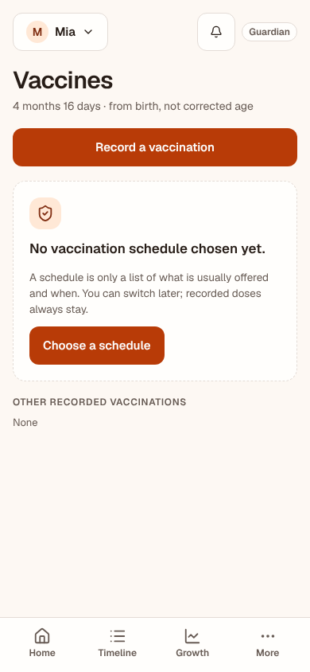 | 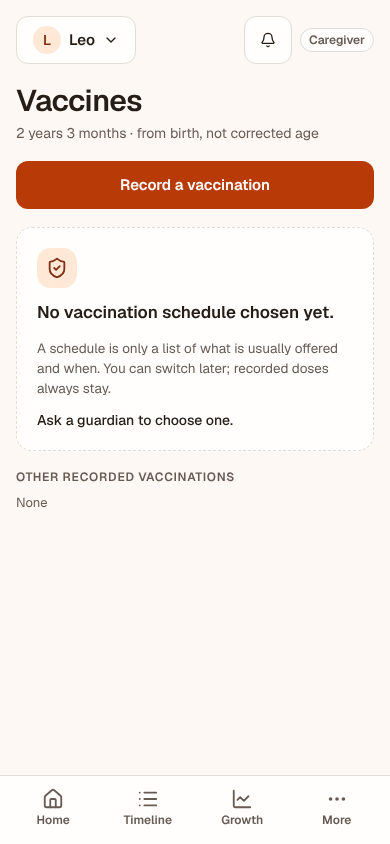 |

### How do I read the schedule?

Under the title the page shows the child's age counted from birth ("1 year 1 month · from birth, not corrected age") and the schedule used ("Schedule: Stub authority, Stub edition (retrieved 2026-11-22)").

The visits are grouped in three places:

1. **Due and overdue**: visits with a line to do now.
2. **Coming up**: later visits. The first one is open, the others are folded.
3. **Completed (N)**: visits whose lines are all given, dismissed or available. They are folded.

Each visit is a card you open and close by tapping its title. Inside, the vaccines are grouped under a sub-heading (for example "Hib" or "MMR") and each line shows the vaccine and dose ("Measles, dose 1"), a status and a sentence:

- "Due from 2026-10-24 · overdue from 2027-01-24" for a routine line.
- "Due from ... · no longer due from ..." for a line that may not be needed.
- "Available from ..." for an optional line.
- "Given 2025-12-24" for a given line. It links to the dose, so you can edit it.
- "Dismissed: not needed" or "Dismissed: given, date unknown" for a dismissed line.

Some lines have a **Note** you can open. It is the schedule's own note for that line.

Every status has a word and an icon, and a border shape, so colour is never the only signal:

| Status | Icon | Border | Meaning |
|---|---|---|---|
| Due | circle | solid | The window has opened. |
| Overdue | clock | dashed | The window has passed. |
| Upcoming | calendar | none | The window opens later. |
| Given | check | none | A dose is recorded for this line. |
| Dismissed | minus | none | A guardian dismissed this line. |
| Available | plus | dotted | Optional: offered, not required by the schedule. |

On a wide screen the visits are on the left, and the notes about the schedule, the optional lines and your records are on the right.

| Phone | Desktop |
|---|---|
| 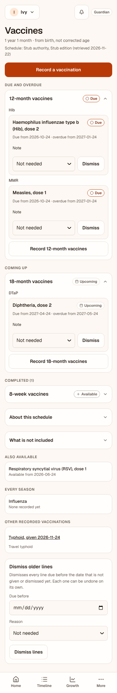 | 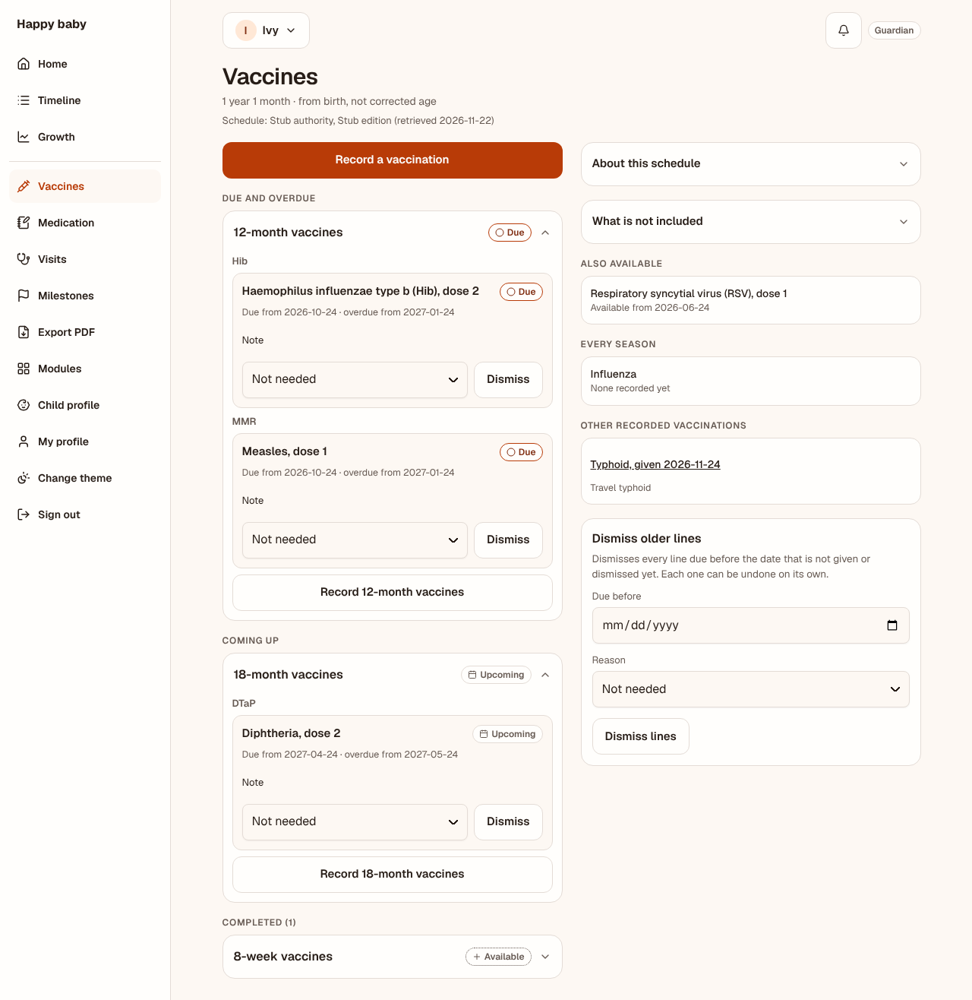 |

Below the visits you find:

- **About this schedule**: the licence and the attribution.
- **What is not included**: what the schedule leaves out (shot `03-us-schedule-about-open`).
- **Also available**: optional lines with the window ("Available from 2026-06-24").
- **Every season**: vaccines taken every season, such as influenza, with "None recorded yet" or a "Given ..." link per dose.
- **Other recorded vaccinations**: doses that are not part of a schedule line, each with its product. A very long product name wraps (shot `15-long-product-on-page`).

Another schedule gives another list for the same child and doses (shot `06-uk-schedule`, for example "1-year vaccines" and "3-year vaccines").

### How do I record a vaccination?

1. On **Vaccines**, tap **Record a vaccination**. Or open a visit and tap **Record 12-month vaccines**: the sheet then opens with that visit's outstanding vaccines already ticked.
2. Check **Date given**. It starts as today and cannot be in the future or before the birth date.
3. Tick every vaccine given. With JavaScript, **Product shortcut** ticks the vaccines a product covers for you, for example a 6-in-1; without JavaScript, tick them yourself.
4. Optionally fill **Lot number**, **Product name** and **Note**. If you tick **Other (product name required)**, the product name is needed.
5. Tap **Save**. The sheet closes, the lines you ticked now read "Given" and the message "Vaccination recorded" appears. Without JavaScript you land back on the Vaccines page.

Vaccines given at a medical visit can also be recorded from the visit, with **Record the visit** ([Medical visits](Medical-visits.md)); their edit sheet then has a **Recorded at a visit** link that opens it.

A caregiver can record a dose.

| Phone, the sheet |
|---|
| 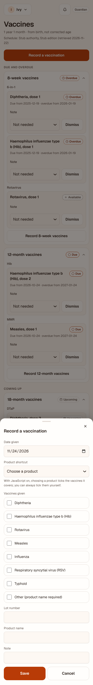 |

| Phone | Desktop |
|---|---|
| 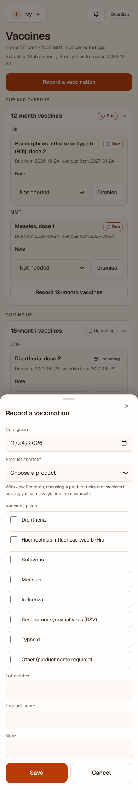 | 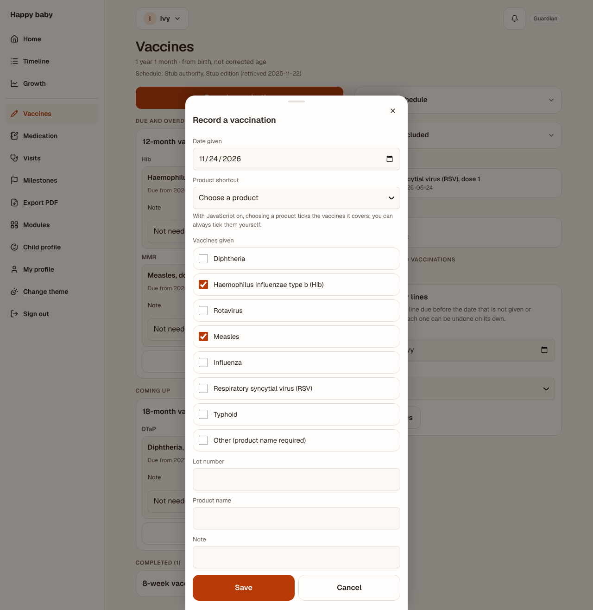 |

If something is wrong, the sheet stays open, a box at the top says "Check the fields with a message." and the field says what to fix. What you typed stays. The messages are:

- "Enter a date that is not in the future and not before the birth date".
- "Choose at least one vaccine from the list".
- "Enter a lot number of up to 40 characters".
- "Enter a product name of up to 80 characters; Other needs one".
- "The note is too long" (the limit is 500 characters).
- "This child has the maximum number of recorded vaccinations".

| Phone |
|---|
| 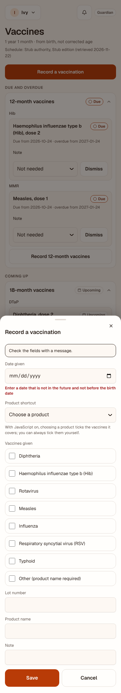 |

### How do I edit or delete a vaccination?

1. Tap the "Given ..." link of a line, a link under **Every season** or **Other recorded vaccinations**. The **Edit vaccination** sheet opens over the page and shows the date, the ticked vaccines, the lot, the product and the note as saved (shot `13-edit-administration`).
2. Change what you need and tap **Save**. The sheet closes and the message "Vaccination saved" appears. Emptying the lot number, product name or note clears it.
3. To remove the record, tap **Delete this vaccination**. A box opens that says "This removes the dose for everyone with access to Ivy." Tap **Yes, delete this vaccination** to confirm.

| Phone |
|---|
| 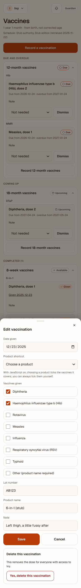 |

A long note or product name stays inside its single-line box and does not widen the sheet (shot `16-long-note-edit`).

### How do I dismiss a line I do not need?

Only a guardian sees these controls. Every open line (due, overdue, upcoming or available) has a **Reason** list and a **Dismiss** button.

1. Choose **Not needed** or **Given, date unknown**.
2. Tap **Dismiss**. The line shows the badge "Dismissed" and "Dismissed: not needed" (or the other reason), with an **Undo** button.
3. To bring the line back, tap **Undo**.

When the last open line of a visit is dismissed, the visit moves under **Completed**. **Undo** moves it back.

| Phone |
|---|
| 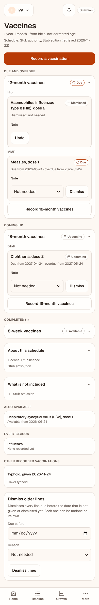 |

### How do I dismiss many old lines at once?

At the bottom of the page (right column on a wide screen), **Dismiss older lines** says "Dismisses every line due before the date that is not given or dismissed yet. Each one can be undone on its own."

1. Pick a date in **Due before**.
2. Choose a **Reason**.
3. Tap **Dismiss lines**. The page says how many it dismissed, for example "Dismissed 1 line." or "Dismissed N lines." (shot `05-dismiss-before-result`).

Without a date the field says "Enter a date". Open **Completed** to find the dismissed lines and undo any of them.

| Phone |
|---|
| 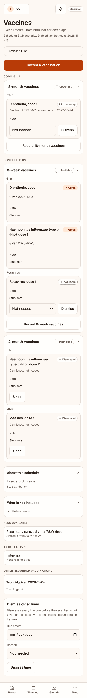 |

### What does a caregiver see?

A caregiver sees the same schedule and can record doses. There is no **Dismiss**, **Undo** or **Dismiss older lines**.

| Phone |
|---|
| 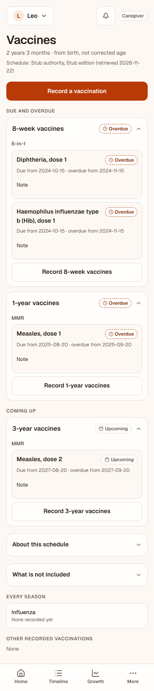 |

## Screens

| Screen | Route | Who can open it | States captured |
|---|---|---|---|
| Vaccines | `/kids/[kid]/vaccines` | Guardian, caregiver. Admin: sent to `/admin/parents`. Signed out: sent to the sign-in page. No grant: the 404 page, identical to an unknown child | `01-no-schedule-guardian`, `02-us-schedule`, `03-us-schedule-about-open`, `04-line-dismissed`, `05-dismiss-before-result`, `06-uk-schedule`, `07-retired-schedule`, `08-no-schedule-caregiver`, `09-caregiver-on-schedule`, `15-long-product-on-page`, `17-completed-open` |
| Record a vaccination (sheet over Vaccines; a page without JavaScript) | `/kids/[kid]/vaccines/new` (optional `?antigens=a,b` from a visit's Record button) | Guardian, caregiver | `10-new-dose-empty`, `11-new-dose-errors`, `12-new-dose-from-record-link` |
| Edit vaccination (sheet over Vaccines; a page without JavaScript) | `/kids/[kid]/vaccines/[administration]` | Guardian, caregiver. No grant, an unknown dose and another child's dose are the same 404 page | `13-edit-administration`, `14-edit-delete-confirm`, `16-long-note-edit` |

### Rules the screens show

- **Schedule**: chosen per child by a guardian in the child's settings. A stored schedule the app no longer ships counts as no schedule. Changing the schedule never deletes recorded doses.
- **Age**: counted from birth, never corrected for early birth ("from birth, not corrected age").
- **Statuses**: Given, Due, Upcoming, Overdue, Dismissed, Available, each with a word, an icon and a border shape.
- **Visit placement**: a visit with a line that is due, overdue or upcoming sits under Due and overdue or Coming up. A visit whose status is Given, Dismissed or Available sits under Completed (folded).
- **Dates**: shown as `YYYY-MM-DD` in the child's calendar.
- **Dismissing**: guardian only. Reasons "Not needed" and "Given, date unknown". A caregiver's posted dismissal is refused with "Only a guardian can dismiss vaccines". Each dismissal can be undone on its own, including those made by Dismiss older lines.
- **Dismiss older lines messages**: "Enter a date", "Choose a reason from the list".
- **Recording limits**: lot up to 40 characters, product up to 80 characters, note up to 500 characters; the date between the birth date and today; at least one vaccine; "Other" needs a product name.
- **Delete**: two steps, with "This removes the dose for everyone with access to {child}."
- **Vaccination module switched off**: the page, the form and the edit page still open when addressed directly; the Vaccines link is hidden from the child's home and navigation (end-to-end test "stays reachable with the module off").
- **Without JavaScript**: each visit is a disclosure, Dismiss and Undo are form posts, and the product shortcut does nothing (tick the vaccines by hand).

Back to the [wiki home](Home.md).
